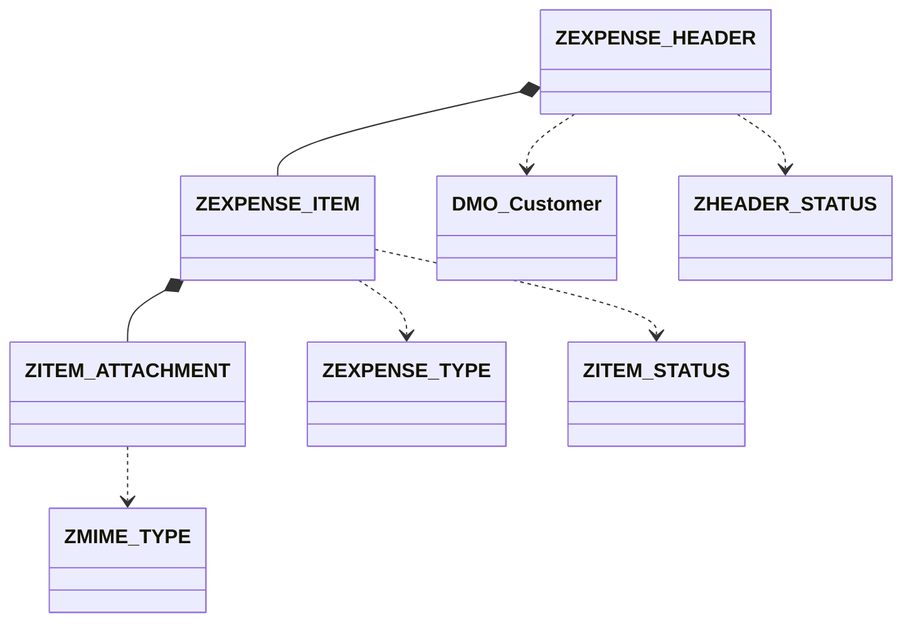
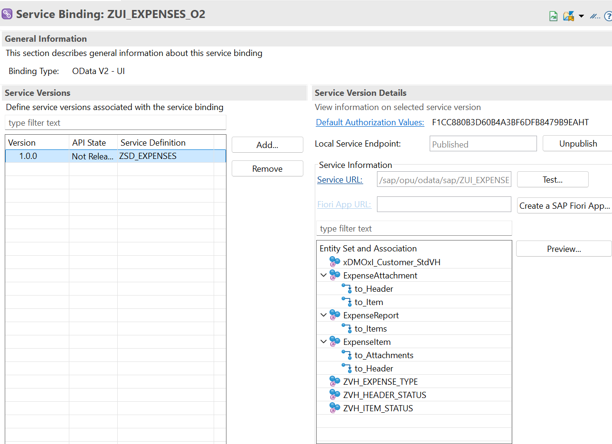

# ZEXPENSE - Aplicación de Liquidación de Gastos - RAP Managed OData V2

### ¿Por qué Managed?

Para la Expense App elegimos **RAP Managed sin Draft** frente a Unmanaged por 3 motivos:

1.  **Numeración automática sin inventar claves:**

Nuestra clave `report_id (CHAR 10)` no es UUID. Con Managed implementamos `early_numbering` con lógica `MAX + 1`, de forma que el sistema propone `0000000001`, `0000000002`... sin que el desarrollador tenga que inventar la clave en el UI. Sin `Number Range Object`, ideal para entorno BTP didáctico.

2.  **Menos código, más framework:** 

En Unmanaged tendríamos que programar a mano todos los `INSERT/UPDATE/DELETE` de `ZEXPENSE_HEADER`, `ZEXPENSE_ITEM` y `ZITEM_ATTACHMENT`. Con Managed RAP gestiona la persistencia, el bloqueo y las tablas DRAFT automáticamente al poner `with draft`.

3.  **UX Fiori Elements:** 

La app requiere crear cabecera + ítems + adjuntos con upload en la misma transacción antes de hacer SAVE. Solo con Draft se puede mantener todo en borrador y validar el flujo `OPEN -> SENT` antes de grabar.

## 1. Resumen Caso de Uso
**Actor:** Empleado viajero.

**Flujo:** Crea carpeta (HEADER) -> carga tickets (ITEM) -> adjunta foto (ATTACHMENT) -> Envía -> Manager Aprueba/Rechaza.

**Tipo:** Aplicación transaccional Fiori Elements sin draft, Validaciones y Upload.

**Arquitectura:** Fiori Elements sobre OData V2 RAP Managed (NO Web API manual). Stack: Tablas Z -> CDS Interface ZI_ -> CDS Projection ZC_ -> Behavior -> Service Definition -> Service Binding.

## 2. Diccionario de Objetos - Nombres Auto-explicativos

### Tablas Auxiliares (Maestras)
| Tabla | Descripción Auto-explicativa |
| :--- | :--- |
| **ZEXPENSE_TYPE** | Catálogo de tipos de gasto. Define límites y si requiere factura. |
| **ZHEADER_STATUS** | Catálogo de estados de la carpeta/cabecera. Controla edición y semáforos. |
| **ZITEM_STATUS** | Catálogo de estados del ticket individual. |
| **ZMIME_TYPE** | Catálogo de tipos de archivo permitidos para upload. |

### Tablas Transaccionales
| Tabla | Descripción Auto-explicativa |
| :--- | :--- |
| **ZEXPENSE_HEADER** | Cabecera del reporte de gastos. ROOT. Reusa /DMO/CUSTOMER como solicitante. |
| **ZEXPENSE_ITEM** | Item / línea del reporte. CHILD de HEADER. |
| **ZITEM_ATTACHMENT** | Adjunto binario del ticket. CHILD de ITEM. |

## 3. Esquema Gráfico de Tablas



## 4. Plan Didáctico - 10 Funcionalidades RAP

1. Value Help (F4 de TYPE y de /DMO/CUSTOMER)
2. Validation (Límite hotel, mime no permitido)
3. Determination (Total header = suma items)
4. Side Effect (Pasar a SENT bloquea edición)
5. Action (Enviar, Aprobar, Rechazar)
6. Composition / Borrado en cascada
7. Criticality (Semáforos verde/rojo)
8. Association a DMO
9. Upload / Display de fichero con @Semantics.largeObject
10. Mensajes Error/Warning/Info con longtext

## 5. Valores Didácticos

**ZEXPENSE_TYPE:** HOTEL (300,X), TAXI (100,''), MEAL (60,X), KM (0,'')

**ZHEADER_STATUS:** OPEN (X), SENT (''), APPROVED (''), REJECTED (X)

**ZITEM_STATUS:** VALID, PENDING, OBSERVED

**ZMIME_TYPE:** application/pdf, image/jpeg

## 6. I18N - Internacionalización
- CDS Labels: Data Elements ZEXPENSE_DE_* traducidos con SE63
- Mensajes: Message Class ZEXPENSE_MSG traducida EN/ES
- Frontend: webapp/i18n/i18n.properties y i18n_es.properties

## 7. DDL - Código de Creación

### ZEXPENSE_TYPE
Tipos de gasto. Define límites y si requiere factura
```abap
@EndUserText.label : 'Tipos de gasto. Define límites y si requiere factura'
@AbapCatalog.enhancement.category : #NOT_EXTENSIBLE
@AbapCatalog.tableCategory : #TRANSPARENT
@AbapCatalog.deliveryClass : #A
@AbapCatalog.dataMaintenance : #RESTRICTED
define table zexpense_type {

  key client       : abap.clnt not null;
  key type_id      : abap.char(10) not null;
  description      : abap.char(40);
  @Semantics.amount.currencyCode : 'zexpense_type.currency_code'
  limit_amount     : abap.curr(10,2);
  requires_invoice : abap.char(1);
  currency_code    : abap.cuky;

}
```

### ZHEADER_STATUS
```abap
@EndUserText.label : 'Catálogo de estados de cabecera'
@AbapCatalog.enhancement.category : #NOT_EXTENSIBLE
@AbapCatalog.tableCategory : #TRANSPARENT
@AbapCatalog.deliveryClass : #A
@AbapCatalog.dataMaintenance : #RESTRICTED
define table zheader_status {

  key client    : abap.clnt not null;
  key status_id : abap.char(10) not null;
  description   : abap.char(40);
  allow_edit    : abap.char(1);
  criticality   : abap.int1;

}
```

### ZITEM_STATUS
```abap
@EndUserText.label : 'Catálogo de estados del ticket individual'
@AbapCatalog.enhancement.category : #NOT_EXTENSIBLE
@AbapCatalog.tableCategory : #TRANSPARENT
@AbapCatalog.deliveryClass : #A
@AbapCatalog.dataMaintenance : #RESTRICTED
define table zitem_status {

  key client    : abap.clnt not null;
  key status_id : abap.char(10) not null;
  description   : abap.char(40);

}
```

### ZMIME_TYPE
```abap
@EndUserText.label : 'Catálogo de tipos de archivo permitidos para upload'
@AbapCatalog.enhancement.category : #NOT_EXTENSIBLE
@AbapCatalog.tableCategory : #TRANSPARENT
@AbapCatalog.deliveryClass : #A
@AbapCatalog.dataMaintenance : #RESTRICTED
define table zmime_type {

  key client    : abap.clnt not null;
  key mime_type : abap.char(30) not null;
  extension     : abap.char(10);
  description   : abap.char(40);

}
```

### ZEXPENSE_HEADER
```abap
@EndUserText.label : 'Cabecera del reporte de gastos'
@AbapCatalog.enhancement.category : #NOT_EXTENSIBLE
@AbapCatalog.tableCategory : #TRANSPARENT
@AbapCatalog.deliveryClass : #A
@AbapCatalog.dataMaintenance : #RESTRICTED
define table zexpense_header {

  key client      : abap.clnt not null;
  key report_id   : abap.char(10) not null;
  customer_id     : abap.char(10) not null;
  report_date     : abap.dats;
  reason          : abap.char(100);
  @Semantics.amount.currencyCode : 'zexpense_header.currency_code'
  total_amount    : abap.curr(15,2);
  currency_code   : abap.cuky;
  header_status   : abap.char(10) not null;
  created_by      : abp_creation_user;
  created_at      : abp_creation_tstmpl;
  last_changed_by : abp_locinst_lastchange_user;
  last_changed_at : abp_locinst_lastchange_tstmpl;

}
```

### ZEXPENSE_ITEM
```abap
@EndUserText.label : 'Item de gastos por reporte. Child'
@AbapCatalog.enhancement.category : #NOT_EXTENSIBLE
@AbapCatalog.tableCategory : #TRANSPARENT
@AbapCatalog.deliveryClass : #A
@AbapCatalog.dataMaintenance : #RESTRICTED
define table zexpense_item {

  key client      : abap.clnt not null;
  key report_id   : abap.char(10) not null;
  key item_id     : abap.char(6) not null;
  expense_type    : abap.char(10) not null;
  item_status     : abap.char(10) not null;
  expense_date    : abap.dats;
  @Semantics.amount.currencyCode : 'zexpense_item.currency_code'
  amount          : abap.curr(10,2);
  currency_code   : abap.cuky;
  vendor          : abap.char(40);
  last_changed_at : abp_locinst_lastchange_tstmpl;

}
```

### ZITEM_ATTACHMENT
```abap
@EndUserText.label : 'Adjunto binario del ticket. CHILD de ITEM'
@AbapCatalog.enhancement.category : #NOT_EXTENSIBLE
@AbapCatalog.tableCategory : #TRANSPARENT
@AbapCatalog.deliveryClass : #A
@AbapCatalog.dataMaintenance : #RESTRICTED
define table zitem_attachment {

  key client      : abap.clnt not null;
  key report_id   : abap.char(10) not null;
  key item_id     : abap.char(6) not null;
  key attach_id   : abap.char(6) not null;
  file_name       : abap.char(100);
  mime_type       : abap.char(30);
  description     : abap.char(128);
  file_content    : abap.rawstring(0);
  last_changed_at : abp_locinst_lastchange_tstmpl;

}
```

## 8. Clase Z de Carga

```abap
CLASS zcl_expense_aux_data_load DEFINITION PUBLIC FINAL CREATE PUBLIC.
  PUBLIC SECTION. INTERFACES if_oo_adt_classrun.
ENDCLASS.
CLASS zcl_expense_aux_data_load IMPLEMENTATION.
  METHOD if_oo_adt_classrun~main.
    DELETE FROM ZEXPENSE_TYPE.
    INSERT ZEXPENSE_TYPE FROM TABLE @( VALUE #(
      ( client = '100' type_id = 'HOTEL' description = 'Hotel' limit_amount = '300' requires_invoice = 'X' currency_code = 'EUR' )
      ( client = '100' type_id = 'TAXI' description = 'Taxi / Uber' limit_amount = '100' requires_invoice = '' currency_code = 'EUR' )
      ( client = '100' type_id = 'MEAL' description = 'Comida' limit_amount = '60' requires_invoice = 'X' currency_code = 'EUR' )
      ( client = '100' type_id = 'KM' description = 'Kilometraje' limit_amount = '0' requires_invoice = '' currency_code = 'EUR' )
    ) ).
    DELETE FROM ZHEADER_STATUS.
    INSERT ZHEADER_STATUS FROM TABLE @( VALUE #(
      ( client = '100' status_id = 'OPEN' description = 'Abierta' allow_edit = 'X' criticality = 0 )
      ( client = '100' status_id = 'SENT' description = 'Enviada' allow_edit = '' criticality = 2 )
      ( client = '100' status_id = 'APPROVED' description = 'Aprobada' allow_edit = '' criticality = 3 )
      ( client = '100' status_id = 'REJECTED' description = 'Rechazada' allow_edit = 'X' criticality = 1 )
    ) ).
    DELETE FROM ZITEM_STATUS.
    INSERT ZITEM_STATUS FROM TABLE @( VALUE #(
      ( client = '100' status_id = 'VALID' description = 'Valido' )
      ( client = '100' status_id = 'PENDING' description = 'Pendiente Factura' )
      ( client = '100' status_id = 'OBSERVED' description = 'Observado' )
    ) ).
    DELETE FROM ZMIME_TYPE.
    INSERT ZMIME_TYPE FROM TABLE @( VALUE #(
      ( client = '100' mime_type = 'application/pdf' extension = 'PDF' description = 'PDF Document' )
      ( client = '100' mime_type = 'image/jpeg' extension = 'JPG' description = 'JPEG Image' )
    ) ).
    out->write( 'Datos auxiliares cargados correctamente' ).
  ENDMETHOD.
ENDCLASS.
```

## 9. CDS Interfaces - Modelo de Datos

| Nombre CDS | Origen | Descripción |
| :--- | :--- | :--- |
| [`ZI_EXP_HEADER`](#zi_exp_header) | `ZEXPENSE_HEADER` | Root - Cabecera de la liquidación de gastos |
| [`ZI_EXP_ITEM`](#zi_exp_item)| `ZEXPENSE_ITEM` | Child - Líneas de gasto (hotel, taxi, etc.) |
| [`ZI_EXP_ATTACH`](#zi_exp_attach) | `ZITEM_ATTACHMENT` | Grandchild - Adjuntos y justificantes del gasto |
| [`ZVH_EXPENSE_TYPE`](#zvh_expense_type) | `ZEXPENSE_TYPE` | Value Help - Tipos de gasto |
| [`ZVH_HEADER_STATUS`](#zvh_header_status) | `ZHEADER_STATUS` | Value Help - Estados de carpeta de gastos |
| [`ZVH_MIME_TYPE`](#zvh_mime_type) | `ZMIME_TYPE` | Value Help - Tipos MIME para upload |
| [`ZVH_ITEM_STATUS`](#zvh_item_status) | `ZITEM_STATUS` | Value Help - Estados de ticket individual |

# ZI_EXP_HEADER
```ABAP
@AbapCatalog.viewEnhancementCategory: [ #NONE ]
@AccessControl.authorizationCheck: #NOT_REQUIRED
@EndUserText.label: 'Interface - Expense Header'
@Metadata.ignorePropagatedAnnotations: true

define root view entity ZI_EXP_HEADER
  as select from zexpense_header as Header

  composition [0..*] of ZI_EXP_ITEMM    as _Items
  association [0..1] to /DMO/I_Customer as _Customer on $projection.customer_id = _Customer.CustomerID
  association [0..1] to I_Currency      as _Currency on $projection.currency_code = _Currency.Currency

{
  key Header.report_id,
      Header.customer_id,

      Header.report_date,
      Header.reason,
      Header.header_status,
      @Semantics.amount.currencyCode: 'currency_code'
      Header.total_amount,
      Header.currency_code,

      @Semantics.user.createdBy: true
      Header.created_by,

      @Semantics.systemDateTime.createdAt: true
      Header.created_at,
      
      @Semantics.user.lastChangedBy: true
      Header.last_changed_by,

      @Semantics.systemDateTime.lastChangedAt: true
      Header.last_changed_at,

      /* Associations */
      _Items,
      _Customer,
      _Currency

}

```

# ZI_EXP_ITEM
```ABAP
//@AbapCatalog.viewEnhancementCategory: [#NONE]
@AccessControl.authorizationCheck: #NOT_REQUIRED

@EndUserText.label: 'Interface - Expense Item'

@Metadata.ignorePropagatedAnnotations: true

define view entity ZI_EXP_ITEMM
  as select from zexpense_item as Item

  association to parent ZI_EXP_HEADER as _Header on $projection.report_id = _Header.report_id
  association [0..1]    to        ZVH_ITEM_STATUS  as _ItemStatus  on $projection.item_status = _ItemStatus.ItemStatus
  association [0..1]    to        ZVH_EXPENSE_TYPE as _ExpenseType on $projection.expense_type = _ExpenseType.type_id
  composition [0..*] of ZI_EXP_ATTACH as _Attachments

{
  key Item.report_id,
  key Item.item_id,

      Item.expense_type,
      Item.item_status,
      Item.vendor,
      Item.expense_date,

      @Semantics.amount.currencyCode: 'currency_code'
      Item.amount,
      Item.currency_code,

      @Semantics.systemDateTime.localInstanceLastChangedAt: true
      Item.last_changed_at,

      /* Associations */
      _Header,
      _ItemStatus,
      _ExpenseType,
      _Attachments
}

```

# ZI_EXP_ATTACH
```ABAP
//@AbapCatalog.viewEnhancementCategory: [#NONE]
@AccessControl.authorizationCheck: #NOT_REQUIRED
@EndUserText.label: 'Interface - Expense Attachment'
@Metadata.ignorePropagatedAnnotations: true

define view entity ZI_EXP_ATTACH
  as select from zitem_attachment as Attach

  association        to parent ZI_EXP_ITEMM  as _Item
    on  $projection.report_id = _Item.report_id
    and $projection.item_id   = _Item.item_id

  association [1..1] to        ZI_EXP_HEADER as _Header
    on $projection.report_id = _Header.report_id

{
  key Attach.report_id,
  key Attach.item_id,
  key Attach.attach_id,

      Attach.file_name,
     @Semantics.mimeType: true      
      Attach.mime_type,
      Attach.description,
      Attach.file_content,

      @Semantics.systemDateTime.localInstanceLastChangedAt: true
      Attach.last_changed_at,

      /* Associations */
      _Header,
      _Item
}

```

# ZVH_EXPENSE_TYPE
```ABAP
@AccessControl.authorizationCheck: #NOT_REQUIRED
@EndUserText.label: 'Value Help - Tipos de gasto'
@Metadata.ignorePropagatedAnnotations: true

define root view entity ZVH_EXPENSE_TYPE
  as select from zexpense_type
{
  key type_id,
      description
}

```
# ZVH_HEADER_STATUS
```ABAP
@AccessControl.authorizationCheck: #NOT_REQUIRED
@EndUserText.label: 'Value Help - Estados de carpeta de gastos'
@Metadata.ignorePropagatedAnnotations: true
define root view entity ZVH_HEADER_STATUS
 as select from zheader_status
{
    key status_id as HeaderStatus,
    description as Description
}

```

# ZVH_MIME_TYPE
```ABAP
@AccessControl.authorizationCheck: #NOT_REQUIRED
@EndUserText.label: 'Value Help - Tipos MIME para upload'
@Metadata.ignorePropagatedAnnotations: true
define root view entity ZVH_MIME_TYPE
 as select from zmime_type
{
    key mime_type as MimeType,
    description as Description
}
```

# ZVH_ITEM_STATUS
```ABAP
@AccessControl.authorizationCheck: #NOT_REQUIRED
@EndUserText.label: 'Value Help - Estados del ticket de individual'
@Metadata.ignorePropagatedAnnotations: true
define root view entity ZVH_ITEM_STATUS 
as select from zitem_status
{
    key status_id as ItemStatus,
    description as Description
}
```
## 10. CDS Consumo - Modelo de Datos

| Nombre CDS | Origen | Descripción |
| :--- | :--- | :--- |
| [`ZC_EXP_HEADER`](#zc_exp_header) | `ZI_EXP_HEADER` | Root - Cabecera de la liquidación de gastos |
| [`ZC_EXP_ITEMM`](#zc_exp_itemm)| `ZI_EXP_ITEMM` | Child - Líneas de gasto (hotel, taxi, etc.) |
| [`ZC_EXP_ATTACH`](#zc_exp_attach) | `ZI_EXP_ATTACH` | Grandchild - Adjuntos y justificantes del gasto |


# ZC_EXP_HEADER
```ABAP
@AccessControl.authorizationCheck: #NOT_REQUIRED
@EndUserText.label: 'Consumption - Expense Header'
@Metadata.allowExtensions: true
@Metadata.ignorePropagatedAnnotations: true

define root view entity ZC_EXP_HEADER
provider contract transactional_query
  as projection on ZI_EXP_HEADER

{
  key report_id       as ReportId,

      @Consumption.valueHelpDefinition: [ { 
      entity: { name: '/DMO/I_Customer_StdVH', element: 'CustomerID' } } ]
      customer_id     as CustomerID,
      report_date     as ReportDate,
      reason          as Reason,

      @Consumption.valueHelpDefinition: [ { 
      entity: { name: 'ZVH_HEADER_STATUS', element: 'HeaderStatus' } } ]      
      header_status   as HeaderStatus,

      @Semantics.amount.currencyCode: 'CurrencyCode'
      total_amount    as TotalAmount,

      currency_code   as CurrencyCode,
      created_by      as CreatedBy,
      created_at      as CreatedAt,
      last_changed_by as LastChangedBy,
      last_changed_at as LastChangedAt,

      /* Associations */
      _Items : redirected to composition child ZC_EXP_ITEMM,

      _Customer,
      _Currency
}
```

# ZC_EXP_ITEMM
```ABAP
@AccessControl.authorizationCheck: #NOT_REQUIRED
@EndUserText.label: 'Consumption - Expense Item'
@Metadata.ignorePropagatedAnnotations: true
@Metadata.allowExtensions: true
define view entity ZC_EXP_ITEMM
  as projection on ZI_EXP_ITEMM

{
  key report_id       as ReportId,
  key item_id         as ItemId,

      @Consumption.valueHelpDefinition: [{
      entity: { name: 'ZVH_EXPENSE_TYPE', element: 'type_id' } } ]
      expense_type    as ExpenseType,

      @Consumption.valueHelpDefinition: [ {
      entity: { name: 'ZVH_ITEM_STATUS', element: 'ItemStatus' } } ]
      item_status     as ItemStatus,
      vendor          as Vendor,
      expense_date    as ExpenseDate,

      @Semantics.amount.currencyCode: 'CurrencyCode'
      amount          as Amount,

      currency_code   as CurrencyCode,
      last_changed_at as LastChangedAt,

      /* Associations */
      _Header      : redirected to parent ZC_EXP_HEADER,
      _ItemStatus,
      _ExpenseType,
      _Attachments : redirected to composition child ZC_EXP_ATTACH
}

```

# ZC_EXP_ATTACH
```ABAP
@AccessControl.authorizationCheck: #NOT_REQUIRED

@EndUserText.label: 'Consumption - Expense Attachment'

@Metadata.allowExtensions: true
//@Metadata.ignorePropagatedAnnotations: true

define view entity ZC_EXP_ATTACH
  as projection on ZI_EXP_ATTACH

{
  key report_id       as ReportId,
  key item_id         as ItemId,
  key attach_id       as AttachId,
      file_name       as FileName,
      mime_type       as MimeType,
      description     as Description,
      @Semantics.largeObject: { 
      mimeType: 'MimeType', 
      fileName: 'FileName', 
      contentDispositionPreference: #INLINE }      
      file_content    as AttachmentContent,
      last_changed_at as LastChangedAt,

      /* Associations */
      _Header : redirected to ZC_EXP_HEADER,
      _Item   : redirected to parent ZC_EXP_ITEMM
}

```

## 11. Metadata Extensions - Consumptions CDS Based

* **`@UI.lineItem`** -> **List Report** (la tabla de entrada de la app)
  Es lo que define las columnas que ves en la tabla principal. Su label es el header de la columna.

* **`@UI.fieldGroup`** -> **Object Page** (cuando entras a un registro)
  Aplica para creación, edición y visualización a nivel de registro. Su label es el label que sale encima del campo en el formulario.

| Nombre CDS | Origen | Descripción |
| :--- | :--- | :--- |
| [`ZC_EXP_HEADER`](#zc_exp_header) | `ZC_EXP_HEADER` | Root - Cabecera de la liquidación de gastos |
| [`ZC_EXP_ITEMM`](#zc_exp_itemm)| `ZC_EXP_ITEMM` | Child - Líneas de gasto (hotel, taxi, etc.) |
| [`ZC_EXP_ATTACH`](#zc_exp_attach) | `ZC_EXP_ATTACH` | Grandchild - Adjuntos y justificantes del gasto |

# ZC_EXP_HEADER
```ABAP
@Metadata.layer: #CUSTOMER

@UI.headerInfo: { typeName: 'Expense Report', 
                  typeNamePlural: 'Expense Reports', 
                  title.value: 'ReportId' }

annotate view ZC_EXP_HEADER with

{
  @UI.facet: [ 
               { id: 'Header', 
                 label: 'General Info', 
                 type: #COLLECTION, 
                 position: 10 },
                 
               { id: 'General',
                 parentId: 'Header',
                 label: 'General',
                 type: #FIELDGROUP_REFERENCE,
                 targetQualifier: 'General',
                 position: 10 },
               
               { id: 'Items',
                 label: 'Items',
                 type: #LINEITEM_REFERENCE,
                 targetElement: '_Items',
                 position: 20 } ]
                 
  @UI.lineItem: [ { position: 10, importance: #HIGH, label: 'Id' } ]
  @UI.fieldGroup: [ { qualifier: 'General', position: 10, label: 'Id', importance: #HIGH } ]
  ReportId;

  @UI.lineItem: [ { position: 20, label: 'Customer'  } ]
  @UI.fieldGroup: [ { qualifier: 'General', position: 20, label: 'Customer' } ]
  CustomerID;

  @UI.lineItem: [ { position: 30, label: 'Open Date' } ]
  @UI.fieldGroup: [ { qualifier: 'General', position: 30, label: 'Open Date' } ]
  ReportDate;

  @UI.lineItem: [ { position: 40, label: 'Status' } ]
  @UI.fieldGroup: [ { qualifier: 'General', position: 40, label: 'Status' } ]
  HeaderStatus;

  @UI.lineItem: [ { position: 50, label: 'Reason' } ]
  @UI.fieldGroup: [ { qualifier: 'General', position: 50, label: 'Reason' } ]
  Reason;
  
  @UI.lineItem: [ { position: 60, label: 'Total Amount' } ]
  @UI.fieldGroup: [ { qualifier: 'General', position: 60, label: 'Total Amount' } ]
  TotalAmount;

  @UI.lineItem: [ { position: 70, label: 'Currency' } ]
//  @UI.fieldGroup: [ { qualifier: 'General', position: 70, label: 'Currency' } ]
  CurrencyCode;
  
}
```

# ZC_EXP_ITEMM
```ABAP
@Metadata.layer: #CUSTOMER

@UI.headerInfo: { typeName: 'Item', typeNamePlural: 'Items', title.value: 'ItemId' }

annotate view ZC_EXP_ITEMM with

{
  @UI.facet: [ 
               { id: 'General',
                 label: 'Item Details',
                 type: #FIELDGROUP_REFERENCE,
                 targetQualifier: 'General',
                 position: 10 },
               
               { id: 'Attachments',
                 label: 'Attachments',
                 type: #LINEITEM_REFERENCE,
                 targetElement: '_Attachments',
                 position: 20 } ]
                 
  @UI.lineItem: [ { position: 10, label: 'Expense type' } ]
  @UI.fieldGroup: [ { qualifier: 'General', position: 10, label: 'Expense type' } ]
  ExpenseType;

  @UI.lineItem: [ { position: 20, label: 'Status' } ]
  @UI.fieldGroup: [ { qualifier: 'General', position: 20, label: 'Status' } ]
  ItemStatus;

  @UI.lineItem: [ { position: 30, label: 'Vendor' } ]
  @UI.fieldGroup: [ { qualifier: 'General', position: 30, label: 'Vendor' } ]
  Vendor;

  @UI.lineItem: [ { position: 40, label: 'Amount' } ]
  @UI.fieldGroup: [ { qualifier: 'General', position: 40, label: 'Amount' } ]
  Amount;

  @UI.lineItem: [ { position: 50, label: 'Date' } ]
  @UI.fieldGroup: [ { qualifier: 'General', position: 50, label: 'Date' } ]
  ExpenseDate;
}
```

# ZC_EXP_ATTACH
```ABAP
@Metadata.layer: #CUSTOMER
annotate view ZC_EXP_ATTACH with
{
  @UI.facet: [ { id: 'General',
                 label: 'Attachment Details',
                 type: #FIELDGROUP_REFERENCE,
                 targetQualifier: 'General',
                 position: 10 } ]
                 
  @UI.fieldGroup: [ { qualifier: 'General', position: 10, label: 'File' } ]
  @UI.lineItem: [ { position: 10, label: 'File'  } ]
  AttachmentContent;

  @UI.fieldGroup: [ { qualifier: 'General', position: 20, label: 'Description' } ]
  @UI.lineItem: [ { position: 20, label: 'Description' } ]
  Description;
  
  @UI.hidden: true
  FileName;

  @UI.hidden: true
  MimeType;
}
```

## 12. Behavior Definitions Interface - CDS Interfaz based

```ABAP
managed implementation in class zbp_zi_exp_header unique;
strict ( 2 );

define behavior for ZI_EXP_HEADER alias Header
persistent table zexpense_header
lock master
authorization master ( global )
etag master last_changed_at
early numbering
{

  // administrative fields: read only
  field ( readonly ) last_changed_at, last_changed_by, created_at, created_by;

  // mandatory fields that are required to create a Expense folder
  field ( mandatory ) customer_id, report_date, reason, header_status, currency_code;

  // Semantic Key field, which is readonly for the consumer, value is assigned in early numbering
  field ( readonly ) report_id;

  // mapping entity's field types with table field types
  mapping for zexpense_header corresponding;

  // standard operations for entity
  create;
  update;
  delete;

  // create expense items by association
  association _Items { create ( features : instance ); }

}

define behavior for ZI_EXP_ITEMM alias item
implementation in class zbp_zi_exp_itemm unique
persistent table zexpense_item
etag master last_changed_at
lock dependent by _Header
early numbering
authorization dependent by _Header

{
  // administrative fields: read only
  field ( readonly ) last_changed_at;

  field ( mandatory ) expense_type, expense_date, amount;

  // static field control
  field ( readonly ) report_id, item_id;

  // mapping entity's field types with table field types
  mapping for zexpense_item corresponding;


  // standard operations for expense item entity
  update;

  association _Header { }

  // create attachment by association
  association _Attachments { create ( features : instance ); }

}

define behavior for ZI_EXP_ATTACH alias attach
implementation in class zbp_zi_exp_attach unique
//with unmanaged save
persistent table zitem_attachment
etag master last_changed_at
lock dependent by _Header
early numbering
authorization dependent by _Header

{
  // administrative fields: read only
  field ( readonly ) last_changed_at;

  // static field control
  field ( readonly ) report_id, item_id, attach_id;

  // mandatory fields that are required to create a attachment
  field ( mandatory ) description;

  // mapping entity's field types with table field types
  mapping for zitem_attachment corresponding;

  // standard operations for attachment entity
  update;

  association _Header { }
  association _Item { }
}
```

Se crean las clases:

* zbp_zi_exp_header
* zbp_zi_exp_itemm 
* zbp_zi_exp_attach

## 13. Behavior Definitions Consumption - CDS Consumption based

```ABAP
projection;
strict ( 2 );

define behavior for ZC_EXP_HEADER alias Header
{
  use create;
  use update;
  use delete;

  use association _Items { create; }
}

define behavior for ZC_EXP_ITEMM alias item
{
  use update;

  use association _Header;
  use association _Attachments { create; }
}

define behavior for ZC_EXP_ATTACH alias attach
{
  use update;

  use association _Header;
  use association _Item;
}
```
## 14. Service Definition - CDS Consumption Header (root) based

```ABAP
@EndUserText.label: 'Service Definition on Expenses App'
define service ZSD_EXPENSES {
  expose ZC_EXP_HEADER as ExpenseReport;
  expose ZC_EXP_ITEMM  as ExpenseItem;
  expose ZC_EXP_ATTACH as ExpenseAttachment;
}
```

## 15. Service Binding: ZUI_EXPENSES_O2 - Service Definition based



## 16. Prueba

Managed sin draft + OData V2 - UI = botón **`Crear`** en List Report.


| Campo | ANTES (tu versión) - Object Page sin etiqueta | DESPUÉS (corregido) - Object Page con etiqueta |
| --- | --- | --- |
| `ReportId` | `@UI.fieldGroup: [{ qualifier: 'General', position: 10, importance: #HIGH }]` | `@UI.fieldGroup: [{ qualifier: 'General', position: 10, **label: 'Id'**, importance: #HIGH }]` |
| `CustomerId` | `@UI.fieldGroup: [{ qualifier: 'General', position: 20 }]` | `@UI.fieldGroup: [{ qualifier: 'General', position: 20, **label: 'Customer'** }]` |
| `ReportDate` | `@UI.fieldGroup: [{ qualifier: 'General', position: 30 }]` | `@UI.fieldGroup: [{ qualifier: 'General', position: 30, **label: 'Open Date'** }]` |
| `HeaderStatus` | `@UI.fieldGroup: [{ qualifier: 'General', position: 40 }]` | `@UI.fieldGroup: [{ qualifier: 'General', position: 40, **label: 'Status'** }]` |
| `TotalAmount` | `@UI.fieldGroup: [{ qualifier: 'General', position: 50 }]` | `@UI.fieldGroup: [{ qualifier: 'General', position: 50, **label: 'Total Amount'** }]` |
| `Reason` | `@UI.fieldGroup: [{ qualifier: 'General', position: 60 }]` | `@UI.fieldGroup: [{ qualifier: 'General', position: 60, **label: 'Reason'** }]` |