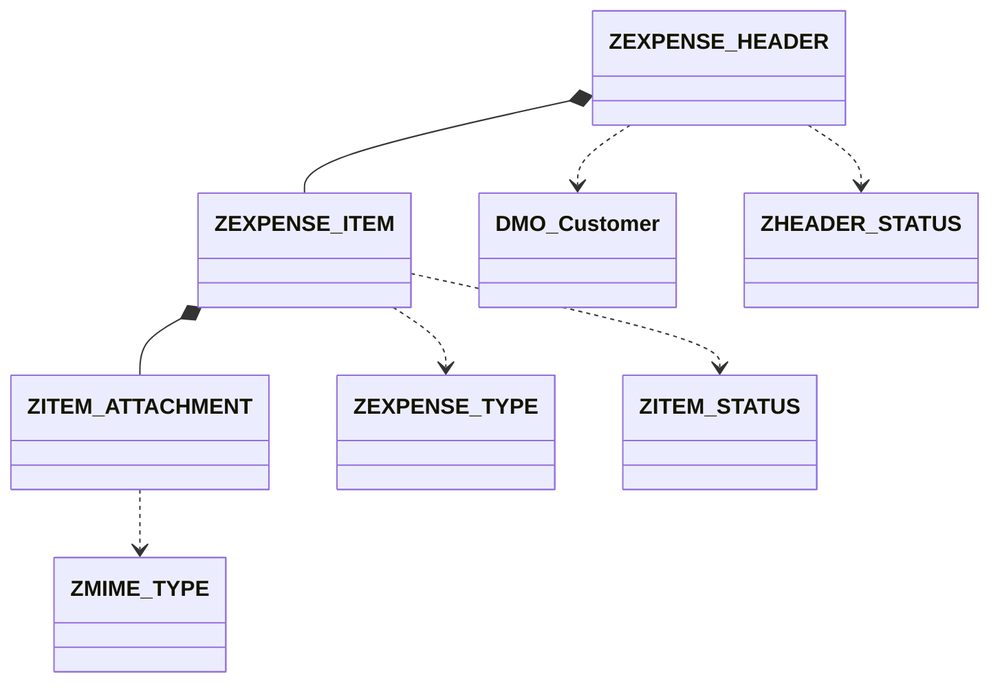

# ZEXPENSE - Aplicación de Liquidación de Gastos - RAP Managed OData V4

### ¿Por qué Managed con Draft?

Para la Expense App elegimos **RAP Managed con Draft** frente a Unmanaged por 3 motivos:

1.  **Numeración automática sin inventar claves:**

Nuestra clave `report_id (CHAR 10)` no es UUID. Con Managed implementamos `early_numbering` con lógica `MAX + 1`, de forma que el sistema propone `0000000001`, `0000000002`... sin que el desarrollador tenga que inventar la clave en el UI. Sin `Number Range Object`, ideal para entorno BTP didáctico.

2.  **Menos código, más framework:** 

En Unmanaged tendríamos que programar a mano todos los `INSERT/UPDATE/DELETE` de `ZEXPENSE_HEADER`, `ZEXPENSE_ITEM` y `ZITEM_ATTACHMENT`. Con Managed RAP gestiona la persistencia, el bloqueo y las tablas DRAFT automáticamente al poner `with draft`.

3.  **UX Fiori Elements:** 

La app requiere crear cabecera + ítems + adjuntos con upload en la misma transacción antes de hacer SAVE. Solo con Draft se puede mantener todo en borrador y validar el flujo `OPEN -> SENT` antes de grabar.

## 1. Resumen Caso de Uso
**Actor:** Empleado viajero.

**Flujo:** Crea carpeta (HEADER) -> carga tickets (ITEM) -> adjunta foto (ATTACHMENT) -> Envía -> Manager Aprueba/Rechaza.

**Tipo:** Aplicación transaccional Fiori Elements con Draft, Validaciones y Upload.

**Arquitectura:** Fiori Elements sobre OData V4 RAP Managed (NO Web API manual). Stack: Tablas Z -> CDS Interface ZI_ -> CDS Projection ZC_ -> Behavior -> Service Definition -> Service Binding.

## 2. Diccionario de Objetos - Nombres Auto-explicativos

### Tablas Auxiliares (Maestras)
| Tabla | Descripción Auto-explicativa |
| :--- | :--- |
| **ZEXPENSE_TYPE** | Catálogo de tipos de gasto. Define límites y si requiere factura. |
| **ZHEADER_STATUS** | Catálogo de estados de la carpeta/cabecera. Controla edición y semáforos. |
| **ZITEM_STATUS** | Catálogo de estados del ticket individual. |
| **ZMIME_TYPE** | Catálogo de tipos de archivo permitidos para upload. |

### Tablas Transaccionales
| Tabla | Descripción Auto-explicativa |
| :--- | :--- |
| **ZEXPENSE_HEADER** | Cabecera del reporte de gastos. ROOT. Reusa /DMO/CUSTOMER como solicitante. |
| **ZEXPENSE_ITEM** | Item / línea del reporte. CHILD de HEADER. |
| **ZITEM_ATTACHMENT** | Adjunto binario del ticket. CHILD de ITEM. |

## 3. Esquema Gráfico de Tablas



## 4. Plan Didáctico - 10 Funcionalidades RAP

1. Value Help (F4 de TYPE y de /DMO/CUSTOMER)
2. Validation (Límite hotel, mime no permitido)
3. Determination (Total header = suma items)
4. Side Effect (Pasar a SENT bloquea edición)
5. Action (Enviar, Aprobar, Rechazar)
6. Composition / Borrado en cascada
7. Criticality (Semáforos verde/rojo)
8. Association a DMO
9. Upload / Display de fichero con @Semantics.largeObject
10. Mensajes Error/Warning/Info con longtext

## 5. Valores Didácticos

**ZEXPENSE_TYPE:** HOTEL (300,X), TAXI (100,''), MEAL (60,X), KM (0,'')

**ZHEADER_STATUS:** OPEN (X), SENT (''), APPROVED (''), REJECTED (X)

**ZITEM_STATUS:** VALID, PENDING, OBSERVED

**ZMIME_TYPE:** application/pdf, image/jpeg

## 6. I18N - Internacionalización
- CDS Labels: Data Elements ZEXPENSE_DE_* traducidos con SE63
- Mensajes: Message Class ZEXPENSE_MSG traducida EN/ES
- Frontend: webapp/i18n/i18n.properties y i18n_es.properties

## 7. DDL - Código de Creación

### ZEXPENSE_TYPE
```abap
define table ZEXPENSE_TYPE {
  key client : abap.clnt not null;
  key type_id : abap.char(10) not null;
  description : abap.char(40);
  @Semantics.amount.currencyCode : 'ZEXPENSE_TYPE.currency_code'
  limit_amount : abap.curr(10,2);
  requires_invoice : abap.char(1);
  currency_code : abap.cuky(5);
}
```

### ZHEADER_STATUS
```abap
define table ZHEADER_STATUS {
  key client : abap.clnt not null;
  key status_id : abap.char(10) not null;
  description : abap.char(40);
  allow_edit : abap.char(1);
  criticality : abap.int1;
}
```

### ZITEM_STATUS
```abap
define table ZITEM_STATUS {
  key client : abap.clnt not null;
  key status_id : abap.char(10) not null;
  description : abap.char(40);
}
```

### ZMIME_TYPE
```abap
define table ZMIME_TYPE {
  key client : abap.clnt not null;
  key mime_type : abap.char(30) not null;
  extension : abap.char(10);
  description : abap.char(40);
}
```

### ZEXPENSE_HEADER
```abap
define table ZEXPENSE_HEADER {
  key client : abap.clnt not null;
  key report_id : abap.char(10) not null;
  customer_id : abap.char(10) not null;
  report_date : abap.dats;
  reason : abap.char(100);
  @Semantics.amount.currencyCode : 'zexpense_header.currency_code'
  total_amount : abap.curr(15,2);
  currency_code : abap.cuky(5);
  header_status : abap.char(10) not null;
}
```

### ZEXPENSE_ITEM
```abap
define table ZEXPENSE_ITEM {
  key client : abap.clnt not null;
  key report_id : abap.char(10) not null;
  key item_id : abap.char(6) not null;
  expense_type : abap.char(10) not null;
  item_status : abap.char(10) not null;
  expense_date : abap.dats;
  @Semantics.amount.currencyCode : 'zexpense_item.currency_code'
  amount : abap.curr(10,2);
  currency_code : abap.cuky(5);
  vendor : abap.char(40);
}
```

### ZITEM_ATTACHMENT
```abap
define table ZITEM_ATTACHMENT {
  key client : abap.clnt not null;
  key report_id : abap.char(10) not null;
  key item_id : abap.char(6) not null;
  key attach_id : abap.char(6) not null;
  file_name : abap.char(100);
  mime_type : abap.char(30);
  file_content : abap.rawstring(0);
}
```

## 8. Clase Z de Carga

```abap
CLASS zcl_expense_aux_data_load DEFINITION PUBLIC FINAL CREATE PUBLIC.
  PUBLIC SECTION. INTERFACES if_oo_adt_classrun.
ENDCLASS.
CLASS zcl_expense_aux_data_load IMPLEMENTATION.
  METHOD if_oo_adt_classrun~main.
    DELETE FROM ZEXPENSE_TYPE.
    INSERT ZEXPENSE_TYPE FROM TABLE @( VALUE #(
      ( client = '100' type_id = 'HOTEL' description = 'Hotel' limit_amount = '300' requires_invoice = 'X' currency_code = 'EUR' )
      ( client = '100' type_id = 'TAXI' description = 'Taxi / Uber' limit_amount = '100' requires_invoice = '' currency_code = 'EUR' )
      ( client = '100' type_id = 'MEAL' description = 'Comida' limit_amount = '60' requires_invoice = 'X' currency_code = 'EUR' )
      ( client = '100' type_id = 'KM' description = 'Kilometraje' limit_amount = '0' requires_invoice = '' currency_code = 'EUR' )
    ) ).
    DELETE FROM ZHEADER_STATUS.
    INSERT ZHEADER_STATUS FROM TABLE @( VALUE #(
      ( client = '100' status_id = 'OPEN' description = 'Abierta' allow_edit = 'X' criticality = 0 )
      ( client = '100' status_id = 'SENT' description = 'Enviada' allow_edit = '' criticality = 2 )
      ( client = '100' status_id = 'APPROVED' description = 'Aprobada' allow_edit = '' criticality = 3 )
      ( client = '100' status_id = 'REJECTED' description = 'Rechazada' allow_edit = 'X' criticality = 1 )
    ) ).
    DELETE FROM ZITEM_STATUS.
    INSERT ZITEM_STATUS FROM TABLE @( VALUE #(
      ( client = '100' status_id = 'VALID' description = 'Valido' )
      ( client = '100' status_id = 'PENDING' description = 'Pendiente Factura' )
      ( client = '100' status_id = 'OBSERVED' description = 'Observado' )
    ) ).
    DELETE FROM ZMIME_TYPE.
    INSERT ZMIME_TYPE FROM TABLE @( VALUE #(
      ( client = '100' mime_type = 'application/pdf' extension = 'PDF' description = 'PDF Document' )
      ( client = '100' mime_type = 'image/jpeg' extension = 'JPG' description = 'JPEG Image' )
    ) ).
    out->write( 'Datos auxiliares cargados correctamente' ).
  ENDMETHOD.
ENDCLASS.
```

## 9. CDS Interfaces - Modelo de Datos

| Nombre CDS | Origen | Descripción |
| :--- | :--- | :--- |
| `ZI_EXP_HEADER` | `ZEXPENSE_HEADER` | Root - Cabecera de la liquidación de gastos |
| `ZI_EXP_ITEM` | `ZEXPENSE_ITEM` | Child - Líneas de gasto (hotel, taxi, etc.) |
| `ZI_EXP_ATTACH` | `ZITEM_ATTACHMENT` | Grandchild - Adjuntos y justificantes del gasto |
| `ZI_ITEM_TYPE` | `ZEXPENSE_TYPE` | Value Help - Tipos de gasto |
| `ZI_MEDIA_TYPE` | `ZMEDIA_TYPE` | Value Help - Tipos MIME para upload |
