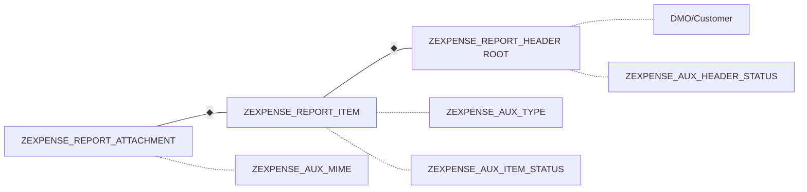

# ZEXPENSE - Modelo de Liquidación de Gastos - RAP Managed OData V4

## 1. Resumen Caso de Uso
**Actor:** Empleado viajero.

**Flujo:** Crea carpeta (HEADER) -> carga tickets (ITEM) -> adjunta foto (ATTACHMENT) -> Envía -> Manager Aprueba/Rechaza.

**Tipo:** Aplicación transaccional Fiori Elements con Draft, Validaciones y Upload.

**Arquitectura:** Fiori Elements sobre OData V4 RAP Managed (NO Web API manual). Stack: Tablas Z -> CDS Interface ZI_ -> CDS Projection ZC_ -> Behavior -> Service Definition -> Service Binding.

## 2. Diccionario de Objetos - Nombres Auto-explicativos

### Tablas Auxiliares (Maestras)
| Tabla | Descripción Auto-explicativa |
| :--- | :--- |
| **ZEXPENSE_AUX_TYPE** | Catálogo de tipos de gasto. Define límites y si requiere factura. |
| **ZEXPENSE_AUX_HEADER_STATUS** | Catálogo de estados de la carpeta/cabecera. Controla edición y semáforos. |
| **ZEXPENSE_AUX_ITEM_STATUS** | Catálogo de estados del ticket individual. |
| **ZEXPENSE_AUX_MIME** | Catálogo de tipos de archivo permitidos para upload. |

### Tablas Transaccionales
| Tabla | Descripción Auto-explicativa |
| :--- | :--- |
| **ZEXPENSE_REPORT_HEADER** | Cabecera del reporte de gastos. ROOT. Reusa /DMO/CUSTOMER como solicitante. |
| **ZEXPENSE_REPORT_ITEM** | Item / línea del reporte. CHILD de HEADER. |
| **ZEXPENSE_REPORT_ATTACHMENT** | Adjunto binario del ticket. CHILD de ITEM. |

## 3. Esquema Gráfico de Tablas



## 4. Plan Didáctico - 10 Funcionalidades RAP

1. Value Help (F4 de TYPE y de /DMO/CUSTOMER)
2. Validation (Límite hotel, mime no permitido)
3. Determination (Total header = suma items)
4. Side Effect (Pasar a SENT bloquea edición)
5. Action (Enviar, Aprobar, Rechazar)
6. Composition / Borrado en cascada
7. Criticality (Semáforos verde/rojo)
8. Association a DMO
9. Upload / Display de fichero con @Semantics.largeObject
10. Mensajes Error/Warning/Info con longtext

## 5. Valores Didácticos

**ZEXPENSE_AUX_TYPE:** HOTEL (300,X), TAXI (100,''), MEAL (60,X), KM (0,'')

**ZEXPENSE_AUX_HEADER_STATUS:** OPEN (X), SENT (''), APPROVED (''), REJECTED (X)

**ZEXPENSE_AUX_ITEM_STATUS:** VALID, PENDING, OBSERVED

**ZEXPENSE_AUX_MIME:** application/pdf, image/jpeg

## 6. I18N - Internacionalización
- CDS Labels: Data Elements ZEXPENSE_DE_* traducidos con SE63
- Mensajes: Message Class ZEXPENSE_MSG traducida EN/ES
- Frontend: webapp/i18n/i18n.properties y i18n_es.properties

## 7. DDL - Código de Creación

### ZEXPENSE_AUX_TYPE
```abap
define table zexpense_aux_type {
  key client : abap.clnt not null;
  key type_id : abap.char(10) not null;
  description : abap.char(40);
  limit_amount : abap.curr(10,2);
  requires_invoice : abap.char(1);
  currency_code : abap.cuky(5);
}
```

### ZEXPENSE_AUX_HEADER_STATUS
```abap
define table zexpense_aux_header_status {
  key client : abap.clnt not null;
  key status_id : abap.char(10) not null;
  description : abap.char(40);
  allow_edit : abap.char(1);
  criticality : abap.int1;
}
```

### ZEXPENSE_AUX_ITEM_STATUS
```abap
define table zexpense_aux_item_status {
  key client : abap.clnt not null;
  key status_id : abap.char(10) not null;
  description : abap.char(40);
}
```

### ZEXPENSE_AUX_MIME
```abap
define table zexpense_aux_mime {
  key client : abap.clnt not null;
  key mime_type : abap.char(30) not null;
  extension : abap.char(10);
  description : abap.char(40);
}
```

### ZEXPENSE_REPORT_HEADER
```abap
define table zexpense_report_header {
  key client : abap.clnt not null;
  key report_id : abap.char(10) not null;
  customer_id : abap.char(10) not null;
  report_date : abap.dats;
  reason : abap.char(100);
  total_amount : abap.curr(15,2);
  currency_code : abap.cuky(5);
  header_status : abap.char(10) not null;
}
```

### ZEXPENSE_REPORT_ITEM
```abap
define table zexpense_report_item {
  key client : abap.clnt not null;
  key report_id : abap.char(10) not null;
  key item_id : abap.char(6) not null;
  expense_type : abap.char(10) not null;
  item_status : abap.char(10) not null;
  expense_date : abap.dats;
  amount : abap.curr(10,2);
  currency_code : abap.cuky(5);
  vendor : abap.char(40);
}
```

### ZEXPENSE_REPORT_ATTACHMENT
```abap
define table zexpense_report_attachment {
  key client : abap.clnt not null;
  key report_id : abap.char(10) not null;
  key item_id : abap.char(6) not null;
  key attach_id : abap.char(6) not null;
  file_name : abap.char(100);
  mime_type : abap.char(30);
  file_content : abap.rawstring(0);
}
```

## 8. Clase Z de Carga

```abap
CLASS zcl_expense_aux_data_load DEFINITION PUBLIC FINAL CREATE PUBLIC.
  PUBLIC SECTION. INTERFACES if_oo_adt_classrun.
ENDCLASS.
CLASS zcl_expense_aux_data_load IMPLEMENTATION.
  METHOD if_oo_adt_classrun~main.
    DELETE FROM zexpense_aux_type.
    INSERT zexpense_aux_type FROM TABLE @( VALUE #(
      ( client = '100' type_id = 'HOTEL' description = 'Hotel' limit_amount = '300' requires_invoice = 'X' currency_code = 'EUR' )
      ( client = '100' type_id = 'TAXI' description = 'Taxi / Uber' limit_amount = '100' requires_invoice = '' currency_code = 'EUR' )
      ( client = '100' type_id = 'MEAL' description = 'Comida' limit_amount = '60' requires_invoice = 'X' currency_code = 'EUR' )
      ( client = '100' type_id = 'KM' description = 'Kilometraje' limit_amount = '0' requires_invoice = '' currency_code = 'EUR' )
    ) ).
    DELETE FROM zexpense_aux_header_status.
    INSERT zexpense_aux_header_status FROM TABLE @( VALUE #(
      ( client = '100' status_id = 'OPEN' description = 'Abierta' allow_edit = 'X' criticality = 0 )
      ( client = '100' status_id = 'SENT' description = 'Enviada' allow_edit = '' criticality = 2 )
      ( client = '100' status_id = 'APPROVED' description = 'Aprobada' allow_edit = '' criticality = 3 )
      ( client = '100' status_id = 'REJECTED' description = 'Rechazada' allow_edit = 'X' criticality = 1 )
    ) ).
    DELETE FROM zexpense_aux_item_status.
    INSERT zexpense_aux_item_status FROM TABLE @( VALUE #(
      ( client = '100' status_id = 'VALID' description = 'Valido' )
      ( client = '100' status_id = 'PENDING' description = 'Pendiente Factura' )
      ( client = '100' status_id = 'OBSERVED' description = 'Observado' )
    ) ).
    DELETE FROM zexpense_aux_mime.
    INSERT zexpense_aux_mime FROM TABLE @( VALUE #(
      ( client = '100' mime_type = 'application/pdf' extension = 'PDF' description = 'PDF Document' )
      ( client = '100' mime_type = 'image/jpeg' extension = 'JPG' description = 'JPEG Image' )
    ) ).
    out->write( 'Datos auxiliares cargados correctamente' ).
  ENDMETHOD.
ENDCLASS.
```