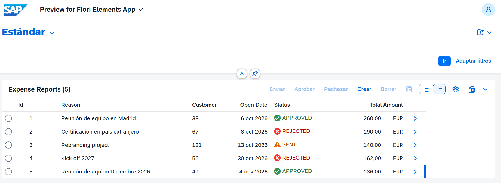
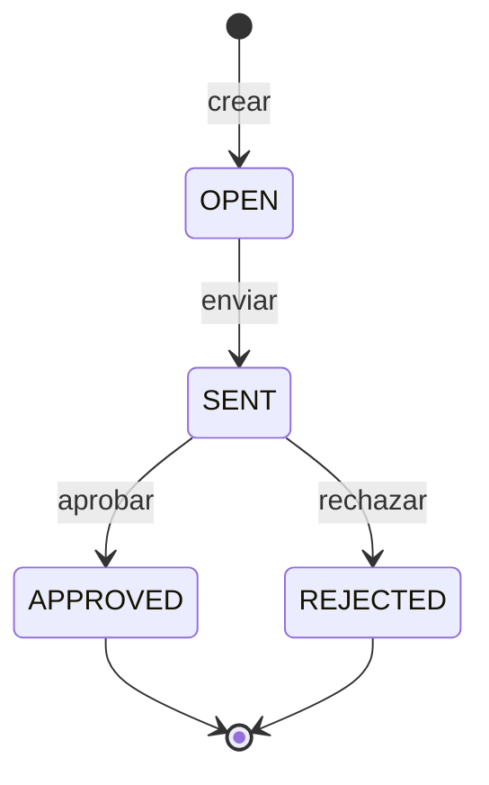
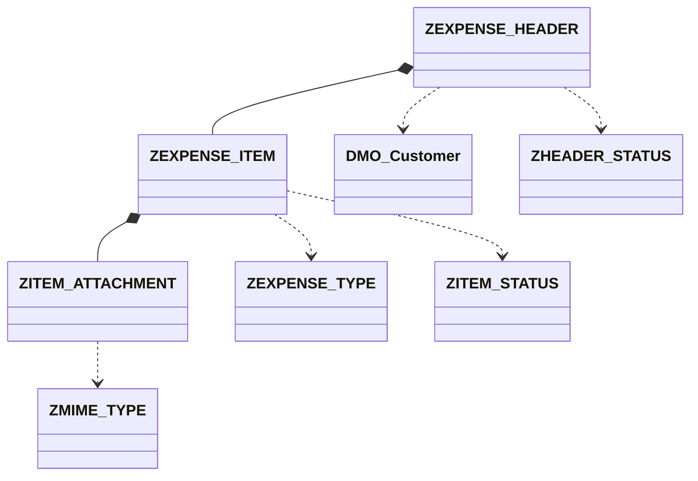

# Aplicación de Liquidación de Gastos · RAP Managed · OData V2

Aplicación transaccional de **informes de gastos** desarrollada en **ABAP Environment (SAP BTP)** con el modelo de programación **RAP** y **Fiori Elements**. Un empleado crea un informe, le añade gastos con sus justificantes y lo envía; un responsable lo aprueba o lo rechaza.

El objetivo es práctico y didáctico: recorrer un ciclo de vida completo con reglas de negocio reales, desde el modelo de datos hasta la interfaz.



## Qué demuestra

- Business object **managed** con composición de tres niveles: Informe → Gasto → Adjunto.
- **Numeración temprana** de claves sin objeto de rango de números.
- **Determinations** para valores por defecto y cálculo automático del total.
- **Validaciones** de negocio: importe positivo y límite de gasto de hotel.
- **Acciones de flujo** (enviar, aprobar, rechazar), una de ellas con parámetro.
- **Feature control por instancia**: un informe enviado se puede consultar, pero no modificar.
- **Side effects** para refrescar la interfaz sin recargar.
- **Criticality**: semáforos de estado en la lista.
- **Value helps** y asociaciones a objetos estándar (`/DMO/CUSTOMER`).
- Subida y visualización de ficheros con `@Semantics.largeObject`.

## ¿Por qué Managed?

Para la Expense App se eligió **RAP `Managed` sin Draft** frente a `Unmanaged` por dos motivos:

1. **Menos código, más framework.** En `Unmanaged` habría que programar a mano todos los `INSERT/UPDATE/DELETE` de `ZEXPENSE_HEADER`, `ZEXPENSE_ITEM` y `ZITEM_ATTACHMENT`. Con `Managed`, RAP gestiona la persistencia y el bloqueo, y el código propio se limita a las reglas de negocio.

2. **Numeración automática sin inventar claves.** La clave `report_id` (CHAR 10) no es UUID. Con `Managed` se implementa `early numbering` con lógica `MAX + 1`, de forma que el sistema asigna `0000000001`, `0000000002`... sin que el usuario tenga que inventar la clave. No se usa `Number Range Object`: es ideal para un entorno BTP didáctico.

## 1. Caso de uso

**Actor:** empleado viajero y responsable.

**Flujo:** crea el informe (HEADER) → añade gastos (ITEM) → adjunta el justificante (ATTACHMENT) → envía → el responsable aprueba o rechaza.

**Tipo:** aplicación transaccional Fiori Elements, sin draft.

**Arquitectura:** Fiori Elements sobre OData V2 y RAP Managed (no es una Web API manual).

```
Tablas Z → 
CDS de interfaz (ZI_) → 
CDS de consumo (ZC_) → 
Behavior → 
Service Definition → 
Service Binding
```

### Ciclo de vida del informe



Solo en estado `OPEN` se puede editar. `APPROVED` y `REJECTED` son estados finales.

## 2. Esquema de tablas



## 3. Documentación

| Documento | Contenido |
|---|---|
| [02 · Modelo de datos](./docs_md/02-modelo-datos.md) | Tablas, catálogos, datos auxiliares, vistas CDS de interfaz y de consumo, asociaciones |
| [03 · Metadata extensions](./docs_md/03-metadata-extensions.md) | Anotaciones de interfaz: columnas, formularios, botones, semáforos |
| [04 · Comportamiento](./docs_md/04-comportamiento.md) | Behavior definitions, validaciones, acciones, feature control, side effects |
| [05 · Guion de pruebas](./docs_md/05-guion-pruebas.md) | Escenarios de prueba con capturas y explicación de cómo se logra cada uno |
| [Despliegue en ABAP Environment](./OTHERS/despliegue_app_rap_abap_trial.md) | Despliegue de la app en una cuenta Trial |

El código de las clases de implementación (
`zbp_zi_exp_header`, 

`zbp_zi_exp_itemm`, 

`zbp_zi_exp_attach`) 

está en la carpeta [`src/`](./src/).

## 4. Plan didáctico: 10 funcionalidades RAP

| # | Funcionalidad | Estado | Detalle |
|---|---|---|---|
| 1 | Value Help | ✅ | Tipo de gasto, cliente (`/DMO/CUSTOMER`), estados |
| 2 | Validation | ✅ | Importe y límite de hotel hechas. Tipo de fichero (mime) pendiente |
| 3 | Determination | ✅ | Total del informe = suma de los gastos |
| 4 | Side Effect y bloqueo | ✅ | Al pasar a `SENT` se bloquea la edición |
| 5 | Action | ✅ | Enviar, aprobar y rechazar (con motivo) |
| 6 | Composition | ✅ | Borrado en cascada de gastos y adjuntos |
| 7 | Criticality | ✅ | Semáforos de estado |
| 8 | Association | ✅ | Asociación a `/DMO/CUSTOMER` |
| 9 | Upload / Display | ✅ | Ficheros con `@Semantics.largeObject` |
| 10 | Mensajes | ⏳ | Pendiente: clase de mensajes con texto largo |

## 5. Limitaciones y próximos pasos

**Limitaciones conocidas**
- Sin `draft`: los datos se guardan al instante. Por eso el cargador de ficheros aparece después de crear el registro del adjunto: Fiori Elements primero crea el registro (que da la clave) y después sube el contenido. Con draft, el botón estaría disponible desde el principio.
- Autorización global: cualquier usuario con el rol puede crear, enviar y aprobar.
- Límite de hotel fijo en el código, en lugar de leído del catálogo de tipos de gasto.
- Mensajes con texto directo, sin clase de mensajes.

**Próximos pasos**
1. Tablas de customizing para los límites de gasto.
2. Web API OData sobre el mismo business object.
3. Draft.
4. Autorizaciones por instancia y por rol.
5. Pruebas unitarias con ABAP Unit.

## 6. Despliegue en ABAP

Se realiza un trabajo adicional para desplegar la app en el entorno `ABAP Environment`, en una cuenta `Trial`. Los pasos están en [Desplegando la App](./OTHERS/despliegue_app_rap_abap_trial.md).

## Estructura del repositorio

```
README.md
docs/
  02-modelo-datos.md
  03-metadata-extensions.md
  04-comportamiento.md
  05-guion-pruebas.md
  img/
src/
  zbp_zi_exp_header.abap
  zbp_zi_exp_itemm.abap
  zbp_zi_exp_attach.abap
OTHERS/
  despliegue_app_rap_abap_trial.md
```
