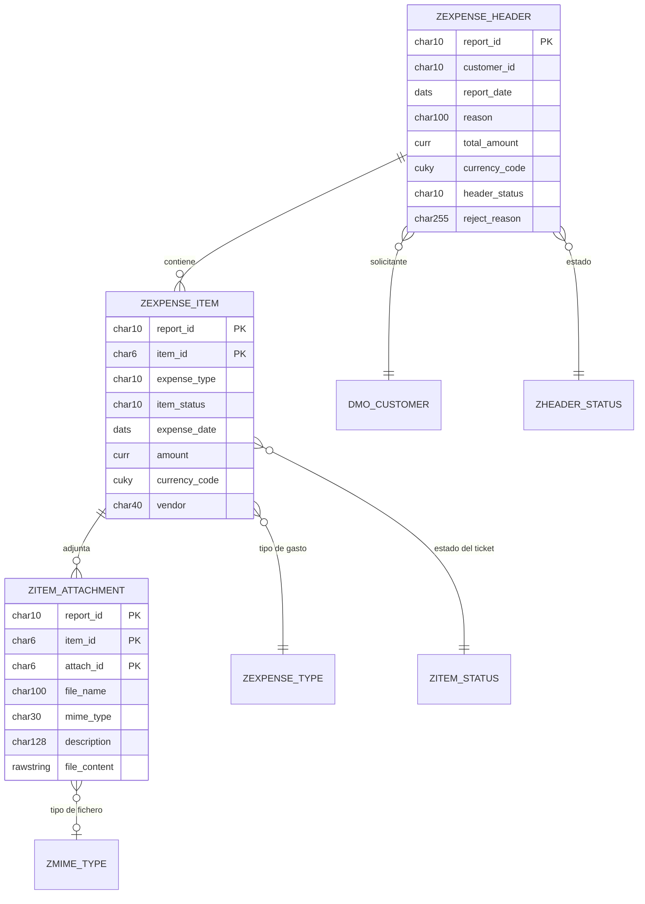

# Modelo de datos: App de informes de gastos

Documento de referencia del modelo de datos de la aplicación (ABAP Environment, RAP managed, Fiori Elements). Recoge las tablas, las vistas CDS de cada capa, las relaciones entre ellas y los datos auxiliares.

---

## Índice

1. [Visión general por capas](#1-visión-general-por-capas)
2. [Diagrama entidad-relación](#2-diagrama-entidad-relación)
3. [Tablas transaccionales](#3-tablas-transaccionales)
4. [Tablas maestras (catálogos)](#4-tablas-maestras-catálogos)
5. [Datos auxiliares](#5-datos-auxiliares)
6. [Capa de interfaz CDS](#6-capa-de-interfaz-cds)
7. [Capa de consumo CDS](#7-capa-de-consumo-cds)
8. [Asociaciones y composiciones](#8-asociaciones-y-composiciones)
9. [Campos con significado especial](#9-campos-con-significado-especial)
10. [Claves y numeración](#10-claves-y-numeración)
11. [Notas y pendientes](#11-notas-y-pendientes)

---

## 1. Visión general por capas

```
Tablas Z (persistencia)
   └── CDS de interfaz  ZI_*   (modelo de negocio, composiciones)
         └── CDS de consumo  ZC_*   (proyección para la UI)
               └── Metadata extensions  (anotaciones UI)
                     └── Service definition → Service binding (OData V2)
```

| Capa | Objetos | Responsabilidad |
|---|---|---|
| Persistencia | `ZEXPENSE_HEADER`, `ZEXPENSE_ITEM`, `ZITEM_ATTACHMENT` + 4 catálogos | Guardar los datos |
| Interfaz | `ZI_EXP_HEADER`, `ZI_EXP_ITEMM`, `ZI_EXP_ATTACH` + 4 value helps | Definir el business object y sus relaciones |
| Consumo | `ZC_EXP_HEADER`, `ZC_EXP_ITEMM`, `ZC_EXP_ATTACH` | Exponer lo necesario a la UI, con alias de campos |
| UI | Metadata extensions | Columnas, formularios, botones, semáforos |

## 2. Diagrama entidad-relación



Las relaciones con los catálogos son lógicas (se resuelven con asociaciones CDS y value helps), no claves foráneas físicas. La jerarquía **Header → Item → Attachment** sí es una composición del business object.

## 3. Tablas transaccionales

### 3.1 `ZEXPENSE_HEADER` (root)

Cabecera del informe de gastos. Reutiliza `/DMO/CUSTOMER` como solicitante.

| Campo | Tipo | Clave | Descripción |
|---|---|---|---|
| `client` | `abap.clnt` | Sí | Mandante |
| `report_id` | `abap.char(10)` | Sí | Identificador del informe (numeración temprana: `0000000001`, ...) |
| `customer_id` | `abap.char(10)` | | Cliente solicitante (`/DMO/I_Customer`) |
| `report_date` | `abap.dats` | | Fecha de apertura |
| `reason` | `abap.char(100)` | | Motivo del informe |
| `total_amount` | `abap.curr(15,2)` | | Total, suma de los gastos (calculado) |
| `currency_code` | `abap.cuky` | | Moneda (siempre EUR) |
| `header_status` | `abap.char(10)` | | Estado: `OPEN`, `SENT`, `APPROVED`, `REJECTED` |
| `reject_reason` | `abap.char(255)` | | Motivo de rechazo (solo se rellena al rechazar) |
| `created_by` | `abp_creation_user` | | Usuario creador |
| `created_at` | `abp_creation_tstmpl` | | Fecha de creación |
| `last_changed_by` | `abp_locinst_lastchange_user` | | Último usuario que modificó |
| `last_changed_at` | `abp_locinst_lastchange_tstmpl` | | Última modificación (ETag) |

<details>
<summary>DDL</summary>

```abap
@EndUserText.label : 'Cabecera del reporte de gastos'
@AbapCatalog.enhancement.category : #NOT_EXTENSIBLE
@AbapCatalog.tableCategory : #TRANSPARENT
@AbapCatalog.deliveryClass : #A
@AbapCatalog.dataMaintenance : #RESTRICTED
define table zexpense_header {

  key client      : abap.clnt not null;
  key report_id   : abap.char(10) not null;
  customer_id     : abap.char(10) not null;
  report_date     : abap.dats;
  reason          : abap.char(100);
  @Semantics.amount.currencyCode : 'zexpense_header.currency_code'
  total_amount    : abap.curr(15,2);
  currency_code   : abap.cuky;
  header_status   : abap.char(10) not null;
  reject_reason   : abap.char(255);
  created_by      : abp_creation_user;
  created_at      : abp_creation_tstmpl;
  last_changed_by : abp_locinst_lastchange_user;
  last_changed_at : abp_locinst_lastchange_tstmpl;

}
```
</details>

### 3.2 `ZEXPENSE_ITEM` (hijo del informe)

Línea de gasto de un informe.

| Campo | Tipo | Clave | Descripción |
|---|---|---|---|
| `client` | `abap.clnt` | Sí | Mandante |
| `report_id` | `abap.char(10)` | Sí | Informe al que pertenece |
| `item_id` | `abap.char(6)` | Sí | Número de línea (numeración temprana) |
| `expense_type` | `abap.char(10)` | | Tipo de gasto (`ZEXPENSE_TYPE`) |
| `item_status` | `abap.char(10)` | | Estado del ticket (`ZITEM_STATUS`) |
| `expense_date` | `abap.dats` | | Fecha del gasto |
| `amount` | `abap.curr(10,2)` | | Importe |
| `currency_code` | `abap.cuky` | | Moneda del importe |
| `vendor` | `abap.char(40)` | | Proveedor |
| `last_changed_at` | `abp_locinst_lastchange_tstmpl` | | Última modificación (ETag local) |

<details>
<summary>DDL</summary>

```abap
@EndUserText.label : 'Item de gastos por reporte. Child'
@AbapCatalog.enhancement.category : #NOT_EXTENSIBLE
@AbapCatalog.tableCategory : #TRANSPARENT
@AbapCatalog.deliveryClass : #A
@AbapCatalog.dataMaintenance : #RESTRICTED
define table zexpense_item {

  key client      : abap.clnt not null;
  key report_id   : abap.char(10) not null;
  key item_id     : abap.char(6) not null;
  expense_type    : abap.char(10) not null;
  item_status     : abap.char(10) not null;
  expense_date    : abap.dats;
  @Semantics.amount.currencyCode : 'zexpense_item.currency_code'
  amount          : abap.curr(10,2);
  currency_code   : abap.cuky;
  vendor          : abap.char(40);
  last_changed_at : abp_locinst_lastchange_tstmpl;

}
```
</details>

### 3.3 `ZITEM_ATTACHMENT` (hijo del gasto)

Adjunto binario de un gasto (recibo, factura).

| Campo | Tipo | Clave | Descripción |
|---|---|---|---|
| `client` | `abap.clnt` | Sí | Mandante |
| `report_id` | `abap.char(10)` | Sí | Informe |
| `item_id` | `abap.char(6)` | Sí | Gasto |
| `attach_id` | `abap.char(6)` | Sí | Número de adjunto |
| `file_name` | `abap.char(100)` | | Nombre del fichero |
| `mime_type` | `abap.char(30)` | | Tipo MIME |
| `description` | `abap.char(128)` | | Descripción |
| `file_content` | `abap.rawstring(0)` | | Contenido binario |
| `last_changed_at` | `abp_locinst_lastchange_tstmpl` | | Última modificación (ETag local) |

<details>
<summary>DDL</summary>

```abap
@EndUserText.label : 'Adjunto binario del ticket. CHILD de ITEM'
@AbapCatalog.enhancement.category : #NOT_EXTENSIBLE
@AbapCatalog.tableCategory : #TRANSPARENT
@AbapCatalog.deliveryClass : #A
@AbapCatalog.dataMaintenance : #RESTRICTED
define table zitem_attachment {

  key client      : abap.clnt not null;
  key report_id   : abap.char(10) not null;
  key item_id     : abap.char(6) not null;
  key attach_id   : abap.char(6) not null;
  file_name       : abap.char(100);
  mime_type       : abap.char(30);
  description     : abap.char(128);
  file_content    : abap.rawstring(0);
  last_changed_at : abp_locinst_lastchange_tstmpl;

}
```
</details>

## 4. Tablas maestras (catálogos)

| Tabla | Clave | Campos | Uso |
|---|---|---|---|
| `ZEXPENSE_TYPE` | `type_id` (char 10) | `description`, `limit_amount`, `requires_invoice`, `currency_code` | Tipos de gasto, límites y si requieren factura |
| `ZHEADER_STATUS` | `status_id` (char 10) | `description`, `allow_edit`, `criticality` | Estados del informe |
| `ZITEM_STATUS` | `status_id` (char 10) | `description` | Estados del ticket |
| `ZMIME_TYPE` | `mime_type` (char 30) | `extension`, `description` | Tipos de fichero permitidos |

<details>
<summary>DDL de los cuatro catálogos</summary>

```abap
@EndUserText.label : 'Tipos de gasto. Define límites y si requiere factura'
@AbapCatalog.enhancement.category : #NOT_EXTENSIBLE
@AbapCatalog.tableCategory : #TRANSPARENT
@AbapCatalog.deliveryClass : #A
@AbapCatalog.dataMaintenance : #RESTRICTED
define table zexpense_type {

  key client       : abap.clnt not null;
  key type_id      : abap.char(10) not null;
  description      : abap.char(40);
  @Semantics.amount.currencyCode : 'zexpense_type.currency_code'
  limit_amount     : abap.curr(10,2);
  requires_invoice : abap.char(1);
  currency_code    : abap.cuky;

}
```

```abap
@EndUserText.label : 'Catálogo de estados de cabecera'
@AbapCatalog.enhancement.category : #NOT_EXTENSIBLE
@AbapCatalog.tableCategory : #TRANSPARENT
@AbapCatalog.deliveryClass : #A
@AbapCatalog.dataMaintenance : #RESTRICTED
define table zheader_status {

  key client    : abap.clnt not null;
  key status_id : abap.char(10) not null;
  description   : abap.char(40);
  allow_edit    : abap.char(1);
  criticality   : abap.int1;

}
```

```abap
@EndUserText.label : 'Catálogo de estados del ticket individual'
@AbapCatalog.enhancement.category : #NOT_EXTENSIBLE
@AbapCatalog.tableCategory : #TRANSPARENT
@AbapCatalog.deliveryClass : #A
@AbapCatalog.dataMaintenance : #RESTRICTED
define table zitem_status {

  key client    : abap.clnt not null;
  key status_id : abap.char(10) not null;
  description   : abap.char(40);

}
```

```abap
@EndUserText.label : 'Catálogo de tipos de archivo permitidos para upload'
@AbapCatalog.enhancement.category : #NOT_EXTENSIBLE
@AbapCatalog.tableCategory : #TRANSPARENT
@AbapCatalog.deliveryClass : #A
@AbapCatalog.dataMaintenance : #RESTRICTED
define table zmime_type {

  key client    : abap.clnt not null;
  key mime_type : abap.char(30) not null;
  extension     : abap.char(10);
  description   : abap.char(40);

}
```
</details>

## 5. Datos auxiliares

### Tipos de gasto (`ZEXPENSE_TYPE`)

| `type_id` | Descripción | Límite | Requiere factura |
|---|---|---|---|
| HOTEL | Hotel | 300 | Sí |
| TAXI | Taxi / Uber | 100 | No |
| MEAL | Comida | 60 | Sí |
| KM | Kilometraje | 0 | No |

### Estados del informe (`ZHEADER_STATUS`)

| `status_id` | Descripción | `allow_edit` | Criticality | Color |
|---|---|---|---|---|
| OPEN | Abierta | X | 0 | Neutro |
| SENT | Enviada | | 2 | Amarillo |
| APPROVED | Aprobada | | 3 | Verde |
| REJECTED | Rechazada | X | 1 | Rojo |

### Estados del ticket (`ZITEM_STATUS`)

| `status_id` | Descripción |
|---|---|
| VALID | Válido |
| PENDING | Pendiente de factura |
| OBSERVED | Observado |

### Tipos de fichero (`ZMIME_TYPE`)

| `mime_type` | Extensión | Descripción |
|---|---|---|
| `application/pdf` | PDF | PDF Document |
| `image/jpeg` | JPG | JPEG Image |

<details>
<summary>Clase de carga de datos auxiliares</summary>

```abap
CLASS zcl_expense_aux_data_load DEFINITION PUBLIC FINAL CREATE PUBLIC.
  PUBLIC SECTION. INTERFACES if_oo_adt_classrun.
ENDCLASS.
CLASS zcl_expense_aux_data_load IMPLEMENTATION.
  METHOD if_oo_adt_classrun~main.
    DELETE FROM ZEXPENSE_TYPE.
    INSERT ZEXPENSE_TYPE FROM TABLE @( VALUE #(
      ( client = '100' type_id = 'HOTEL' description = 'Hotel' limit_amount = '300' requires_invoice = 'X' currency_code = 'EUR' )
      ( client = '100' type_id = 'TAXI' description = 'Taxi / Uber' limit_amount = '100' requires_invoice = '' currency_code = 'EUR' )
      ( client = '100' type_id = 'MEAL' description = 'Comida' limit_amount = '60' requires_invoice = 'X' currency_code = 'EUR' )
      ( client = '100' type_id = 'KM' description = 'Kilometraje' limit_amount = '0' requires_invoice = '' currency_code = 'EUR' )
    ) ).
    DELETE FROM ZHEADER_STATUS.
    INSERT ZHEADER_STATUS FROM TABLE @( VALUE #(
      ( client = '100' status_id = 'OPEN' description = 'Abierta' allow_edit = 'X' criticality = 0 )
      ( client = '100' status_id = 'SENT' description = 'Enviada' allow_edit = '' criticality = 2 )
      ( client = '100' status_id = 'APPROVED' description = 'Aprobada' allow_edit = '' criticality = 3 )
      ( client = '100' status_id = 'REJECTED' description = 'Rechazada' allow_edit = 'X' criticality = 1 )
    ) ).
    DELETE FROM ZITEM_STATUS.
    INSERT ZITEM_STATUS FROM TABLE @( VALUE #(
      ( client = '100' status_id = 'VALID' description = 'Valido' )
      ( client = '100' status_id = 'PENDING' description = 'Pendiente Factura' )
      ( client = '100' status_id = 'OBSERVED' description = 'Observado' )
    ) ).
    DELETE FROM ZMIME_TYPE.
    INSERT ZMIME_TYPE FROM TABLE @( VALUE #(
      ( client = '100' mime_type = 'application/pdf' extension = 'PDF' description = 'PDF Document' )
      ( client = '100' mime_type = 'image/jpeg' extension = 'JPG' description = 'JPEG Image' )
    ) ).
    out->write( 'Datos auxiliares cargados correctamente' ).
  ENDMETHOD.
ENDCLASS.
```
</details>

## 6. Capa de interfaz CDS

| Vista | Origen | Papel | Descripción |
|---|---|---|---|
| `ZI_EXP_HEADER` | `ZEXPENSE_HEADER` | Root | Cabecera del informe |
| `ZI_EXP_ITEMM` | `ZEXPENSE_ITEM` | Hijo | Líneas de gasto |
| `ZI_EXP_ATTACH` | `ZITEM_ATTACHMENT` | Nieto | Adjuntos del gasto |
| `ZVH_EXPENSE_TYPE` | `ZEXPENSE_TYPE` | Value help | Tipos de gasto |
| `ZVH_HEADER_STATUS` | `ZHEADER_STATUS` | Value help | Estados del informe |
| `ZVH_ITEM_STATUS` | `ZITEM_STATUS` | Value help | Estados del ticket |
| `ZVH_MIME_TYPE` | `ZMIME_TYPE` | Value help | Tipos de fichero |
| `ZA_EXP_REJECT_PARAM` | action `reject` | Define Abstract Entity | Definición de parámetro |

### 6.1 `ZI_EXP_HEADER`

<details>
<summary>Código</summary>

```abap
@AbapCatalog.viewEnhancementCategory: [ #NONE ]
@AccessControl.authorizationCheck: #NOT_REQUIRED
@EndUserText.label: 'Interface - Expense Header'
@Metadata.ignorePropagatedAnnotations: true

define root view entity ZI_EXP_HEADER
  as select from zexpense_header as Header

  composition [0..*] of ZI_EXP_ITEMM    as _Items
  association [0..1] to /DMO/I_Customer as _Customer on $projection.customer_id = _Customer.CustomerID
  association [0..1] to I_Currency      as _Currency on $projection.currency_code = _Currency.Currency

{
  key Header.report_id,

      Header.customer_id,

      Header.report_date,
      Header.reason,
      Header.header_status,

      @Semantics.amount.currencyCode: 'currency_code'
      Header.total_amount,

      Header.currency_code,

      Header.reject_reason,
      
      // Se añade campo calculado para colorear:
      // 0 Neutral (OPEN)
      // 1 Rojo (REJECTED)
      // 2 Amarillo (SENT)
      // 3 Verde (APPROVED)
      cast(case Header.header_status
             when 'SENT'     then 2
             when 'APPROVED' then 3
             when 'REJECTED' then 1
             else 0
           end as abap.int1)  as status_criticality,

      @Semantics.user.createdBy: true
      Header.created_by,

      @Semantics.systemDateTime.createdAt: true
      Header.created_at,

      @Semantics.user.lastChangedBy: true
      Header.last_changed_by,

      @Semantics.systemDateTime.lastChangedAt: true
      Header.last_changed_at,

      /* Associations */
      _Items,
      _Customer,
      _Currency
}

```
</details>

### 6.2 `ZI_EXP_ITEMM`

<details>
<summary>Código</summary>

```abap
@AccessControl.authorizationCheck: #NOT_REQUIRED
@EndUserText.label: 'Interface - Expense Item'
@Metadata.ignorePropagatedAnnotations: true

define view entity ZI_EXP_ITEMM
  as select from zexpense_item as Item

  association to parent ZI_EXP_HEADER as _Header on $projection.report_id = _Header.report_id
  association [0..1] to ZVH_ITEM_STATUS  as _ItemStatus  on $projection.item_status = _ItemStatus.ItemStatus
  association [0..1] to ZVH_EXPENSE_TYPE as _ExpenseType on $projection.expense_type = _ExpenseType.type_id
  composition [0..*] of ZI_EXP_ATTACH as _Attachments

{
  key Item.report_id,
  key Item.item_id,

      Item.expense_type,
      Item.item_status,
      Item.vendor,
      Item.expense_date,

      @Semantics.amount.currencyCode: 'currency_code'
      Item.amount,
      Item.currency_code,

      @Semantics.systemDateTime.localInstanceLastChangedAt: true
      Item.last_changed_at,

      /* Associations */
      _Header,
      _ItemStatus,
      _ExpenseType,
      _Attachments
}
```
</details>

### 6.3 `ZI_EXP_ATTACH`

<details>
<summary>Código</summary>

```abap
@AccessControl.authorizationCheck: #NOT_REQUIRED
@EndUserText.label: 'Interface - Expense Attachment'
@Metadata.ignorePropagatedAnnotations: true

define view entity ZI_EXP_ATTACH
  as select from zitem_attachment as Attach

  association to parent ZI_EXP_ITEMM as _Item
    on  $projection.report_id = _Item.report_id
    and $projection.item_id   = _Item.item_id

  association [1..1] to ZI_EXP_HEADER as _Header
    on $projection.report_id = _Header.report_id

{
  key Attach.report_id,
  key Attach.item_id,
  key Attach.attach_id,

      Attach.file_name,
      @Semantics.mimeType: true
      Attach.mime_type,
      Attach.description,
      Attach.file_content,

      @Semantics.systemDateTime.localInstanceLastChangedAt: true
      Attach.last_changed_at,

      /* Associations */
      _Header,
      _Item
}
```
</details>

### 6.4 Value helps

<details>
<summary>Código de las cuatro vistas</summary>

```abap
@AccessControl.authorizationCheck: #NOT_REQUIRED
@EndUserText.label: 'Value Help - Tipos de gasto'
@Metadata.ignorePropagatedAnnotations: true
define root view entity ZVH_EXPENSE_TYPE
  as select from zexpense_type
{
  key type_id,
      description
}
```

```abap
@AccessControl.authorizationCheck: #NOT_REQUIRED
@EndUserText.label: 'Value Help - Estados de carpeta de gastos'
@Metadata.ignorePropagatedAnnotations: true
define root view entity ZVH_HEADER_STATUS
  as select from zheader_status
{
  key status_id as HeaderStatus,
      description as Description
}
```

```abap
@AccessControl.authorizationCheck: #NOT_REQUIRED
@EndUserText.label: 'Value Help - Tipos MIME para upload'
@Metadata.ignorePropagatedAnnotations: true
define root view entity ZVH_MIME_TYPE
  as select from zmime_type
{
  key mime_type as MimeType,
      description as Description
}
```

```abap
@AccessControl.authorizationCheck: #NOT_REQUIRED
@EndUserText.label: 'Value Help - Estados del ticket individual'
@Metadata.ignorePropagatedAnnotations: true
define root view entity ZVH_ITEM_STATUS
  as select from zitem_status
{
  key status_id as ItemStatus,
      description as Description
}
```
</details>

### 6.5 `ZA_EXP_REJECT_PARAM`

<details>
<summary>Define Abstract Entity. Un tipo estructurado de CDS que solo describe datos, sin tabla ni selección</summary>

```abap
@EndUserText.label: 'Reject Parameter CDS'
define abstract entity ZA_EXP_REJECT_PARAM
{
  @EndUserText.label: 'Motivo del rechazo'
  reason : abap.char(255);
}
```

</details>

## 7. Capa de consumo CDS

| Vista | Origen | Descripción |
|---|---|---|
| `ZC_EXP_HEADER` | `ZI_EXP_HEADER` | Proyección root del informe |
| `ZC_EXP_ITEMM` | `ZI_EXP_ITEMM` | Proyección de los gastos |
| `ZC_EXP_ATTACH` | `ZI_EXP_ATTACH` | Proyección de los adjuntos |

Las proyecciones renombran los campos a *CamelCase* para la UI (`report_id` → `ReportId`) y definen los value helps de cada campo.

### 7.1 Equivalencia de nombres

| Interfaz | Consumo (UI) |
|---|---|
| `report_id` | `ReportId` |
| `customer_id` | `CustomerID` |
| `report_date` | `ReportDate` |
| `reason` | `Reason` |
| `header_status` | `HeaderStatus` |
| `reject_reason` | `RejectReason` |
| `total_amount` | `TotalAmount` |
| `currency_code` | `CurrencyCode` |
| `StatusCriticality` | `StatusCriticality` |
| `item_id` | `ItemId` |
| `expense_type` | `ExpenseType` |
| `item_status` | `ItemStatus` |
| `expense_date` | `ExpenseDate` |
| `vendor` | `Vendor` |
| `amount` | `Amount` |
| `attach_id` | `AttachId` |
| `file_name` | `FileName` |
| `mime_type` | `MimeType` |
| `description` | `Description` |
| `file_content` | `AttachmentContent` |

### 7.2 `ZC_EXP_HEADER`

<details>
<summary>Código</summary>

```abap
@AccessControl.authorizationCheck: #NOT_REQUIRED
@EndUserText.label: 'Consumption - Expense Header'
@Metadata.allowExtensions: true
@Metadata.ignorePropagatedAnnotations: true

define root view entity ZC_EXP_HEADER
provider contract transactional_query
  as projection on ZI_EXP_HEADER

{
  key report_id       as ReportId,

      @Consumption.valueHelpDefinition: [ {
      entity: { name: '/DMO/I_Customer_StdVH', element: 'CustomerID' } } ]
      customer_id     as CustomerID,
      report_date     as ReportDate,
      reason          as Reason,

      @Consumption.valueHelpDefinition: [ {
      entity: { name: 'ZVH_HEADER_STATUS', element: 'HeaderStatus' } } ]
      header_status   as HeaderStatus,

      reject_reason   as RejectReason,

      @Semantics.amount.currencyCode: 'CurrencyCode'
      total_amount    as TotalAmount,

      currency_code   as CurrencyCode,
      StatusCriticality,
      created_by      as CreatedBy,
      created_at      as CreatedAt,
      last_changed_by as LastChangedBy,
      last_changed_at as LastChangedAt,

      /* Associations */
      _Items : redirected to composition child ZC_EXP_ITEMM,

      _Customer,
      _Currency
}
```
</details>

### 7.3 `ZC_EXP_ITEMM`

<details>
<summary>Código</summary>

```abap
@AccessControl.authorizationCheck: #NOT_REQUIRED
@EndUserText.label: 'Consumption - Expense Item'
@Metadata.ignorePropagatedAnnotations: true
@Metadata.allowExtensions: true
define view entity ZC_EXP_ITEMM
  as projection on ZI_EXP_ITEMM

{
  key report_id       as ReportId,
  key item_id         as ItemId,

      @Consumption.valueHelpDefinition: [{
      entity: { name: 'ZVH_EXPENSE_TYPE', element: 'type_id' } } ]
      expense_type    as ExpenseType,

      @Consumption.valueHelpDefinition: [ {
      entity: { name: 'ZVH_ITEM_STATUS', element: 'ItemStatus' } } ]
      item_status     as ItemStatus,
      vendor          as Vendor,
      expense_date    as ExpenseDate,

      @Semantics.amount.currencyCode: 'CurrencyCode'
      amount          as Amount,

      currency_code   as CurrencyCode,
      last_changed_at as LastChangedAt,

      /* Associations */
      _Header      : redirected to parent ZC_EXP_HEADER,
      _ItemStatus,
      _ExpenseType,
      _Attachments : redirected to composition child ZC_EXP_ATTACH
}
```
</details>

### 7.4 `ZC_EXP_ATTACH`

<details>
<summary>Código</summary>

```abap
@AccessControl.authorizationCheck: #NOT_REQUIRED
@EndUserText.label: 'Consumption - Expense Attachment'
@Metadata.allowExtensions: true

define view entity ZC_EXP_ATTACH
  as projection on ZI_EXP_ATTACH

{
  key report_id       as ReportId,
  key item_id         as ItemId,
  key attach_id       as AttachId,
      file_name       as FileName,
      mime_type       as MimeType,
      description     as Description,
      @Semantics.largeObject: {
      mimeType: 'MimeType',
      fileName: 'FileName',
      contentDispositionPreference: #INLINE }
      file_content    as AttachmentContent,
      last_changed_at as LastChangedAt,

      /* Associations */
      _Header : redirected to ZC_EXP_HEADER,
      _Item   : redirected to parent ZC_EXP_ITEMM
}
```
</details>

## 8. Asociaciones y composiciones

| Desde | Hacia | Tipo | Cardinalidad | Condición |
|---|---|---|---|---|
| `ZI_EXP_HEADER` | `ZI_EXP_ITEMM` (`_Items`) | Composición | 0..* | Hijos del informe |
| `ZI_EXP_ITEMM` | `ZI_EXP_HEADER` (`_Header`) | Padre | 1 | `report_id` |
| `ZI_EXP_ITEMM` | `ZI_EXP_ATTACH` (`_Attachments`) | Composición | 0..* | Hijos del gasto |
| `ZI_EXP_ATTACH` | `ZI_EXP_ITEMM` (`_Item`) | Padre | 1 | `report_id` + `item_id` |
| `ZI_EXP_ATTACH` | `ZI_EXP_HEADER` (`_Header`) | Asociación | 1..1 | `report_id` (raíz del BO, usada para bloqueo y autorización) |
| `ZI_EXP_HEADER` | `/DMO/I_Customer` (`_Customer`) | Asociación | 0..1 | `customer_id = CustomerID` |
| `ZI_EXP_HEADER` | `I_Currency` (`_Currency`) | Asociación | 0..1 | `currency_code = Currency` |
| `ZI_EXP_ITEMM` | `ZVH_ITEM_STATUS` (`_ItemStatus`) | Asociación | 0..1 | `item_status` |
| `ZI_EXP_ITEMM` | `ZVH_EXPENSE_TYPE` (`_ExpenseType`) | Asociación | 0..1 | `expense_type = type_id` |

Redirecciones en la capa de consumo:

| Proyección | Asociación | Redirigida a |
|---|---|---|
| `ZC_EXP_HEADER` | `_Items` | `ZC_EXP_ITEMM` (composition child) |
| `ZC_EXP_ITEMM` | `_Header` | `ZC_EXP_HEADER` (parent) |
| `ZC_EXP_ITEMM` | `_Attachments` | `ZC_EXP_ATTACH` (composition child) |
| `ZC_EXP_ATTACH` | `_Item` | `ZC_EXP_ITEMM` (parent) |
| `ZC_EXP_ATTACH` | `_Header` | `ZC_EXP_HEADER` |

## 9. Campos con significado especial

| Campo | Anotación | Efecto |
|---|---|---|
| `total_amount`, `amount` | `@Semantics.amount.currencyCode` | El importe se muestra junto a su moneda |
| `created_by`, `last_changed_by` | `@Semantics.user.*` | Rellenados automáticamente por el framework |
| `created_at`, `last_changed_at` | `@Semantics.systemDateTime.*` | Sello de tiempo automático; `last_changed_at` actúa como ETag |
| `last_changed_at` (item, attach) | `@Semantics.systemDateTime.localInstanceLastChangedAt` | ETag local de cada entidad hija |
| `mime_type` | `@Semantics.mimeType` | Marca el campo que contiene el tipo MIME |
| `AttachmentContent` | `@Semantics.largeObject` | Permite subir y descargar el fichero desde la UI |
| `StatusCriticality` | Campo calculado | 0 neutro, 1 rojo, 2 amarillo, 3 verde; alimenta los semáforos |

## 10. Claves y numeración

| Entidad | Clave | Cómo se asigna |
|---|---|---|
| Informe | `report_id` (char 10) | Numeración temprana (`early numbering`): se toma el máximo existente + 1 y se rellena con ceros (`0000000001`) |
| Gasto | `report_id` + `item_id` (char 6) | Numeración temprana dentro de cada informe |
| Adjunto | `report_id` + `item_id` + `attach_id` (char 6) | Numeración temprana dentro de cada gasto |

El usuario nunca informa las claves: son de solo lectura en el behavior definition. No se usa un objeto de rango de números para mantener el ejercicio autocontenido en BTP.

## 11. Notas y pendientes

- **Límite de hotel:** los datos auxiliares dejan 300 € para HOTEL, pero la validación y el guion de pruebas usan 150 €. Conviene unificar el valor, o hacer que la validación lea el límite de `ZEXPENSE_TYPE` en lugar de usar una constante.
- **`ZVH_MIME_TYPE` y `ZMIME_TYPE`:** existen y están cargadas, pero todavía no se usan en ninguna validación ni value help. Quedan para el tratamiento del tipo de fichero.
- **`allow_edit` en `ZHEADER_STATUS`:** el catálogo marca REJECTED como editable, mientras que el comportamiento actual lo trata como estado final. El control real del bloqueo vive en el feature control del behavior, no en esta columna.
- **`ZEXPENSE_TYPE.requires_invoice`:** hoy la regla del recibo (gastos de más de 50 €) está en la acción `send` y no depende de este campo.
- **Mandante `'100'`** fijo en la clase de carga de datos.
