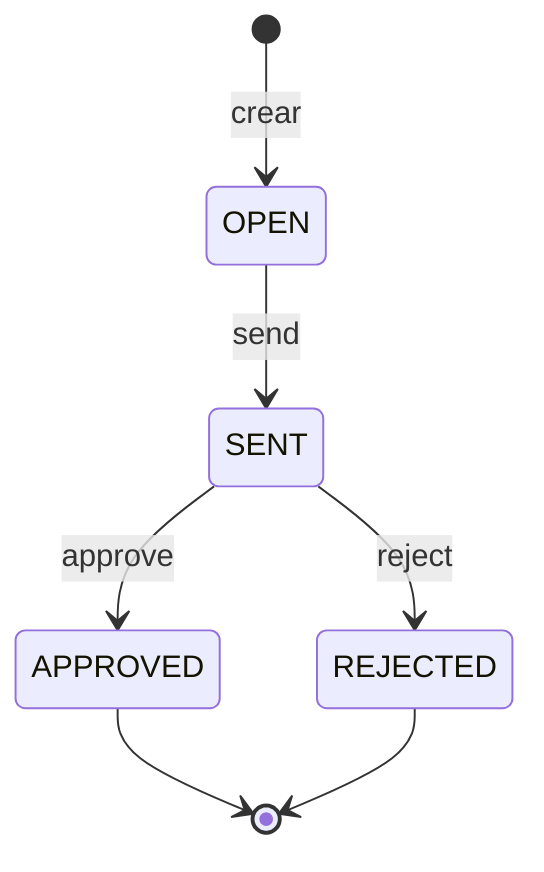

# Comportamiento: App de informes de gastos

Este documento describe el **comportamiento** del business object: qué operaciones permite cada entidad, qué reglas se aplican y cómo cambia el informe de estado. Complementa a [`modelo_datos_app_gastos.md`](./modelo_datos_app_gastos.md), que describe la estructura de datos.

---

## Índice

1. [Ciclo de vida del informe](#1-ciclo-de-vida-del-informe)
2. [Behavior definition de interfaz](#2-behavior-definition-de-interfaz)
3. [Resumen por entidad](#3-resumen-por-entidad)
4. [Numeración temprana](#4-numeración-temprana)
5. [Determinations](#5-determinations)
6. [Validaciones](#6-validaciones)
7. [Acciones](#7-acciones)
8. [Feature control: bloqueo por estado](#8-feature-control-bloqueo-por-estado)
9. [Side effects](#9-side-effects)
10. [Bloqueo, autorización y ETag](#10-bloqueo-autorización-y-etag)
11. [Behavior definition de proyección](#11-behavior-definition-de-proyección)
12. [Mapa de clases y métodos](#12-mapa-de-clases-y-métodos)
13. [Limitaciones y pendientes](#13-limitaciones-y-pendientes)

---

## 1. Ciclo de vida del informe



El estado vive solo en la cabecera (`header_status`) y es de solo lectura para el usuario: únicamente cambia mediante las acciones. `APPROVED` y `REJECTED` son estados finales.

| Estado | Editar / borrar informe | Crear gastos | Editar / borrar gastos y adjuntos | `send` | `approve` | `reject` |
|---|---|---|---|---|---|---|
| OPEN | Sí | Sí | Sí | Sí | No | No |
| SENT | No | No | No | No | Sí | Sí |
| APPROVED | No | No | No | No | No | No |
| REJECTED | No | No | No | No | No | No |

## 2. Behavior definition de interfaz

<details>
<summary>Ver el BDEF completo (<code>ZI_EXP_HEADER</code>)</summary>

```abap
managed implementation in class zbp_zi_exp_header unique;
strict ( 2 );

define behavior for ZI_EXP_HEADER alias Header
persistent table zexpense_header
lock master
authorization master ( global )
etag master last_changed_at
early numbering
{

  // administrative fields: read only
  field ( readonly ) last_changed_at, last_changed_by, created_at, created_by;

  // mandatory fields
  field ( mandatory ) customer_id, report_date, reason;

  field ( readonly ) report_id;
  field ( readonly ) header_status;
  field ( readonly ) total_amount;
  field ( readonly ) currency_code;
  field ( readonly ) reject_reason;

  // mapping entity's field types with table field types
  mapping for zexpense_header corresponding;

  determination setStatusDefault on modify { create; }
  action ( features : instance ) send result [1] $self;
  action ( features : instance ) approve result [1] $self;
  action ( features : instance ) reject parameter ZA_EXP_REJECT_PARAM result [1] $self;

  // standard operations for entity
  create;
  update ( features : instance );
  delete ( features : instance );

  side effects
  {
    action send affects $self, entity _Items;
    action approve affects $self, entity _Items;
    action reject affects $self, entity _Items;
  }

  // create expense items by association
  association _Items { create ( features : instance ); }

}

define behavior for ZI_EXP_ITEMM alias item
implementation in class zbp_zi_exp_itemm unique
persistent table zexpense_item
etag master last_changed_at
lock dependent by _Header
early numbering
authorization dependent by _Header

{
  // administrative fields: read only
  field ( readonly ) last_changed_at;

  // static field control
  field ( readonly ) report_id, item_id;

  field ( mandatory ) expense_type, expense_date, amount;

  // mapping entity's field types with table field types
  mapping for zexpense_item corresponding;

  // standard operations for expense item entity
  update ( features : instance );
  delete ( features : instance );

  determination setCurrency on modify { create; }
  determination updateHeaderTotal on save { create; update; delete; }

  validation validateAmount on save { create; update; field amount; }
  validation validateHotelLimit on save { create; update; field expense_type, amount; }

  side effects
  {
    field amount affects field _Header.total_amount;
  }

  association _Header { }

  // create attachment by association
  association _Attachments { create ( features : instance ); }

}

define behavior for ZI_EXP_ATTACH alias attach
implementation in class zbp_zi_exp_attach unique
persistent table zitem_attachment
etag master last_changed_at
lock dependent by _Header
early numbering
authorization dependent by _Header

{
  // administrative fields: read only
  field ( readonly ) last_changed_at;

  // static field control
  field ( readonly ) report_id, item_id, attach_id;

  // mandatory fields that are required to create a attachment
  field ( mandatory ) description;

  // mapping entity's field types with table field types
  mapping for zitem_attachment corresponding;

  // standard operations for attachment entity
  update ( features : instance );
  delete ( features : instance );

  association _Header { }
  association _Item { }
}
```
</details>

El modelo es **managed sin draft**: RAP gestiona la persistencia (`INSERT/UPDATE/DELETE`), y el código propio se limita a las reglas de negocio.

## 3. Resumen por entidad

| Aspecto | Header (`ZI_EXP_HEADER`) | Item (`ZI_EXP_ITEMM`) | Attach (`ZI_EXP_ATTACH`) |
|---|---|---|---|
| **Papel** | Root | Hijo del informe | Hijo del gasto |
| **Operaciones** | `create`, `update`, `delete` | `update`, `delete` | `update`, `delete` |
| **Alta** | Directa | Por la asociación `_Items` del header | Por la asociación `_Attachments` del item |
| **Campos obligatorios** | `customer_id`, `report_date`, `reason` | `expense_type`, `expense_date`, `amount` | `description` |
| **Solo lectura** | `report_id`, `header_status`, `total_amount`, `currency_code`, `reject_reason`, campos de administración | `report_id`, `item_id`, `last_changed_at` | `report_id`, `item_id`, `attach_id`, `last_changed_at` |
| **Determinations** | `setStatusDefault` | `setCurrency`, `updateHeaderTotal` | Ninguna |
| **Validaciones** | Ninguna | `validateAmount`, `validateHotelLimit` | Ninguna |
| **Acciones** | `send`, `approve`, `reject` | Ninguna | Ninguna |
| **Numeración** | Temprana | Temprana | Temprana |
| **Bloqueo** | `lock master` | `lock dependent by _Header` | `lock dependent by _Header` |
| **Autorización** | `master ( global )` | `dependent by _Header` | `dependent by _Header` |
| **ETag** | `last_changed_at` | `last_changed_at` | `last_changed_at` |
| **Feature control** | `update`, `delete`, acciones y alta de gastos | `update`, `delete` y alta de adjuntos | `update`, `delete` |

Detalle sobre `currency_code`: en el header es de solo lectura. En el item **no** se declara `readonly` en el BDEF, porque RAP no admite un campo de moneda de solo lectura estática junto a un importe editable (`amount`). Lo asigna la determination `setCurrency` y se oculta en la interfaz.

## 4. Numeración temprana

Las tres entidades usan `early numbering`. El usuario nunca informa las claves (`report_id`, `item_id`, `attach_id`): se asignan al crear la instancia, antes de guardar, mediante el método `earlynumbering_create` de cada clase.

- **Informe:** se toma el máximo existente más uno, en formato de 10 caracteres (`0000000001`).
- **Gasto y adjunto:** se numeran dentro de su informe y de su gasto respectivamente.

No se usa un objeto de rango de números, para mantener el ejercicio autocontenido.

## 5. Determinations

| Determination | Entidad | Disparador | Qué hace |
|---|---|---|---|
| `setStatusDefault` | Header | `on modify { create; }` | Asigna el estado inicial `OPEN` y la moneda `EUR` al crear el informe |
| `setCurrency` | Item | `on modify { create; }` | Asigna la moneda `EUR` al crear un gasto |
| `updateHeaderTotal` | Item | `on save { create; update; delete; }` | Recalcula `total_amount` del informe como suma de sus gastos |

Se usa `on modify` para los valores por defecto porque el valor queda disponible de inmediato; `on save` para el total, porque se calcula con los datos ya definitivos.

## 6. Validaciones

Todas son `on save` y se declaran en el item. Siguen el mismo patrón: **leer** las instancias recibidas, **comprobar** la regla, **marcar `failed`** para impedir el guardado y **publicar `reported`** con el mensaje y el campo afectado.

| Validación | Disparador | Regla | Resultado |
|---|---|---|---|
| `validateAmount` | `create; update; field amount` | `amount` debe ser mayor que 0 | Error sobre el campo importe |
| `validateHotelLimit` | `create; update; field expense_type, amount` | Un gasto de hotel no puede superar el límite (150 €) | Error si lo supera; aviso (warning) si se acerca al límite |

`failed` decide **si se guarda**; `reported` decide **qué ve el usuario**. Por eso un *warning* usa solo `reported` y un *error* usa ambos.

### Decisión de diseño: el recibo no es una validación

La regla "los gastos de más de 50 € necesitan un adjunto" **no** es una validación del item. Depende de dos entidades (item y adjuntos) y ningún disparador de una sola entidad la cubre bien: si se borra un adjunto, el item no cambia y la validación no se ejecutaría. Por eso se comprueba como **precondición de la acción `send`**, justo en el momento que importa.

> **Regla práctica.** Una validación protege la integridad de los datos de una entidad cada vez que se guarda. Una precondición de acción protege una transición de negocio, solo cuando se intenta.

## 7. Acciones

Las tres acciones son del header, tienen `features : instance` y devuelven la propia instancia (`result [1] $self`) para que la interfaz refresque la fila sin recargar.

| Acción | Habilitada en | Parámetro | Efecto |
|---|---|---|---|
| `send` | OPEN | Ninguno | Pasa a `SENT` si se cumplen las precondiciones |
| `approve` | SENT | Ninguno | Pasa a `APPROVED` |
| `reject` | SENT | `ZA_EXP_REJECT_PARAM` (motivo) | Pasa a `REJECTED` y guarda el motivo en `reject_reason` |

### 7.1 `send`: precondiciones

Se evalúan en este orden y se corta en la primera que falla:

1. El informe está en `OPEN`.
2. Tiene al menos un gasto.
3. Cada gasto de más de 50 € tiene al menos un adjunto.

Si alguna falla, la acción devuelve `failed` + `reported` con **un único mensaje en el header** (con el número de gastos sin recibo) y no modifica nada. Solo si todas se cumplen cambia el estado a `SENT`.

Para comprobarlo lee el informe, sus gastos (`BY \_Items`) y los adjuntos de esos gastos (`BY \_Attachments`, solo los enlaces con `LINK`), sin necesidad de traer el contenido binario.

### 7.2 `approve`

Comprueba por seguridad que el informe está en `SENT` (el feature control ya lo garantiza en la interfaz, pero no sustituye a la comprobación en backend) y cambia el estado a `APPROVED`.

### 7.3 `reject`

- Recibe el motivo mediante la *abstract entity* `ZA_EXP_REJECT_PARAM`, que Fiori muestra como un diálogo.
- Exige un motivo de al menos 10 caracteres; si no, devuelve error y el informe sigue en `SENT`.
- Guarda el motivo en `reject_reason` (campo de solo lectura, que solo escribe la acción) y pasa a `REJECTED`.

Un parámetro de acción **no se persiste solo**: existe únicamente mientras se ejecuta, y por eso se copia explícitamente al campo de la tabla.

## 8. Feature control: bloqueo por estado

Cuando el informe sale de `OPEN` se bloquea su edición. El mecanismo es `features : instance`, que obliga a implementar `get_instance_features` en cada entidad:

| Entidad | Qué controla | Cómo decide |
|---|---|---|
| Header | `update`, `delete`, alta de gastos, `send`, `approve`, `reject` | Lee su propio `header_status` |
| Item | `update`, `delete`, alta de adjuntos | Navega al padre (`BY \_Header`) y lee **el estado del header** |
| Attach | `update`, `delete` | Navega al padre (`BY \_Header`) y lee **el estado del header** |

Puntos importantes:

- **Es un control de backend, no solo visual.** Una llamada por API a un informe `SENT` también se rechaza.
- **La navegación y la lectura siguen disponibles.** Solo se bloquean las operaciones de escritura.
- **Crear el informe no se bloquea:** no existe un estado previo. Solo se bloquea crear hijos (por la asociación) cuando el padre no está en `OPEN`.
- **El estado se consulta siempre en el header.** Item y adjunto no tienen estado propio que gobierne la edición.

## 9. Side effects

Indican a la interfaz **qué recargar** tras un cambio. No bloquean nada por sí mismos: el bloqueo lo hace el feature control; el side effect hace que el usuario vea el resultado sin refrescar la página.

| Origen | Afecta a | Para qué |
|---|---|---|
| Acción `send` | El propio informe y sus gastos | Refrescar estado, semáforo y botones |
| Acción `approve` | El propio informe y sus gastos | Ídem |
| Acción `reject` | El propio informe y sus gastos | Ídem, y muestra el motivo |
| Campo `amount` (item) | `_Header.total_amount` | El total de la cabecera se actualiza al cambiar un importe |

## 10. Bloqueo, autorización y ETag

- **Lock:** `lock master` en el header y `lock dependent by _Header` en los hijos. Al bloquear un informe se bloquean también sus gastos y adjuntos.
- **Autorización:** `authorization master ( global )` en el header, con `authorization dependent by _Header` en los hijos. Es una autorización global, sin distinción por instancia ni por rol.
- **ETag:** `last_changed_at` en las tres entidades. Protege frente a modificaciones concurrentes: si el registro cambió desde que se leyó, la actualización se rechaza.

## 11. Behavior definition de proyección

La proyección **no repite la lógica**. Solo decide qué operaciones del business object se exponen a la interfaz; determinations, validaciones y feature control se heredan del BDEF de interfaz.

```abap
projection;
strict ( 2 );
use side effects;

define behavior for ZC_EXP_HEADER alias Header
{
  use create;
  use update;
  use delete;

  use action send;
  use action approve;
  use action reject;

  use association _Items { create; }
}

define behavior for ZC_EXP_ITEMM alias item
{
  use update;
  use delete;

  use association _Header;
  use association _Attachments { create; }
}

define behavior for ZC_EXP_ATTACH alias attach
{
  use update;
  use delete;

  use association _Header;
  use association _Item;
}
```

| Entidad | Operaciones expuestas | Notas |
|---|---|---|
| `ZC_EXP_HEADER` | `create`, `update`, `delete`, `send`, `approve`, `reject`, alta de gastos | Todo lo que ofrece el BO |
| `ZC_EXP_ITEMM` | `update`, `delete`, alta de adjuntos | El alta de gastos se hace desde el informe |
| `ZC_EXP_ATTACH` | `update`, `delete` | El alta se hace desde el gasto |

`use side effects` en la cabecera de la proyección es lo que permite que los side effects declarados en la interfaz lleguen a la interfaz de usuario.

## 12. Mapa de clases y métodos

| Clase | Entidad | Métodos |
|---|---|---|
| `zbp_zi_exp_header` | Header | `earlynumbering_create`, `setStatusDefault`, `get_instance_features`, `get_global_authorizations`, `send`, `approve`, `reject` |
| `zbp_zi_exp_itemm` | Item | `earlynumbering_create`, `setCurrency`, `updateHeaderTotal`, `validateAmount`, `validateHotelLimit`, `get_instance_features` |
| `zbp_zi_exp_attach` | Attach | `earlynumbering_create`, `get_instance_features` |

El código de las clases está en [`src/`](../src/).

## 13. Limitaciones y pendientes

- **Sin draft:** los datos se guardan al instante; no hay borrador. Esto explica, por ejemplo, que el cargador de ficheros aparezca después de crear el registro del adjunto.
- **Autorización global:** cualquier usuario con el rol puede crear, enviar y aprobar. Falta separar roles (quien envía no debería aprobar).
- **Límite de hotel fijo en el código** (150 €), en lugar de leerlo de la tabla de tipos de gasto.
- **Mensajes con texto directo:** sin clase de mensajes ni textos largos.
- **Validación del tipo de fichero (mime) pendiente:** el catálogo `ZMIME_TYPE` existe, pero el attach no tiene todavía validación.
- **`updateHeaderTotal` está declarada `on save` también para `delete`:** conviene comprobar que el total se recalcula correctamente al borrar un gasto, porque en una validación o determination `on save` los datos de la instancia borrada ya no se pueden leer.
