# ZEXPENSE2_API: la app de gastos RAP, ahora como API Web OData V4

Una app Fiori de informes de gastos (RAP, ABAP Environment) expuesta también como **API Web Cloud**, reutilizando el mismo business object y probada paso a paso desde **Postman**.

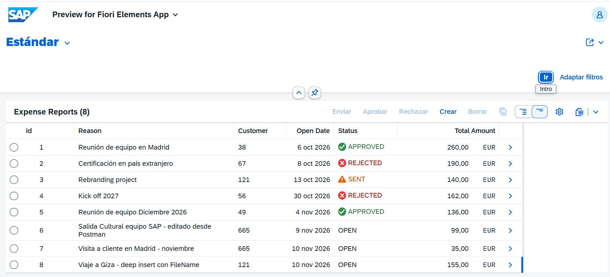

 **Modelo de datos:** 
 
 ```
Informe (Header, root)
 └── Gasto (Item)
      └── Adjunto (Attachment)
```

*Lo que crea la API lo ve la app: es el mismo business object.*


## Índice

1. [Cabecera](#1-cabecera)
2. [Posición](#2-posición)
3. [Registro del fichero](#3-registro-del-fichero)
   - [3.1 Binario (PUT)](#31-binario-put)
   - [3.2 Nombre (PATCH)](#32-nombre-patch)
4. [Deep insert](#4-deep-insert)
5. [send](#5-send)
6. [approve](#6-approve)
7. [reject](#7-reject)
- [Apéndice A: conectar Postman con ABAP Environment](#apéndice-a-conectar-postman-con-abap-environment-trial)

## Convenciones

```
BASE_V4 = https://6449ad14-b137-4a27-8017-6421c2c4f0b0.abap.us10.hana.ondemand.com/sap/opu/odata4/sap/zapi_expenses_o4/srvd_a2x/sap/zsd_expenses_api/0001
```

- **Todas las llamadas** llevan el token OAuth ([apéndice A](#apéndice-a-conectar-postman-con-abap-environment-trial)). 

Las escrituras (`POST`, `PATCH`, `PUT`, `DELETE`) llevan además `X-CSRF-Token`.

- **Claves:** los IDs llevan espacios a la izquierda y van en la URL como `%20`, tal cual los devuelve el servicio.

| Entidad | Clave de ejemplo (informe 8, posición 2, adjunto 1) |
|---|---|
| `ExpenseReport` | `ExpenseReport(ReportId='%20%20%20%20%20%20%20%207')` |
| `ExpenseItem` | `ExpenseItem(ReportId='%20%20%20%20%20%20%20%207',ItemId='%20%20%20%201')` |
| `ExpenseAttachment` | `ExpenseAttachment(ReportId='%20%20%20%20%20%20%20%207',ItemId='%20%20%20%201',AttachId='%20%20%20%201')` |

✅ probado · ⏳ pendiente de probar

---

## 1. Cabecera

`POST {BASE_V4}/ExpenseReport` ✅

```json
{
  "CustomerID": "121",
  "ReportDate": "2026-11-10",
  "Reason": "Viaje a El Cairo"
}
```

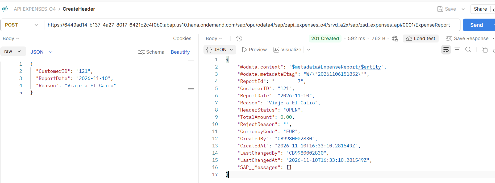

**STAR**
- **S:** la app de gastos existe y hay que comprobar que la API crea informes igual que ella.
- **T:** crear un informe con lo mínimo.
- **A:** `POST` con solo los tres campos obligatorios, que salen del `$metadata` (`FieldControl = Mandatory`). El resto es `Core.Computed`.
- **R:** `201`, `HeaderStatus: OPEN`, moneda `EUR`, `TotalAmount: 0.00` e id asignado por el servidor.

---

## 2. Posición

`POST {BASE_V4}/ExpenseReport(ReportId='%20%20%20%20%20%20%20%207')/_Items` ✅

```json
{
  "ExpenseType": "TAXI",
  "ItemStatus": "VALID",
  "Vendor": "Radio Taxi El Camello Veloz",
  "ExpenseDate": "2026-11-09",
  "Amount": 35.00,
  "CurrencyCode": "EUR"
}
```

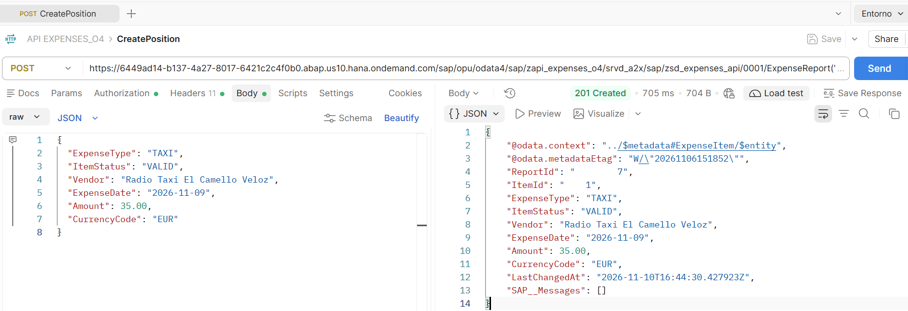

**STAR**
- **S:** informe en `OPEN`, sin gastos.
- **T:** añadir un gasto.
- **A:** `POST` por la navegación `_Items`, porque la posición no se puede crear directamente (`Insertable = false`).
- **R:** `201` con `ItemId: 1`. El total de la cabecera pasó de 0,00 a **35,00**: la determination `updateHeaderTotal` se ejecuta también por la API.

---

## 3. Registro del fichero

`POST {BASE_V4}/ExpenseItem(ReportId='%20%20%20%20%20%20%20%207',ItemId='%20%20%20%201')/_Attachments` ✅

```json
{
  "Description": "Factura del hotel"
}
```

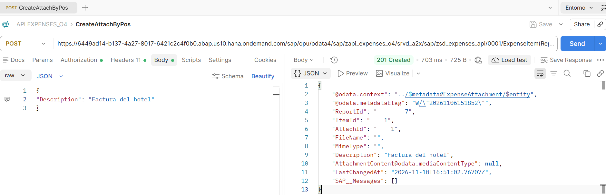

**STAR**
- **S:** la app crea el adjunto en dos tiempos: primero el registro y luego el fichero.
- **T:** replicar ese flujo por la API.
- **A:** `POST` por la navegación `_Attachments` con solo `Description`, la única obligatoria. La primera vez se envió también `FileName` y `MimeType`, y en la app el adjunto quedó a medias.
- **R:** `201` con `AttachId: 1`, sin fichero todavía.

### 3.1 Binario (PUT)

`PUT {BASE_V4}/ExpenseAttachment(ReportId='%20%20%20%20%20%20%20%207',ItemId='%20%20%20%201',AttachId='%20%20%20%201')/AttachmentContent` ✅

- Headers: `Content-Type: application/pdf`
- Body: *binary* (el PDF). No es JSON.

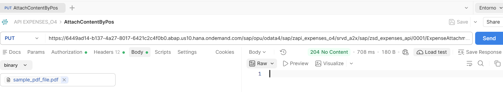

Tras el PUT: hay contenido y MimeType, pero FileName vacío

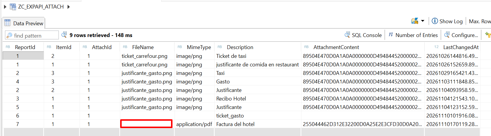

**STAR**
- **S:** `AttachmentContent` es un `Edm.Stream`: el fichero no puede ir dentro del JSON.
- **T:** subir el PDF al adjunto.
- **A:** `PUT` a `…/AttachmentContent` con el `Content-Type` del fichero y los bytes como body.
- **R:** `204`. El contenido se guarda y `MimeType` se informa solo, pero **el `PUT` deja vacío el `FileName`**.

### 3.2 Nombre (PATCH)

`PATCH {BASE_V4}/ExpenseAttachment(ReportId='%20%20%20%20%20%20%20%207',ItemId='%20%20%20%201',AttachId='%20%20%20%201')` ✅

- Headers: `Content-Type: application/json` (sin `/AttachmentContent` en la URL)

```json
{
  "FileName": "Factura del hotel.pdf"
}
```


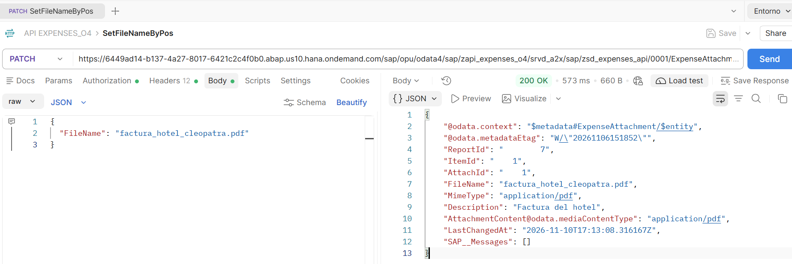

**STAR**
- **S:** tras el `PUT` el adjunto no tiene nombre y la app no muestra el enlace al fichero.
- **T:** informar `FileName`.
- **A:** `PATCH` al adjunto, no al `/AttachmentContent` (ese segmento solo admite `PUT` y `GET`), con `Content-Type: application/json`.
- **R:** el nombre aparece en el Data Preview y la app muestra el PDF enlazado (captura de la portada). Orden que funciona: registro → `PUT` → `PATCH`.

---

## 4. Deep insert

`POST {BASE_V4}/ExpenseReport` ✅

```json
{
  "CustomerID": "121",
  "ReportDate": "2026-11-10",
  "Reason": "Viaje a El Cairo - deep insert",
  "_Items": [
    {
      "ExpenseType": "TAXI",
      "ItemStatus": "VALID",
      "Vendor": "Radio Taxi El Camello Veloz",
      "ExpenseDate": "2026-11-09",
      "Amount": 35.00,
      "CurrencyCode": "EUR"
    },
    {
      "ExpenseType": "HOTEL",
      "ItemStatus": "VALID",
      "Vendor": "Hotel Cleopatra",
      "ExpenseDate": "2026-11-09",
      "Amount": 120.00,
      "CurrencyCode": "EUR",
      "_Attachments": [
        { "Description": "Factura del hotel" }
      ]
    }
  ]
}
```

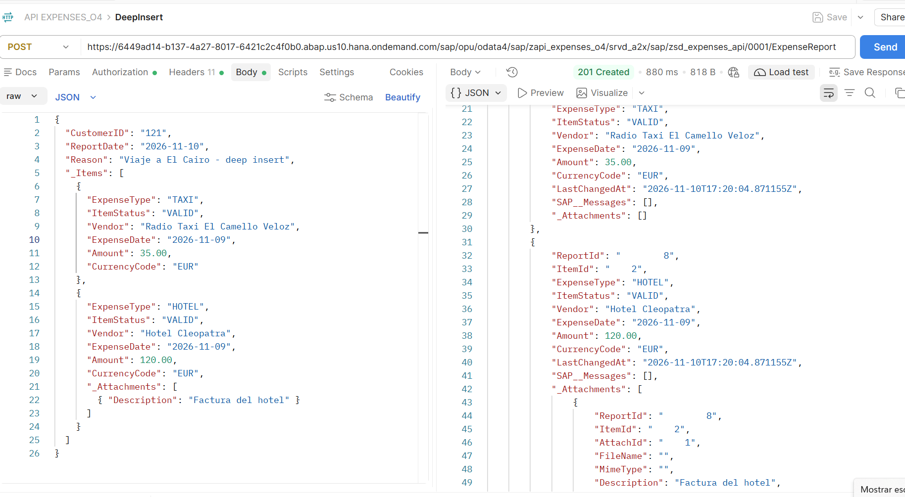

**STAR**
- **S:** crear un informe con posición y adjunto costaba tres llamadas.
- **T:** crear los tres niveles en una sola.
- **A:** `POST` a la cabecera con `_Items` y `_Attachments` anidados, sin ninguna clave en el body.
- **R:** `201`. La numeración temprana asignó `ReportId 8`, `ItemId 1` y `2`, `AttachId 1`, y el total salió ya en **155,00**. El binario no puede viajar aquí: sigue yendo aparte (3.1 y 3.2).

---

## 5. send

`POST {BASE_V4}/ExpenseReport(ReportId='%20%20%20%20%20%20%20%206')/com.sap.gateway.srvd_a2x.zsd_expenses_api.v0001.send`

- Estado necesario: `OPEN`.

Informe en OPEN antes del send

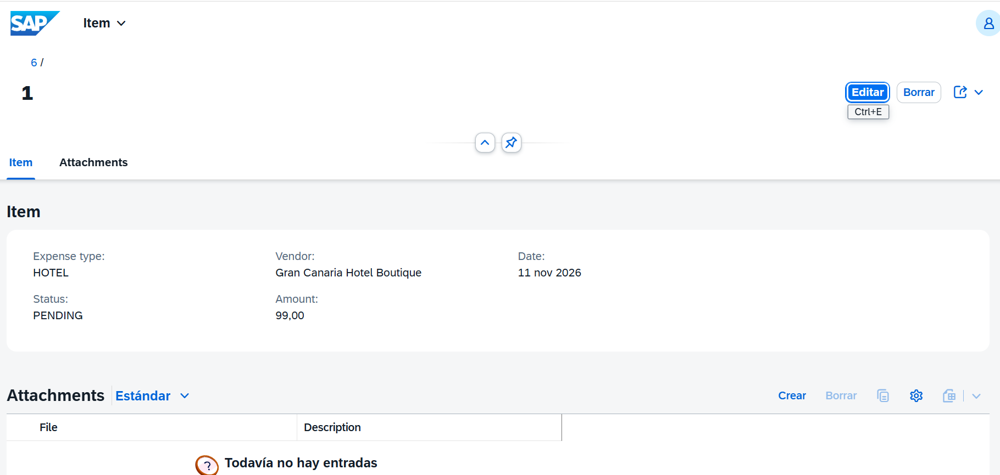

**Sin adjunto en un gasto de más de 50 EUR** ✅

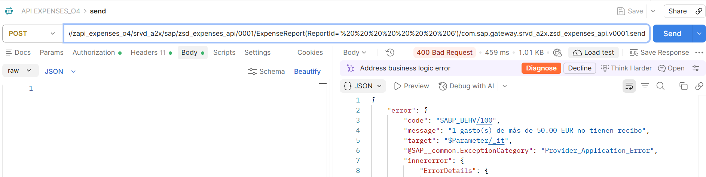

```json
{
  "error": {
    "code": "SABP_BEHV/100",
    "message": "1 gasto(s) de más de 50.00 EUR no tienen recibo",
    "target": "$Parameter/_it"
  }
}
```

**Con el adjunto creado** ✅ (aunque estuviera vacío) → `200`, `HeaderStatus: SENT`

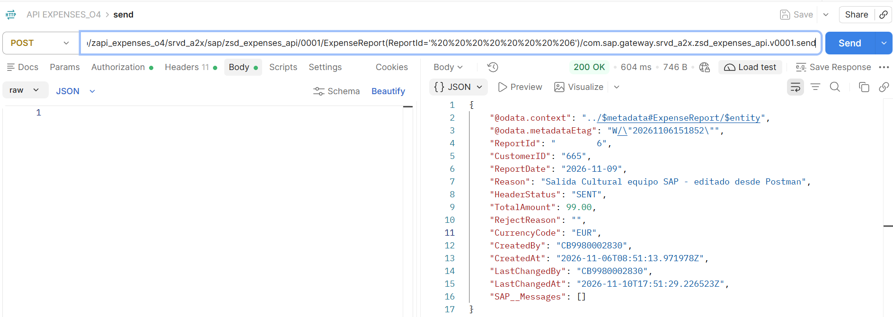

**Con el adjunto completo (fichero y nombre)** ⏳

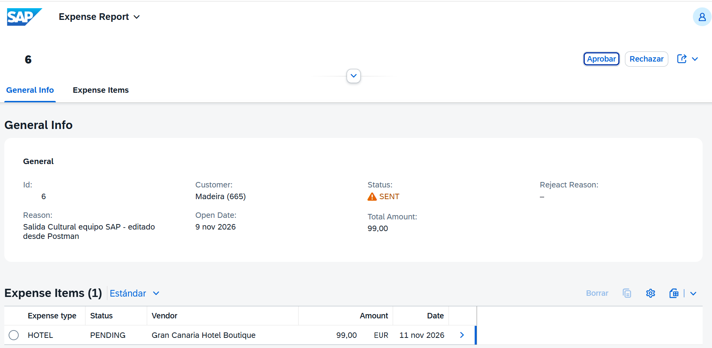

**STAR**
- **S:** `send` exige un recibo en cada gasto de más de 50 EUR.
- **T:** comprobar que la API aplica la misma regla que la app.
- **A:** `POST` a la acción ligada `send`, primero sin adjunto y luego con él. Se leyó el método en el behavior y se depuró en ADT.
- **R:** sin adjunto, error de negocio `SABP_BEHV/100`. Con adjunto, pasa a `SENT`. La regla comprueba que **exista el registro**, no que tenga fichero: un adjunto vacío también la cumple, en la API y en la app.

---

## 6. approve ⏳

`POST {BASE_V4}/ExpenseReport(ReportId='…')/com.sap.gateway.srvd_a2x.zsd_expenses_api.v0001.approve`

- Body vacío. Estado necesario: `SENT`.

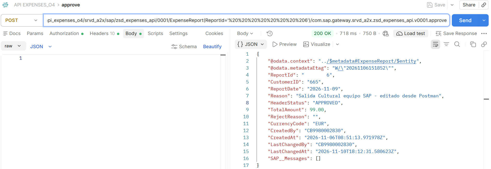

**STAR**
- **S:** un informe enviado espera aprobación.
- **T:** aprobarlo por la API.
- **A:** `POST` a la acción ligada `approve`.
- **R (esperado):** `200` y `HeaderStatus: APPROVED`. Fuera de `SENT`, error de negocio.

---

## 7. reject ⏳

`POST {BASE_V4}/ExpenseReport(ReportId='…')/com.sap.gateway.srvd_a2x.zsd_expenses_api.v0001.reject`

- Estado necesario: `SENT`.

```json
{
  "reason": "Falta el justificante del hotel"
}
```

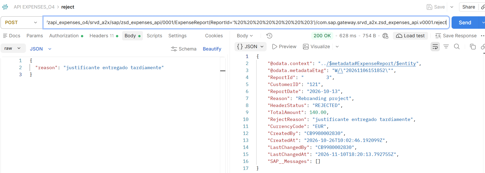

**STAR**
- **S:** un informe enviado puede rechazarse indicando el motivo.
- **T:** rechazarlo por la API con motivo.
- **A:** `POST` a la acción ligada `reject` con el parámetro `reason` (mínimo 10 caracteres).
- **R (esperado):** `200`, `HeaderStatus: REJECTED` y `RejectReason` informado. Con un motivo más corto, error.

---

## Apéndice A: conectar Postman con ABAP Environment (trial)

> La parte más costosa del proyecto, y por eso va documentada.

### Lo que no funciona en un trial

- **Basic Auth con Communication User:** necesita Communication Management, que no está disponible en el ABAP Environment trial compartido (KBA 3725960).
- **Role collections del cockpit:** no tienen relación con esto.
- **Grant type `Client Credentials`:** da un token sin usuario de negocio y el ABAP responde `401` con HTML de login.

### Lo que sí funciona: OAuth 2.0 Authorization Code con la Service Key

**Host:** `6449ad14-b137-4a27-8017-6421c2c4f0b0.abap.us10.hana.ondemand.com` (no el `abap-web`, que es el del navegador).

**Datos:** del bloque `uaa` de la Service Key: `url`, `clientid`, `clientsecret`.

> El `clientsecret` es un secreto: no se publica. Cuando termine el desarrollo, conviene borrar la key y crear otra.

**Entorno de Postman:** dos variables, `sap_client_id` y `sap_client_secret`, usadas con llaves dobles (`{{sap_client_id}}`).

| Campo | Valor |
|---|---|
| Grant type | **Authorization Code** |
| Callback URL | `http://localhost:8080` |
| Auth URL | `<uaa.url>/oauth/authorize` |
| Access Token URL | `<uaa.url>/oauth/token` |
| Client ID / Secret | `{{sap_client_id}}` / `{{sap_client_secret}}` |
| Client Authentication | Send as Basic Auth header |


**Pasos:** *Get New Access Token* → login con el usuario BTP → *Use Token* (`TokenForAllAbapADT`) → elegirlo en el desplegable *Token* de cada request.

> Al **duplicar** un request, el token no se hereda: hay que seleccionarlo de nuevo.

### Token CSRF (escrituras)

1. `GET` a cualquier URL del servicio con el header `X-CSRF-Token: Fetch`.
2. Copiar el valor del header `x-csrf-token` de la respuesta.
3. Usarlo en `X-CSRF-Token` de la escritura. Si da `403`, repetir.


