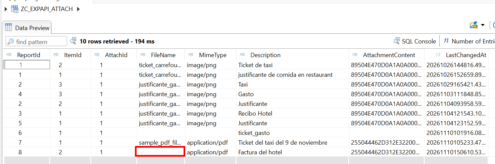
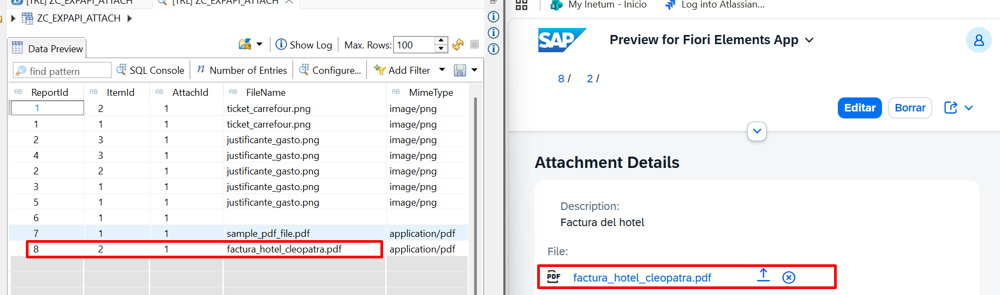

# ZEXPENSE2_API: una API Web OData V4 sobre un business object RAP existente

Proyecto de aprendizaje de **RAP (ABAP RESTful Application Programming Model)** en **SAP BTP ABAP Environment (Trial)**. Una app Fiori de informes de gastos que ya existía se expone ahora también como **API Web Cloud (OData V4)**, reutilizando el mismo business object (tablas, lógica y validaciones) y probada de punta a punta desde **Postman**.

- **Escenario de pruebas:** SAP BTP ABAP Environment (cuenta Trial, plan `shared`) + Postman.
- **Última actualización:** 2026-11-10.
- **Estado:** creación (simple y deep insert), lectura, modificación, subida y bajada de binarios y borrado en cascada probados. `send` probado en sus dos resultados (error y éxito). `approve`, `reject` y varios borrados quedan pendientes (ver [sección 12](#12-pendientes-e-ideas)).

> **Cómo se rellenan las capturas.** Cada ficha de prueba tiene un hueco de imagen con un nombre de fichero sugerido (`img/…png`). Se guarda la captura en la carpeta `img/`, junto a este README, con ese nombre, y aparece sola. Las que ya existen están marcadas con ✅.

---

## Qué demuestra este proyecto

| Capacidad | Dónde se ve |
|---|---|
| Reutilizar un BO RAP *managed* creando una **segunda capa de consumo** (proyecciones, behavior projection, service definition y binding) sin duplicar lógica | [3](#3-arquitectura-y-construcción) |
| Que la API **hereda** validaciones, determinaciones, acciones y feature control por estado | [10](#10-reglas-de-negocio-que-hereda-la-api), fichas 7.12 y 7.13 |
| Autenticarse desde un cliente externo contra ABAP Environment **sin Communication Management** (limitación del trial) | [4](#4-conectar-postman-con-abap-environment-trial) |
| Manejar `Edm.Stream` (binarios) y entender por qué la subida va en dos pasos | [Reto 2](#reto-2-adjuntos-binarios-y-el-put-que-borra-el-nombre), fichas 7.5 a 7.8 |
| Leer un `$metadata` OData V4 y deducir de él qué se puede enviar | [9](#9-cómo-leer-el-metadata-de-la-api) |
| **Deep insert** con numeración temprana en tres niveles | ficha 7.9 |
| Depurar en ADT una petición que llega desde un cliente externo | [Reto 4](#reto-4-la-regla-del-recibo-comprueba-el-registro-no-el-fichero) |

## Índice

1. [Retos resueltos (formato STAR)](#1-retos-resueltos-formato-star)
2. [Escenario de pruebas](#2-escenario-de-pruebas-abap-environment)
3. [Arquitectura y construcción](#3-arquitectura-y-construcción)
4. [Conectar Postman con ABAP Environment (trial)](#4-conectar-postman-con-abap-environment-trial)
5. [Convenciones de las pruebas](#5-convenciones-de-las-pruebas)
6. [Fichas de prueba: servicio V2 de la app (referencia)](#6-fichas-de-prueba-servicio-v2-de-la-app-referencia)
7. [Fichas de prueba: API V4](#7-fichas-de-prueba-api-v4)
8. [Hallazgos y lecciones](#8-hallazgos-y-lecciones)
9. [Cómo leer el `$metadata` de la API](#9-cómo-leer-el-metadata-de-la-api)
10. [Reglas de negocio que hereda la API](#10-reglas-de-negocio-que-hereda-la-api)
11. [Errores encontrados y soluciones](#11-errores-encontrados-y-soluciones)
12. [Pendientes e ideas](#12-pendientes-e-ideas)

---

## 1. Retos resueltos (formato STAR)

### Reto 1: conectar Postman con ABAP Environment en un trial

- **Situación.** Se quería probar la API desde Postman. El sistema es un ABAP Environment **Trial compartido**, donde las apps de Communication Management (Communication Systems, Arrangements y Users) **no están disponibles**.
- **Tarea.** Obtener una autenticación válida para un cliente externo, sin crear usuarios de comunicación.
- **Acción.** Se descartó Basic Auth (necesita Communication User) y las role collections del cockpit. Se probó `Client Credentials`, que devuelve un token sin usuario de negocio y el ABAP lo rechaza con un 401 y HTML de login. Se resolvió con **OAuth 2.0 Authorization Code** usando el bloque `uaa` de la Service Key, el host `abap` (no `abap-web`) y variables de entorno `{{sap_client_id}}` y `{{sap_client_secret}}`.
- **Resultado.** Lectura y escritura funcionando contra V2 y V4. Detalle completo en la [sección 4](#4-conectar-postman-con-abap-environment-trial).

### Reto 2: adjuntos binarios y el PUT que borra el nombre

- **Situación.** El adjunto tiene una propiedad `AttachmentContent` de tipo `Edm.Stream`. Se quería crear el informe completo en una sola llamada, binario incluido.
- **Tarea.** Subir el fichero y dejar `FileName` y `MimeType` coherentes, igual que hace la app.
- **Acción.** Se comprobó con el `$metadata` y con pruebas que un stream es un recurso aparte, que se sube con `PUT` a `…/AttachmentContent` y no puede ir dentro del JSON. Al probar a enviar `FileName` en el deep insert, el `PUT` posterior lo **dejó vacío** (captura en 7.10). `MimeType`, en cambio, lo informó el servidor a partir del `Content-Type`.
- **Resultado.** Flujo que funciona: crear adjunto → `PUT` del binario → `PATCH` de `FileName`. Se documenta el porqué y las alternativas (ver [8](#8-hallazgos-y-lecciones)).

### Reto 3: claves con espacios a la izquierda

- **Situación.** Los IDs que devuelve el servicio llevan espacios a la izquierda (`"        8"`), y las consultas por clave y los filtros fallaban o devolvían vacío.
- **Tarea.** Direccionar siempre el registro correcto.
- **Acción.** Se usó el valor exacto devuelto por el servicio, con cada espacio codificado como `%20`, y se copia el `uri` del propio registro en vez de escribirlo a mano.
- **Resultado.** Todas las URLs de este documento usan esa convención. El origen de los espacios (numeración temprana sobre un campo CHAR) sigue sin verificar.

### Reto 4: la regla del recibo comprueba el registro, no el fichero

- **Situación.** `send` exige un recibo en cada gasto de más de 50 EUR. Un `send` lanzado con un adjunto **vacío** pasó, y el informe quedó en `SENT`.
- **Tarea.** Entender qué valida exactamente la regla.
- **Acción.** Se leyó el método `send` del behavior: busca los enlaces `item → adjuntos` (`line_exists`) y no lee el fichero ni el nombre. Se comprobó que la app Fiori hace lo mismo. Después se borró el adjunto y el mismo `send` falló con `SABP_BEHV/100` (ficha 7.12). Se usó el debugger de ADT con un breakpoint externo para confirmar los datos en la línea de la condición.
- **Resultado.** Queda documentado el hueco ("la regla pide registro, no fichero") y el dilema de diseño que lo rodea (ver [8](#8-hallazgos-y-lecciones)).

### Reto 5: dar a la API su propio contrato sin duplicar lógica

- **Situación.** La app y la API debían comportarse igual, pero poder evolucionar por separado.
- **Tarea.** Exponer el mismo BO como API sin copiar tablas ni validaciones.
- **Acción.** Capa de consumo propia (`ZC_EXPAPI_*`), behavior projection propia y service definition y binding nuevos sobre el BO de interfaz compartido (`ZI_EXP_*`).
- **Resultado.** La API **hereda** estados, determinaciones y validaciones. Se vio, por ejemplo, el recálculo del total al crear posiciones por la API y el bloqueo de `send` por falta de recibo.

---

## 2. Escenario de pruebas (ABAP Environment)

| Elemento | Valor |
|---|---|
| Plataforma | SAP BTP, cuenta Trial, subaccount `trial`, región us10 |
| Servicio | ABAP environment, plan `shared` (instancia `default_abap-trial`) |
| Sistema / mandante | `TRL` / `100` |
| IDE | Eclipse con ABAP Development Tools (proyecto ABAP Cloud) |
| Cliente de pruebas | Postman |
| Paquete de la app | `ZEXPENSE2` |
| Paquete de la API | `ZEXPENSE2_API` |
| Instancia | Se detiene cada noche: arrancarla antes de probar |

**Hosts.** El mismo sistema tiene dos puertas:

| Host | Uso |
|---|---|
| `6449ad14-b137-4a27-8017-6421c2c4f0b0.abap-web.us10.hana.ondemand.com` | Navegador y Launchpad (login SSO). No sirve para Postman. |
| `6449ad14-b137-4a27-8017-6421c2c4f0b0.abap.us10.hana.ondemand.com` | **Postman** y cualquier cliente externo (token OAuth). |

**Datos de prueba.** Los informes de ejemplo usan un viaje ficticio a Egipto (cliente `121`, "Radio Taxi El Camello Veloz", "Hotel Cleopatra").

## 3. Arquitectura y construcción

Existe una app RAP (List Report + Object Page) de informes de gastos en el paquete `ZEXPENSE2`: **Carpeta de gastos** (root) → **Posición** (child) → **Adjunto** (grandchild). La solución es una **segunda capa de consumo** sobre el mismo business object:

```
Tablas Z ── CDS de interfaz ZI_* ── BDEF managed (lógica, clases ZBP_*)   ← compartido
                  ├── ZC_EXP_*     → app Fiori (V2, UI)                   ← ya existía
                  └── ZC_EXPAPI_*  → API Web (V4)                         ← nuevo (ZEXPENSE2_API)
```

### 3.1 Objetos reutilizados (no se copian)

- Tablas: `ZEXPENSE_HEADER`, `ZEXPENSE_ITEM`, `ZITEM_ATTACHMENT` y catálogos `ZEXPENSE_TYPE`, `ZHEADER_STATUS`, `ZITEM_STATUS`, `ZMIME_TYPE`.
- CDS de interfaz: `ZI_EXP_HEADER`, `ZI_EXP_ITEMM`, `ZI_EXP_ATTACH`, value helps `ZVH_*`, `ZA_EXP_REJECT_PARAM`.
- Behavior definition managed de `ZI_EXP_HEADER` (sin draft, numeración temprana, etag `last_changed_at`) y clases `ZBP_ZI_EXP_HEADER`, `ZBP_ZI_EXP_ITEMM`, `ZBP_ZI_EXP_ATTACH`.

### 3.2 Objetos nuevos (paquete `ZEXPENSE2_API`)

| Objeto | Nombre | Descripción |
|---|---|---|
| CDS de consumo (root) | `ZC_EXPAPI_HEADER` | Expense Report - API Projection |
| CDS de consumo (hijo) | `ZC_EXPAPI_ITEM` | Expense Item - API Projection |
| CDS de consumo (nieto) | `ZC_EXPAPI_ATTACH` | Expense Attachment - API Projection |
| Behavior projection | `ZC_EXPAPI_HEADER` | Behavior Projection - Expense API |
| Service definition | `ZSD_EXPENSES_API` | Expense API - Service Definition |
| Service binding | `ZAPI_EXPENSES_O4` | Expense API - Web API (OData V4 - Web API) |

Alias expuestos en la service definition: `ExpenseReport`, `ExpenseItem`, `ExpenseAttachment`.

📷 **Captura sugerida:** `img/arq-01-arbol-paquete-adt.png` (árbol del paquete `ZEXPENSE2_API` en ADT).


### 3.3 Pasos seguidos

1. **Paquete** `ZEXPENSE2_API`, con el mismo software component y transport layer que `ZEXPENSE2`.
2. **Tres CDS de consumo** nuevas, proyectando `ZI_EXP_HEADER`, `ZI_EXP_ITEMM` y `ZI_EXP_ATTACH`. Se partió de las `ZC_EXP_*` de la app, y se ajustó:
   - Las asociaciones se redirigen a las **proyecciones nuevas**, nunca a las `ZC_EXP_*` (si no, la API quedaría atada a la capa de la UI).
   - El provider contract (`transactional_query`) va solo en la proyección raíz.
   - En el adjunto se conserva la anotación de objeto grande (`@Semantics.largeObject`), que genera la propiedad binaria `AttachmentContent`.
   - Sin metadata extensions: no hay UI.
3. **Behavior projection** `ZC_EXPAPI_HEADER`, con la misma oferta que la app:

   | Entidad | Operaciones | Acciones | Crear hijos |
   |---|---|---|---|
   | `ZC_EXPAPI_HEADER` | crear, modificar, borrar | `send`, `approve`, `reject` | ítems |
   | `ZC_EXPAPI_ITEM` | modificar, borrar | ninguna | adjuntos |
   | `ZC_EXPAPI_ATTACH` | modificar, borrar | ninguna | ninguno |

   Cada hijo expone además su asociación al padre. Rol: `Implementation Type = Projection`, y la raíz es la **vista de proyección nueva**, no `ZI_EXP_HEADER`.
4. **Service definition** `ZSD_EXPENSES_API` con las tres entidades.
5. **Service binding** `ZAPI_EXPENSES_O4`, tipo *OData V4 - Web API*, y **Publish**.

### 3.4 Por qué se hizo así

- **Contrato independiente de la UI.** App y API evolucionan por separado: cambiar un campo para una pantalla no rompe a un consumidor de la API.
- **Behavior de proyección propio.** Está atado a una vista de proyección concreta. Una proyección sin él es de solo lectura. No duplica lógica: solo decide qué se ofrece.
- **¿Dónde está el enlace con el BDEF de interfaz?** No está escrito en el BDEF de proyección. Lo hace la vista (`as projection on ZI_EXP_HEADER`) y el sistema comprueba cada `use` contra el BO base al activar. Se comprueba con Ctrl+clic.
- **Las metadata extensions** de la app están ligadas a las vistas `ZC_EXP_*`; una proyección con otro nombre parte limpia, sin anotaciones de UI.
- **El protocolo se elige en el binding**, no en las vistas ni en el behavior. Pasar a V2 sería otro binding sobre la misma definición.
- **V4** es la opción recomendada por SAP para servicios transaccionales nuevos. Convención de nombre de binding Web API: prefijo `API_`, sufijo `_O4`.

## 4. Conectar Postman con ABAP Environment (trial)

> Esta fue la parte más costosa del proyecto. Se documenta con detalle.

### 4.1 Lo que NO funciona en un trial

- **Basic Auth con Communication User.** Requiere Communication Management, cuyas apps **no están disponibles en el ABAP Environment trial compartido** (limitación de SAP, ver KBA 3725960). El Communication Scenario `ZEXPENSES_SCEN` creado en ADT no sirve para este fin.
- **Role collections de BTP.** Los roles de Communication Management no se gestionan en el cockpit, y las role collections del subaccount (Build Apps, Build Code, BAS, etc.) no tienen relación.
- **Grant type `Client Credentials`.** Genera un token sin usuario de negocio que el ABAP rechaza (401 con página de login en HTML).

### 4.2 Lo que SÍ funciona: OAuth 2.0 Authorization Code con la Service Key

**Datos de la Service Key** (cockpit → Instances and Subscriptions → instancia ABAP → Service Keys). Del bloque `uaa`: `url`, `clientid` y `clientsecret`. La `url` de la raíz del JSON es la del sistema ABAP y es otra cosa.

> El `clientsecret` es un secreto: no se publica ni se comparte. Cuando termine el desarrollo conviene borrar la key y crear otra.

**Entorno de Postman** (pestaña *Environments*): dos variables, `sap_client_id` y `sap_client_secret`, con los valores del bloque `uaa`. Se usan con llaves dobles, `{{sap_client_id}}`. Sin llaves, Postman envía el texto literal y SAP responde *No client with requested id*. El entorno debe estar **seleccionado** (selector arriba a la derecha).

**Configuración OAuth 2.0** (pestaña *Authorization* de la colección o del request):

| Campo | Valor |
|---|---|
| Auth type | OAuth 2.0 |
| Add authorization data to | Request Headers |
| Grant type | **Authorization Code** |
| Callback URL | `http://localhost:8080` |
| Auth URL | `<uaa.url>/oauth/authorize` |
| Access Token URL | `<uaa.url>/oauth/token` |
| Client ID | `{{sap_client_id}}` |
| Client Secret | `{{sap_client_secret}}` |
| Scope | vacío |
| Client Authentication | Send as Basic Auth header |

📷 **Captura sugerida:** `img/conexion-01-oauth-postman.png` (pestaña Authorization **sin** mostrar el secreto).


Pasos:

1. **Get New Access Token** → se abre el login → *Default Identity Provider* → entrar con el usuario BTP.
2. Aparece *Authentication complete* → **Use Token**. Nombre del token usado: `TokenForAllAbapADT`.
3. En cada request, en *Authorization*, elegir ese token en el desplegable **Token**.

> **Importante:** al **duplicar** un request, el token **no** se hereda. Hay que seleccionarlo en el desplegable *Token* de cada request nuevo. Olvidarlo produce un 401 que parece de configuración.

El token caduca: ante un 401, generar uno nuevo y volver a seleccionarlo.

### 4.3 Token CSRF (obligatorio en escrituras)

Las llamadas `POST`, `PATCH`, `PUT` y `DELETE` necesitan `X-CSRF-Token`.

1. `GET` a cualquier URL del servicio con el header `X-CSRF-Token: Fetch`.
2. En la respuesta, copiar el valor del header `x-csrf-token`.
3. Usarlo en el header `X-CSRF-Token` de la escritura. Postman guarda además la cookie de sesión (`sap-XSRF_TRL_100`), a la que va ligado el token.
4. Si la escritura devuelve 403, repetir el paso 1.
5. Si una acción o un borrado devuelve `428`, añadir `If-Match: *` (etag `LastChangedAt`).

📷 **Captura sugerida:** `img/conexion-02-csrf-fetch.png` (GET con `X-CSRF-Token: Fetch` y el header de respuesta).


## 5. Convenciones de las pruebas

**URLs base** (host `abap`, sin `-web`):

```
BASE_V2 = https://6449ad14-b137-4a27-8017-6421c2c4f0b0.abap.us10.hana.ondemand.com/sap/opu/odata/sap/ZUI_EXPENSES_O2
BASE_V4 = https://6449ad14-b137-4a27-8017-6421c2c4f0b0.abap.us10.hana.ondemand.com/sap/opu/odata4/sap/zapi_expenses_o4/srvd_a2x/sap/zsd_expenses_api/0001
```

**Claves de las entidades.** Los IDs devueltos por el servicio llevan **espacios a la izquierda**, que en la URL van como `%20`. Se usa siempre el valor **tal cual lo devuelve el servicio**.

| Entidad | Clave de ejemplo (informe 8, posición 2, adjunto 1) |
|---|---|
| `ExpenseReport` | `ExpenseReport(ReportId='%20%20%20%20%20%20%20%208')` |
| `ExpenseItem` | `ExpenseItem(ReportId='%20%20%20%20%20%20%20%208',ItemId='%20%20%20%202')` |
| `ExpenseAttachment` | `ExpenseAttachment(ReportId='%20%20%20%20%20%20%20%208',ItemId='%20%20%20%202',AttachId='%20%20%20%201')` |

En V4 la clave compuesta va dentro de un solo paréntesis, con nombre de campo (`ReportId='...',ItemId='...'`). En V2 la sintaxis es distinta.

**Acciones ligadas.** Se invocan con `POST` a la entidad más el nombre calificado de la acción: `…/ExpenseReport(ReportId='…')/com.sap.gateway.srvd_a2x.zsd_expenses_api.v0001.send`. El namespace sale del `$metadata`.

**Ids reutilizados.** La numeración temprana calcula el máximo más uno, así que si se borra el informe con el id más alto, el siguiente que se cree **reutiliza ese número**. Por eso aparecen dos informes distintos con `ReportId` 8 en este documento (uno borrado y otro creado después).

**Leyenda de requisitos y estado de las fichas:**

- **Token:** OAuth 2.0 (`TokenForAllAbapADT`) seleccionado en el request.
- **CSRF:** `X-CSRF-Token` vigente (solo escrituras).
- **Estado:** estado que debe tener el informe para que la operación se acepte.
- ✅ probada · ⏳ pendiente.

## 6. Fichas de prueba: servicio V2 de la app (referencia)

Servicio de la app, `ZUI_EXPENSES_O2` (OData V2 - UI). Se usó para validar la conectividad antes de construir la API.

### 6.1 Contar informes ✅

| | |
|---|---|
| Entidad / operación | `ExpenseReport`, contar |
| Petición | `GET {BASE_V2}/ExpenseReport/$count` |
| Requisitos | Token |
| Resultado | `200`, devuelve `5` (los registros existentes) |
| Nota | En V2 no vale `$count=true` (es de V4). Alternativa: `?$inlinecount=allpages&$format=json`. |

📷 `img/v2-01-count.png`


### 6.2 Leer informes ✅

| | |
|---|---|
| Entidad / operación | `ExpenseReport`, leer lista |
| Petición | `GET {BASE_V2}/ExpenseReport` |
| Requisitos | Token |
| Resultado | `200`, XML (Atom) por defecto. Añadir `?$format=json` para JSON. |
| Nota | Para reutilizar la clave de un registro, copiar el `uri` de `__metadata`. |

📷 `img/v2-02-read.png`


### 6.3 Obtener el token CSRF ✅

| | |
|---|---|
| Petición | `GET {BASE_V2}/ExpenseReport` con header `X-CSRF-Token: Fetch` |
| Requisitos | Token |
| Resultado | `200`; el valor viene en el header `x-csrf-token` de la respuesta |

### 6.4 Modificar el motivo de un informe ✅

| | |
|---|---|
| Entidad / operación | `ExpenseReport`, modificar (`PATCH`) |
| Petición | `PATCH {BASE_V2}/ExpenseReport('%20%20%20%20%20%20%20%206')` |
| Headers | Token, `X-CSRF-Token`, `Content-Type: application/json`, `Accept: application/json` |
| Estado | `OPEN` (el informe 6 se creó desde la app) |
| Body | `{ "Reason": "Salida Cultural equipo SAP - editado desde Postman" }` |
| Resultado | `204 No Content`. La app Fiori muestra el nuevo valor. |
| Nota | El informe 4 (`REJECTED`) no se podía editar en la UI: la API respeta la misma regla. `RejectReason` no es editable: solo lo escribe la acción `reject`. |

📷 `img/v2-03-patch-reason.png`


## 7. Fichas de prueba: API V4

Todas con `BASE_V4`. Requisitos comunes: **Token** seleccionado; escrituras con **CSRF**.

### 7.1 Contar informes ✅

| | |
|---|---|
| Entidad / operación | `ExpenseReport`, contar |
| Petición | `GET {BASE_V4}/ExpenseReport/$count` |
| Requisitos | Token |
| Resultado | `200`, devuelve `6` (5 originales + 1 creado desde la app) |

📷 `img/v4-01-count.png`


### 7.2 Crear una cabecera ✅

| | |
|---|---|
| Entidad / operación | `ExpenseReport`, crear (`POST`) |
| Petición | `POST {BASE_V4}/ExpenseReport` |
| Headers | Token, `X-CSRF-Token`, `Content-Type: application/json` |
| Campos | Solo los obligatorios (`FieldControl/Mandatory` en el metadata): `CustomerID`, `ReportDate`, `Reason`. El resto es `Core.Computed`. |

Body:

```json
{
  "CustomerID": "665",
  "ReportDate": "2026-11-10",
  "Reason": "Visita a cliente en Madrid - noviembre"
}
```

Resultado: la respuesta devuelve el informe creado con `ReportId: "        7"`, `HeaderStatus: "OPEN"`, `TotalAmount: 0.00`, `CurrencyCode: "EUR"`, `CreatedBy` y `LastChangedBy` con el usuario que llama, y `SAP__Messages` vacío.

Nota: `CurrencyCode` de la cabecera es solo lectura (lo asigna la determination `setStatusDefault`). Apuntar el `ReportId` exacto para las pruebas siguientes.

📷 `img/v4-02-post-cabecera.png`


### 7.3 Crear una posición dentro de una cabecera ✅

| | |
|---|---|
| Entidad / operación | `ExpenseItem`, crear por la navegación `_Items` |
| Petición | `POST {BASE_V4}/ExpenseReport(ReportId='%20%20%20%20%20%20%20%207')/_Items` |
| Headers | Token, `X-CSRF-Token`, `Content-Type: application/json` |
| Estado | `OPEN` (la creación de hijos se bloquea fuera de `OPEN`) |
| Metadata | `NavigationRestrictions` de `ExpenseReport`: `_Items` con `Insertable = true` |

Body (obligatorios: `ExpenseType`, `ExpenseDate`, `Amount`; `Vendor`, `ItemStatus` y `CurrencyCode` no admiten nulo):

```json
{
  "ExpenseType": "TAXI",
  "ItemStatus": "VALID",
  "Vendor": "Radio Taxi Madrid",
  "ExpenseDate": "2026-11-09",
  "Amount": 35.00,
  "CurrencyCode": "EUR"
}
```

Resultado: devuelve la posición con `ItemId: "    1"`. Comprobado en la app Fiori: el informe 7 muestra la posición y su `Total Amount` pasó de 0,00 a **35,00**, es decir, la determination `updateHeaderTotal` se ejecutó.

Valores válidos: `ExpenseType` = `HOTEL`, `TAXI`, `MEAL`, `KM` (catálogo `ZEXPENSE_TYPE`); `ItemStatus` = `VALID`, `PENDING`, `OBSERVED`. La API **no** expone una URL para consultarlos (ver pendientes).

📷 `img/v4-03-post-posicion.png`


### 7.4 Crear un adjunto (solo la entidad) ✅

El flujo es en **dos tiempos**, como la app: primero la entidad, luego el fichero.

| | |
|---|---|
| Entidad / operación | `ExpenseAttachment`, crear por la navegación `_Attachments` |
| Petición | `POST {BASE_V4}/ExpenseItem(ReportId='%20%20%20%20%20%20%20%207',ItemId='%20%20%20%201')/_Attachments` |
| Headers | Token, `X-CSRF-Token`, `Content-Type: application/json` |
| Estado | `OPEN` |

Body (solo `Description`, que es el campo con `FieldControl/Mandatory`):

```json
{
  "Description": "Ticket del taxi del 9 de noviembre"
}
```

Resultado: devuelve el adjunto con `AttachId: "    1"` y el binario sin informar todavía.

Nota: la primera vez se envió también `FileName` y `MimeType`, y en la app el adjunto quedó a medias (con nombre pero sin fichero).

📷 `img/v4-04-post-adjunto.png`


### 7.5 Subir el contenido binario del adjunto ✅

| | |
|---|---|
| Entidad / operación | `ExpenseAttachment`, propiedad `AttachmentContent` (`Edm.Stream`), subir (`PUT`) |
| Petición | `PUT {BASE_V4}/ExpenseAttachment(ReportId='%20%20%20%20%20%20%20%207',ItemId='%20%20%20%201',AttachId='%20%20%20%201')/AttachmentContent` |
| Headers | Token, `X-CSRF-Token`, `Content-Type: application/pdf` (debe coincidir con el fichero) |
| Body | Postman: *Body → binary → Select File* (PDF). No es JSON. |
| Resultado | `204 No Content`. `MimeType` queda informado por el servidor. En la app aparece el icono de PDF con las acciones de subir y borrar. |

Nota: el cuerpo del `PUT` son solo los bytes del archivo. **El nombre no puede ir en el body**, y este `PUT` **deja vacío el `FileName`** (ver 7.10).

📷 `img/v4-05-put-binario.png`


### 7.6 Poner el nombre del fichero ✅

Tras el `PUT`, el adjunto no tiene nombre y la app no muestra un enlace para abrir el fichero. Se resuelve informando `FileName` con una llamada propia.

| | |
|---|---|
| Entidad / operación | `ExpenseAttachment`, modificar (`PATCH`) |
| Petición | `PATCH {BASE_V4}/ExpenseAttachment(ReportId='%20%20%20%20%20%20%20%207',ItemId='%20%20%20%201',AttachId='%20%20%20%201')` |
| Headers | Token, `X-CSRF-Token`, **`Content-Type: application/json`** |
| Body | `{ "FileName": "sample_pdf_file.pdf" }` |
| Resultado | `FileName` informado (verificado con un `GET`, 7.7, y en el Data Preview). |

Errores típicos de esta llamada: ver sección 11 (`NOT_ALLOWED` y `UNSUPP_MEDIA_TYPE`).

📷 `img/v4-06-patch-filename.png`


### 7.7 Leer el adjunto (metadatos) ✅

| | |
|---|---|
| Petición | `GET {BASE_V4}/ExpenseAttachment(ReportId='%20%20%20%20%20%20%20%207',ItemId='%20%20%20%201',AttachId='%20%20%20%201')` |
| Requisitos | Token |
| Resultado | `200`, con `FileName: "sample_pdf_file.pdf"`, `MimeType: "application/pdf"`, `Description` y `AttachmentContent@odata.mediaContentType: "application/pdf"` |

📷 `img/v4-07-get-adjunto.png`


### 7.8 Leer el binario del adjunto ✅

| | |
|---|---|
| Petición | `GET {BASE_V4}/ExpenseAttachment(ReportId='%20%20%20%20%20%20%20%207',ItemId='%20%20%20%201',AttachId='%20%20%20%201')/AttachmentContent` |
| Requisitos | Token |
| Resultado | `200`, devuelve el PDF subido. En Postman se ve en la pestaña *Preview* o con *Save Response → Save to a file*. |
| Verificación cruzada | El mismo fichero se abre desde la app Fiori. |

📷 `img/v4-08-get-binario.png`


### 7.9 Deep insert: cabecera, posiciones y adjuntos en una sola llamada ✅

| | |
|---|---|
| Entidad / operación | `ExpenseReport`, crear con hijos anidados (`POST`) |
| Petición | `POST {BASE_V4}/ExpenseReport` |
| Headers | Token, `X-CSRF-Token`, `Content-Type: application/json` |
| Metadata | `NavigationRestrictions`: `_Items` (en cabecera) y `_Attachments` (en posición) con `Insertable = true`; `DeepUpdateSupport/ContentIDSupported` |
| Requisitos | Ninguna clave en el body: las asigna el servidor (numeración temprana) |

Body:

```json
{
  "CustomerID": "121",
  "ReportDate": "2026-11-10",
  "Reason": "Viaje a El Cairo - deep insert",
  "_Items": [
    {
      "ExpenseType": "TAXI",
      "ItemStatus": "VALID",
      "Vendor": "Radio Taxi El Camello veloz",
      "ExpenseDate": "2026-11-09",
      "Amount": 35.00,
      "CurrencyCode": "EUR"
    },
    {
      "ExpenseType": "HOTEL",
      "ItemStatus": "VALID",
      "Vendor": "Hotel Cleopatra",
      "ExpenseDate": "2026-11-09",
      "Amount": 120.00,
      "CurrencyCode": "EUR",
      "_Attachments": [
        { "Description": "Factura del hotel" }
      ]
    }
  ]
}
```

Resultado: `201 Created`, con los tres niveles en la respuesta. La numeración temprana asignó `ReportId` 8, `ItemId` 1 y 2, y `AttachId` 1 (en el item 2). `TotalAmount` fue **155.00**: la determination de suma también se ejecuta en un deep insert. El adjunto nace sin fichero (`MimeType` vacío y `AttachmentContent@odata.mediaContentType: null`).

Nota: el binario **no puede viajar** en esta llamada (es un `Edm.Stream`). Se sube después con el `PUT` de 7.5.

📷 `img/v4-09-deep-insert.png`


### 7.10 Deep insert con `FileName` y `PUT` posterior ✅

Se probó a enviar el nombre del fichero en el propio deep insert para ahorrar el `PATCH`.

| | |
|---|---|
| Petición 1 | `POST {BASE_V4}/ExpenseReport`, mismo body que 7.9 con `"FileName": "factura_hotel_cleopatra.pdf"` dentro del adjunto |
| Resultado 1 | `201`. El adjunto nace con `FileName` informado y `MimeType` vacío. |
| Petición 2 | `PUT` del PDF a `…/ExpenseAttachment(ReportId='%20%20%20%20%20%20%20%208',ItemId='%20%20%20%202',AttachId='%20%20%20%201')/AttachmentContent` con `Content-Type: application/pdf` |
| Resultado 2 | El contenido **sí** se guardó y `MimeType` quedó en `application/pdf`, pero **`FileName` quedó vacío**. |
| Corrección | `PATCH` de 7.6 con `{ "FileName": "factura_hotel_cleopatra.pdf" }`. |

**Conclusión:** enviar `FileName` en el deep insert no sirve si luego se hace el `PUT`, porque el `PUT` lo pisa. El orden que funciona es: crear → `PUT` → `PATCH`. La causa exacta (probablemente el framework actualiza `FileName` desde la cabecera `Content-Disposition` de la petición, que no se manda) está **sin verificar**.

📷 `img/v4-10b-put-borra-filename-adt.png` ✅ (Data Preview de `ZC_EXPAPI_ATTACH`: fila 8/2/1 con contenido y `MimeType` pero sin `FileName`)



### 7.11 Borrar una cabecera y comprobar la cascada ✅

| | |
|---|---|
| Entidad / operación | `ExpenseReport`, borrar (`DELETE`) |
| Petición | `DELETE {BASE_V4}/ExpenseReport(ReportId='%20%20%20%20%20%20%20%208')` |
| Headers | Token, `X-CSRF-Token` (sin body ni `Content-Type`). Si da `428`, añadir `If-Match: *`. |
| Estado | `OPEN` (el feature control deshabilita el borrado en cualquier otro estado) |
| Metadata | `OnDelete Action="Cascade"` en `_Items` y `_Attachments` |
| Resultado | `204 No Content`. La cabecera y sus posiciones desaparecieron. |

Nota: el adjunto se había borrado antes, así que esta prueba **no demuestra** el borrado hasta el tercer nivel (ver 7.18).

📷 `img/v4-11-delete-cabecera.png`


### 7.12 Enviar un informe sin recibo (error de negocio) ✅

| | |
|---|---|
| Entidad / operación | `ExpenseReport`, acción ligada `send` |
| Petición | `POST {BASE_V4}/ExpenseReport(ReportId='%20%20%20%20%20%20%20%208')/com.sap.gateway.srvd_a2x.zsd_expenses_api.v0001.send` |
| Headers | Token, `X-CSRF-Token`, `Content-Type: application/json`. Body vacío (la acción no tiene parámetros). |
| Estado | `OPEN` |
| Escenario | Informe con un item de 120 EUR (más de 50) **sin ningún adjunto** (se había borrado) |
| Resultado | Error de negocio de la regla de recibos |

Respuesta (resumida):

```json
{
  "error": {
    "code": "SABP_BEHV/100",
    "message": "1 gasto(s) de más de 50.00 EUR no tienen recibo",
    "target": "$Parameter/_it",
    "@SAP__common.ExceptionCategory": "Provider_Application_Error"
  }
}
```

El informe **no** cambia de estado. Es el mensaje del método `send` del behavior: la API devuelve los mensajes de negocio como errores OData V4 con código `SABP_BEHV/100`.

📷 `img/v4-12-send-error-sin-recibo.png`


### 7.13 Enviar un informe con adjunto vacío (la regla pasa) ✅

| | |
|---|---|
| Entidad / operación | `ExpenseReport`, acción `send` |
| Petición | La misma de 7.12 |
| Escenario | Informe 8 (primera versión, "Viaje a El Cairo"), con el item de 120 EUR y un adjunto **sin fichero ni nombre** |
| Resultado | `200 OK`, `HeaderStatus: "SENT"`, `TotalAmount: 155.00` |

**Lectura:** la regla de recibos comprueba que **exista** el registro del adjunto, no que tenga contenido (ver [8](#8-hallazgos-y-lecciones)). La app Fiori se comporta igual.

Tras esta prueba el informe quedó en `SENT` y no hay forma de reabrirlo por la API (ver [8](#8-hallazgos-y-lecciones)). Para repetir pruebas se usó una clase auxiliar de un solo uso (ya borrada) que puso el estado de nuevo en `OPEN` directamente en la tabla, saltándose el BO. Solo es válido en un entorno de pruebas.

📷 `img/v4-13-send-ok-adjunto-vacio.png`


📷 `img/app-informe8-open-tras-reapertura.png` ✅ (la app muestra el informe 8 otra vez en `OPEN` tras la reapertura de pruebas)


### 7.14 Informe completo creado por la API, visto en ADT y en la app ✅

Con el flujo completo (deep insert → `PUT` → `PATCH`), el informe 8 (viaje a Giza) queda con el adjunto en el mismo estado que si se hubiera creado desde la app.

| | |
|---|---|
| Verificación 1 | Data Preview de `ZC_EXPAPI_ATTACH`: fila 8/2/1 con `FileName` = `factura_hotel_cleopatra.pdf` y `MimeType` = `application/pdf` |
| Verificación 2 | App Fiori, *Attachment Details*: descripción "Factura del hotel" y el PDF enlazado con su nombre |

Esto demuestra el objetivo del proyecto: **lo que crea la API lo ve la app**, porque es el mismo business object.

📷 `img/v4-14-adjunto-completo-adt-y-app.png` ✅



### 7.15 Enviar con adjunto completo ⏳

| | |
|---|---|
| Petición | La de 7.12 sobre el informe con adjunto y fichero completos |
| Esperado | `200`, `HeaderStatus: "SENT"` |

📷 `img/v4-15-send-ok-completo.png`


### 7.16 Aprobar un informe ⏳

| | |
|---|---|
| Petición | `POST {BASE_V4}/ExpenseReport(ReportId='…')/com.sap.gateway.srvd_a2x.zsd_expenses_api.v0001.approve` |
| Estado | `SENT` |
| Esperado | `200`, `HeaderStatus: "APPROVED"`. En cualquier otro estado, error de negocio. |

📷 `img/v4-16-approve.png`


### 7.17 Rechazar un informe ⏳

| | |
|---|---|
| Petición | `POST {BASE_V4}/ExpenseReport(ReportId='…')/com.sap.gateway.srvd_a2x.zsd_expenses_api.v0001.reject` |
| Estado | `SENT` |
| Body | `{ "reason": "Falta el justificante del hotel" }` (mínimo 10 caracteres; el parámetro se llama `reason`) |
| Esperado | `200`, `HeaderStatus: "REJECTED"` y `RejectReason` informado. Con menos de 10 caracteres, error. |

📷 `img/v4-17-reject.png`


### 7.18 Borrado en cascada hasta el adjunto ⏳

| | |
|---|---|
| Petición | `DELETE` de una cabecera `OPEN` que tenga adjunto con fichero |
| Esperado | `204`, y los `GET` de `ExpenseItem` y `ExpenseAttachment` filtrados por ese `ReportId` devuelven lista vacía |

📷 `img/v4-18-delete-cascada-completa.png`


## 8. Hallazgos y lecciones

1. **La regla del recibo comprueba el registro, no el fichero.** `send` solo exige que exista un adjunto por cada gasto de más de 50 EUR. Un adjunto vacío cumple la regla. Es un hueco del BO compartido y la app Fiori se comporta igual. Endurecerlo (exigir fichero o nombre) tocaría también la app.
2. **Por qué no se puede exigir el fichero sin draft.** Un `Edm.Stream` se sube en una llamada aparte, así que al crear el adjunto el fichero aún no existe. Si la regla lo exigiera al guardar, la creación fallaría siempre. **Con draft** el estado intermedio no se confirmaría hasta la activación y la regla vería el adjunto completo. Alternativas: pasar a draft (cambia el BO y la app) o enviar el contenido como `Edm.Binary` en base64 dentro del JSON (una sola llamada, pero solo para ficheros pequeños y deja de usar `@Semantics.largeObject`).
3. **El `PUT` del binario deja vacío `FileName`** y rellena `MimeType` desde el `Content-Type`. Por eso, el nombre se pone **después** con un `PATCH`. Probado con y sin `FileName` en el deep insert.
4. **El binario nunca viaja en un deep insert.** El deep insert crea la cabecera, las posiciones y el registro del adjunto; el contenido va siempre con su `PUT`.
5. **No hay forma de reabrir un informe.** `HeaderStatus` es `Core.Computed` y las únicas acciones son `send` (OPEN → SENT), `approve` y `reject` (desde SENT). Un informe en `SENT` se queda así. Reabrirlo sería una mejora del BO (acción `reopen`) y cambiaría también la app.
6. **Los ids borrados se reutilizan.** La numeración temprana toma el máximo existente más uno: si se borra el último informe, el siguiente recibe el mismo `ReportId`.
7. **Los errores de negocio llegan como OData V4 estándar:** código `SABP_BEHV/100`, mensaje del behavior en `message` y la acción en `target`.
8. **El deep insert dispara las determinaciones** de la misma forma que las operaciones sueltas: el total de la cabecera sale ya calculado (155,00) en la respuesta del `POST`.

## 9. Cómo leer el `$metadata` de la API

URL: `{BASE_V4}/$metadata`. Al ser un documento EDMX, **las entidades salen ordenadas por nombre, no por jerarquía**. La jerarquía se lee en las propiedades de navegación.

| Qué buscar | Qué dice |
|---|---|
| `EntitySet` dentro de `EntityContainer` | Los tres conjuntos expuestos: `ExpenseReport`, `ExpenseItem`, `ExpenseAttachment`. No hay catálogos. |
| `Key` / `PropertyRef` | Claves compuestas: item = `ReportId`+`ItemId`; adjunto = `ReportId`+`ItemId`+`AttachId`. Cada nivel arrastra la clave de su padre. |
| `NavigationProperty` con `Partner` | La composición: `_Items` ↔ `_Header`, `_Attachments` ↔ `_Item`. `OnDelete Cascade` indica borrado en cascada. |
| `ReferentialConstraint` | Qué campo del hijo corresponde al del padre. |
| `Core.Computed` | Lo pone el servidor: **no se envía** (`ReportId`, `ItemId`, `AttachId`, `HeaderStatus`, `TotalAmount`, `RejectReason`, `CurrencyCode` de la cabecera, campos de auditoría). |
| `Common.FieldControl = Mandatory` | Obligatorio. En cabecera: `CustomerID`, `ReportDate`, `Reason`. En ítem: `ExpenseType`, `ExpenseDate`, `Amount`. En adjunto: `Description`. |
| `Nullable="false"` | No admite nulo. En ABAP un campo CHAR vacío no es nulo, así que **no equivale a obligatorio**. |
| `MaxLength` | Longitud máxima (p. ej. `Reason` 100, `Vendor` 40). |
| `Capabilities.NavigationRestrictions` | Qué navegaciones admiten crear hijos (`Insertable = true` en `_Items` de la cabecera y `_Attachments` del ítem). |
| `Capabilities.InsertRestrictions` | `ExpenseItem` y `ExpenseAttachment` no se crean directamente (`Insertable = false`): se crean por la navegación del padre. |
| `Action` con `IsBound="true"` | Acciones: `send`, `approve`, `reject` (esta con el parámetro `reason`). |
| `Edm.Stream` + `Core.MediaType`/`Core.ContentDisposition` | `AttachmentContent` es el binario; su tipo sale de `MimeType` y su nombre de `FileName`. |
| Tipos | Fechas `Edm.Date` (`2026-11-10`); importes `Edm.Decimal` (número JSON, sin comillas). |

Lo que el metadata declara es lo **general**; lo que se permite en cada momento depende además del **estado** del registro (feature control).

## 10. Reglas de negocio que hereda la API

Toda la lógica vive en el business object de interfaz; la API la hereda sin escribirla de nuevo.

| Estado | Editar/borrar informe | Crear/editar gastos y adjuntos | `send` | `approve` | `reject` |
|---|---|---|---|---|---|
| `OPEN` | Sí | Sí | Sí | No | No |
| `SENT` | No | No | No | Sí | Sí |
| `APPROVED` | No | No | No | No | No |
| `REJECTED` | No | No | No | No | No |

Reglas relevantes al probar:

- Estado inicial `OPEN` y moneda `EUR`, asignados al crear.
- `TotalAmount` se recalcula como suma de los gastos.
- `Amount` debe ser mayor que 0.
- Un gasto de tipo `HOTEL` no puede superar 150 EUR (aviso al acercarse al 80 %).
- `send` exige: informe en `OPEN`, al menos un gasto y **un adjunto (registro)** en cada gasto de más de 50 EUR. No exige que el adjunto tenga fichero (ver [8](#8-hallazgos-y-lecciones)).
- `reject` exige un motivo de al menos 10 caracteres.
- Las claves (`ReportId`, `ItemId`, `AttachId`) las asigna el servidor (numeración temprana).

## 11. Errores encontrados y soluciones

| Síntoma | Causa | Solución |
|---|---|---|
| `401` con HTML de login (`Anmeldung fehlgeschlagen`) | Token caducado, no seleccionado en el request, o generado con `Client Credentials` | Generar token con **Authorization Code** y elegirlo en el desplegable *Token* |
| Error de login `No client with requested id: sap_client_id` | Variables escritas sin llaves dobles | Usar `{{sap_client_id}}` y `{{sap_client_secret}}`, con el entorno activo |
| Request duplicado da `401` aunque el original funciona | El token no se hereda al duplicar | Seleccionar el token en el nuevo request |
| Basic Auth no funciona en trial | No hay Communication Management en el trial compartido | Usar OAuth 2.0 Authorization Code con la Service Key |
| `403` en una escritura | Token CSRF ausente, caducado o de otra sesión | Repetir el `GET` con `X-CSRF-Token: Fetch` |
| `428` en una acción o un borrado | Falta la precondición de etag | Añadir `If-Match: *` |
| `404` o registro no encontrado al filtrar por clave | Faltan o sobran espacios en la clave | Copiar la clave del `uri`/respuesta del servicio |
| `/IWCOR/CX_OD_METHD_NOT_ALLOWED` | Método no permitido para la URL (p. ej. `PATCH` sobre `.../AttachmentContent`) | `PATCH` al adjunto sin `/AttachmentContent`; ese segmento solo admite `PUT`/`GET` |
| `/IWCOR/CX_OD_UNSUPP_MEDIA_TYPE` | `Content-Type` incorrecto (p. ej. `application/pdf` en un `PATCH` con JSON) | `Content-Type: application/json` en llamadas JSON |
| `SABP_BEHV/100` en `send`: "gasto(s) de más de 50.00 EUR no tienen recibo" | Un item de más de 50 EUR sin ningún adjunto | Crear el adjunto (7.4) antes de enviar |
| Adjunto sin `FileName` tras el `PUT` | El `PUT` del stream deja vacío el nombre | `PATCH` de `FileName` después del `PUT` (7.6) |
| Informe imposible de reabrir | `HeaderStatus` es calculado y no hay acción `reopen` | Crear un informe nuevo (o reabrirlo solo en pruebas con una clase auxiliar) |
| `$count=true` no funciona en la app V2 | Es sintaxis de V4 | En V2, `/$count` o `$inlinecount` |
| `403`/`401` en host `abap-web` | Es el host del navegador (SSO) | Usar el host `abap` |
| Adjunto "a medias" en la app | Se creó con `FileName` y `MimeType` pero sin contenido | Crear solo con `Description`, subir el binario y después informar `FileName` |

## 12. Pendientes e ideas

**Pruebas por hacer**

- `send` con el adjunto completo (7.15), `approve` (7.16), `reject` con motivo corto y largo (7.17).
- Borrado en cascada hasta el adjunto (7.18).
- `DELETE` de un adjunto y de una posición sueltos. Comprobar que `updateHeaderTotal` recalcula el total al borrar una posición (punto a revisar).
- `PATCH` de `CurrencyCode` en una posición: el campo no es de solo lectura en el ítem.
- Probar el `PUT` con una cabecera `Content-Disposition: attachment; filename="..."` para ver si conserva `FileName` (hipótesis sin verificar).

**Mejoras y decisiones aparcadas**

- Endurecer la regla de recibos para exigir fichero o nombre (afecta también a la app). Ver el dilema con draft en la sección 8.
- Valorar **draft** para el adjunto, o `Edm.Binary` en base64 si los ficheros son pequeños.
- Acción `reopen` para volver un informe de `SENT` a `OPEN`.
- Informar `FileName` en la misma operación que la subida del contenido: `Content-Disposition` en el `PUT`, un `$batch` con *changeset*, o una acción propia en el business object. Las tres sin probar.
- Exponer los catálogos (p. ej. `ZVH_EXPENSE_TYPE`) como entity set, con proyección propia y alias CamelCase, para que un consumidor pueda consultar los valores válidos.
- Clave `ReportId`: en la documentación del modelo figura como `0000000001`, pero el servicio devuelve el valor con espacios a la izquierda. Se sospecha de la numeración temprana sobre un campo CHAR; verificar con *Data Preview* de `ZEXPENSE_HEADER` antes de cambiar nada, porque afecta también a la app.
- Numeración: la reutilización de ids borrados puede ser un problema en un sistema real (auditoría, referencias externas).
- Autorización: es global, sin separar roles. Quien envía podría aprobar.
- El límite de hotel (150 EUR) está fijo en el código y los datos auxiliares dejan 300 EUR.
- Las llamadas de un sistema externo con usuario técnico permanente no son posibles en el trial (sin Communication Management). Requiere una cuenta con licencia o free tier.
- Gráfico de dos imágenes espejo: objetos de la app a la izquierda y de la API a la derecha, con huecos o guiones en los reutilizados.
- Valorar V2 Web API como segundo binding sobre la misma definición.
