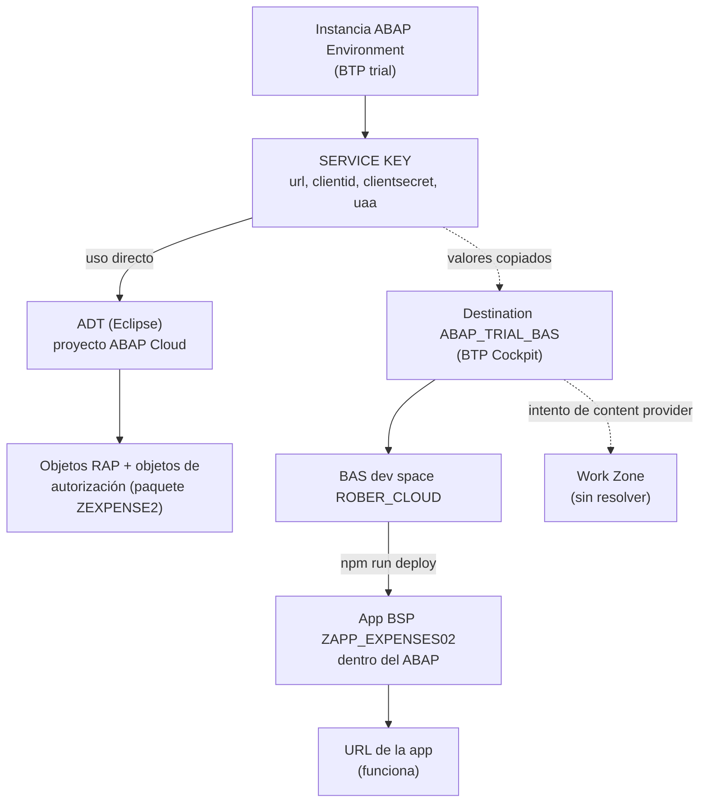

# App RAP en ABAP Environment (trial): configuración y despliegue

Documento de estado a **28 de octubre de 2026**.
App: **Expense Report** (List Report sobre un servicio RAP, OData V2).

---

## 1. Resumen en 30 segundos

| Objetivo | Estado |
|---|---|
| App RAP creada y service binding publicado | ✅ |
| Conexión BTP ↔ BAS ↔ ABAP (destination) | ✅ |
| App generada en BAS y desplegada en el ABAP | ✅ |
| App abierta con su URL mostrando datos reales | ✅ |
| Launchpad App Descriptor Item, IAM App, Business Catalog, plantilla de rol (ADT) | ✅ creados y publicados |
| Tile visible en el Launchpad del ABAP (franja rosa) | ❌ no se pudo (ver sección 8) |
| App visible dentro de SAP Build Work Zone | ❌ pendiente |

**Lo logrado:** la app funciona, está desplegada y su autorización está construida.
**Lo pendiente:** verla desde Work Zone. Es una limitación del trial, y no un fallo de configuración.

---

## 2. Mapa de componentes

Los cuatro "grupos" de trabajo:

| Grupo | Para qué se usó |
|---|---|
| 🟦 ADT (Eclipse) | Crear el RAP y los objetos de autorización |
| 🟧 BTP Cockpit (trial) | Service key, destination, suscripciones |
| 🟩 BAS (Business Application Studio) | Generar la UI y desplegarla |
| 🟪 Work Zone | Intento de publicar la app en un site |

---

## 3. EL SERVICE KEY: la pieza central

> **Todo parte del service key de la instancia ABAP Environment.** Si algo falla en BAS o en Work Zone, lo primero que hay que comprobar es que los datos copiados del service key sigan siendo correctos.

**Dónde está:** BTP Cockpit → *Instances and Subscriptions* → tu instancia ABAP Environment → pestaña *Service Keys*.

**Qué contiene** (JSON): la `url` del sistema ABAP y, dentro de `uaa`: `clientid`, `clientsecret` y `url` (servidor de tokens).

### Traza: quién usa el service key

| Quién | Cómo lo usa | Valores que toma |
|---|---|---|
| **ADT** | Directamente, al crear el proyecto ABAP Cloud | El JSON completo |
| **Destination `ABAP_TRIAL_BAS`** | Se **copian** valores a mano | `url`, `uaa.clientid`, `uaa.clientsecret`, `uaa.url` + `/oauth/token` |
| **BAS** | Indirectamente, a través de la destination | (nada propio) |
| **Work Zone** | Indirectamente, a través de una destination | (nada propio) |

**Importante:**
- Las destinations **no están enlazadas** al service key; tienen una copia de sus valores. Si regeneras el key, hay que **actualizar a mano** la destination y el proyecto de ADT.
- En la destination se usa el `uaa.url` del key, nunca el campo `sburl`. El `sburl` es interno y da error.
- **El `clientsecret` es una credencial.** No lo pegues en chats, documentos ni repositorios.

> ⚠️ **Pendiente de seguridad:** durante la sesión el service key completo (con su `clientsecret`) quedó visible en un chat. Al terminar, hay que borrarlo, crear uno nuevo y actualizar ADT y la destination (ver sección 9).

---

## 4. Nombres acordados (para la traza)

| Elemento | Valor |
|---|---|
| Subaccount | `dd130660trial` |
| Paquete | `ZEXPENSE2` |
| Service binding (OData V2) | `ZUI_EXPENSES_02` |
| Destination (BTP) | `ABAP_TRIAL_BAS` |
| Dev space BAS | `ROBER_CLOUD` (tipo SAP Fiori) |
| Proyecto en BAS | `zapp_expenses_02` |
| ID de la app (manifest) | `zappexpenses02` |
| App BSP en el ABAP | `ZAPP_EXPENSES02` |
| Semantic object / Action | `ZExpense` / `manage` |
| Launchpad App Descriptor Item | `ZEXPENSE2_LPD` |
| Tile ID | `ZEXPENSE2_LPD_TILE` |
| IAM App | `ZEXPENSE2_IAM_EXT` |
| Business Catalog | `ZEXPENSE2_CAT` |
| Business Role Template | `ZEXPENSE2_ROLE` |

> Los tres nombres de la app son distintos pero están relacionados: `ZAPP_EXPENSES02` (BSP en el ABAP), `zappexpenses02` (ID en el manifest) y `zapp_expenses_02` (carpeta del proyecto en BAS).

**URL de la app desplegada:**
`https://6449ad14-b137-4a27-8017-6421c2c4f0b0.abap-web.us10.hana.ondemand.com/sap/bc/ui5_ui5/sap/zapp_expenses02/index.html`

---

## 5. Cómo quedó configurado, grupo a grupo

### 🟦 ADT (Eclipse)

1. Proyecto ABAP Cloud conectado con el service key.
2. Service definition y service binding `ZUI_EXPENSES_02` (OData V2) publicados.
3. Después del despliegue desde BAS, en el paquete `ZEXPENSE2`:
   - **Launchpad App Descriptor Item** `ZEXPENSE2_LPD`: SAPUI5 App ID `zappexpenses02`, `ZExpense` / `manage`, Tile ID en **mayúsculas** (`ZEXPENSE2_LPD_TILE`).
   - **IAM App** `ZEXPENSE2_IAM_EXT`: tipo *External App*; servicio `ZUI_EXPENSES_02` (OData V2, sufijo `0001`); el campo *Fiori Launchpad App Descr Item ID* apunta a `ZEXPENSE2_LPD`.
   - **Business Catalog** `ZEXPENSE2_CAT`: contiene la IAM App; publicado con *Publish Locally*.
   - **Business Role Template** `ZEXPENSE2_ROLE`: contiene el catálogo; publicada.
4. La pestaña *Authorizations* de la IAM App puede quedar vacía; no es un error.
5. El sistema generó un descriptor item duplicado (`ZAPP_EXPENSES02_UI5R`) al desplegar. **No se toca ni se borra**, y no se mete en ningún catálogo.

### 🟧 BTP Cockpit

1. Suscripciones activas: SAP Business Application Studio y SAP Build Work Zone.
2. **Destination `ABAP_TRIAL_BAS`** (*Connectivity → Destinations → From Scratch*):

| Campo | Valor |
|---|---|
| Type / Proxy | `HTTP` / `Internet` |
| URL | `url` del service key (host `...abap.us10...`) |
| Authentication | `OAuth2UserTokenExchange` |
| Client ID / Secret | `uaa.clientid` / `uaa.clientsecret` |
| Token Service URL Type | `Dedicated` |
| Token Service URL | `uaa.url` + `/oauth/token` |
| Propiedades adicionales | `WebIDEEnabled=true`, `WebIDEUsage=odata_abap,dev_abap,abap_cloud`, `HTML5.DynamicDestination=true` |

3. *Check Connection* da éxito, pero esa prueba **no usa credenciales**. La prueba real es que BAS la vea y conecte.

### 🟩 BAS

1. Dev space `ROBER_CLOUD` (tipo SAP Fiori), en estado *Running*.
2. *Fiori application generator* → List Report Page → *Connect to a System* → `ABAP_TRIAL_BAS (BTP)` → servicio `ZUI_EXPENSES_02`.
3. Atributos del proyecto:
   - Module name `zapp_expenses_02`, namespace vacío.
   - *Add Deployment Configuration*: Sí. Destino **ABAP**, repositorio `ZAPP_EXPENSES02`, paquete `ZEXPENSE2`.
   - *Add FLP Configuration*: Sí. `ZExpense` / `manage`.
4. Comprobar `webapp/manifest.json` (inbound `ZExpense-manage`) y `ui5-deploy.yaml` (destination, paquete, nombre).
5. Probar en local: `npm start`.
6. Desplegar: `npm run deploy`, con resultado *Deployment Successful*.

### 🟪 Work Zone

1. Site `MyfirstSite` con el rol `Everyone` asignado.
2. App `Expense Report` (*Dynamic URL*, sistema `ABAP_TRIAL_BAS`, `ZExpense` / `manage`) asignada al rol `Everyone`.
3. **El site abre vacío; la app no aparece.**
4. Intento de *Content Provider* con `ABAP_TRIAL_BAS` como destination de diseño y de ejecución: *Internal Error* al guardar.

---

## 6. Rutina de cada día

1. **Reiniciar la instancia ABAP** (*Instances and Subscriptions*). El trial la apaga cada noche.
2. Abrir BAS y comprobar que el dev space está en *Running*.
3. Si cambias la destination con BAS abierto, recarga la pestaña.

---

## 7. Problemas encontrados y cómo se resolvieron

| Problema | Causa | Solución |
|---|---|---|
| Error `Tile ID ... is invalid` en el descriptor item | El ID automático llevaba minúsculas | Cambiar el Tile ID a mayúsculas (`ZEXPENSE2_LPD_TILE`) |
| Nombre de app BSP rechazado | `ZAPP_EXPENSES_02` tiene 16 caracteres; el límite es 15 | Usar `ZAPP_EXPENSES02` |
| Descriptor item duplicado | Lo generó el despliegue desde el manifest | Dejarlo; usar solo el propio |
| La IAM App se llama `..._EXT` | ADT añade el sufijo por el tipo *External App* | Usar ese nombre en el catálogo |
| *Authorizations* de la IAM App vacía | El servicio se autoriza en la pestaña *Services* | Es normal |
| *Check Connection* "sin autenticación" | La prueba no usa credenciales | Probar desde BAS |
| La app no aparece en BTP → HTML5 Applications | Se desplegó a ABAP, no a Cloud Foundry | Es lo esperado |

---

## 8. Lo que no se pudo (y por qué)

- **No hay *Maintain Business Roles* ni *Maintain Business Users*** en el Launchpad del ABAP del trial. Las apps de administración (por ejemplo *Communication Systems*) tampoco aparecen. Según lo investigado, esas funciones requieren licencia y el trial solo ofrece catálogos de desarrollo y monitorización.
- Por eso no se puede asignar el rol propio al usuario, y la tile `Expense Report` no sale en el Launchpad del ABAP.
- **El content provider oficial de Work Zone** parte de esas mismas apps de administración. Con `ABAP_TRIAL_BAS` no funcionó.
- No se encontró ningún caso documentado de una app propia que llegara al Launchpad del ABAP o a Work Zone con un usuario trial.

**Esto no invalida lo hecho:** la IAM App, el catálogo y la plantilla están correctos y se usarían con una licencia o con un rol asignable.

---

## 9. Pendientes

### Seguridad (hacer pronto)
1. BTP Cockpit → instancia ABAP → *Service Keys*: **borrar** el key actual y **crear uno nuevo**.
2. Actualizar con los valores nuevos:
   - El proyecto de ADT (conexión con service key).
   - La destination `ABAP_TRIAL_BAS` (Client ID, Client Secret y Token URL).
3. No volver a pegar el JSON en ningún chat.

### Limpieza
- En Work Zone → *Channel Manager*, comprobar que no quedó ningún content provider a medias.

### Siguiente intento (opcional): desplegar a Cloud Foundry
- No probado todavía. La documentación y un blog lo describen como camino hacia Work Zone, porque el canal `HTML5 Apps` ya existe.
- Pasos previstos:
  1. En BAS: `F1` → `CF: Login to Cloud Foundry` (comprobar que hay organización y espacio).
  2. Generar un **proyecto nuevo**, sin tocar el actual, con destino Cloud Foundry.
  3. Construir el MTA y desplegar.
  4. En Work Zone: refrescar el canal `HTML5 Apps`, añadir la app desde *Content Explorer* y asignarla a `Everyone`.
- **Incógnita:** si el servicio OData autorizará al usuario desde la app de Cloud Foundry.

---

## 10. Comandos útiles

| Acción | Dónde | Comando |
|---|---|---|
| Probar la app en local | Terminal de BAS, en `zapp_expenses_02` | `npm start` |
| Desplegar al ABAP | Terminal de BAS | `npm run deploy` |
| Publicar un catálogo, IAM App o plantilla | ADT | *Publish Locally* |
| Activar un objeto | ADT | `Ctrl+F3` |
| Login a Cloud Foundry | BAS | `F1` → `CF: Login to Cloud Foundry` |
