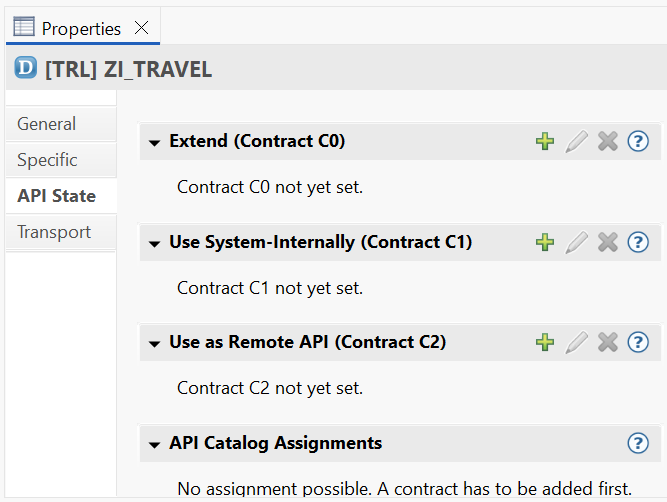

# Extensibilidad de los objetos de negocio

## Introducción al concepto de extensibilidad

El concepto de extensión del modelo de programación de aplicaciones ABAP RESTful tiene las siguientes propiedades:

* **Los objetos de negocio RAP no son extensibles por defecto**

Un objeto de negocio RAP no es extensible por defecto y, por lo tanto, debe marcarse explícitamente como extensible mediante las palabras clave adecuadas en los puntos previstos para tal fin. Solo entonces un consumidor podrá realizar extensiones.

* **Puntos de extensión previstos**

Los campos con propiedades y asignación de campos, determinaciones, validaciones u operaciones específicas pueden implementarse como puntos de extensión si el objeto de negocio RAP permite una extensión correspondiente.

* **Estabilidad del ciclo de vida**

Si un objeto de negocio RAP ofrece extensibilidad, celebra un contrato público (contrato de lanzamiento C0) con los consumidores. Todas las extensiones potencialmente implementadas deben seguir funcionando incluso después de una actualización del objeto de negocio RAP del proveedor. Por este motivo, los puntos de extensión forman parte de la interfaz pública de un objeto de negocio RAP y, una vez publicados, deben mantenerse compatibles con los consumidores de dichos puntos.

* **extensiones aisladas**

Las extensiones para un objeto de negocio RAP son autónomas y pueden proporcionarse de forma aislada. Para un objeto de negocio RAP, puede desarrollar diferentes extensiones de forma independiente.

* **La funcionalidad existente no se puede sobrescribir**

La funcionalidad existente de un objeto de negocio RAP no se puede sobrescribir con una extensión.

* **Capas de extensión**

Las extensiones pueden declararse como extensibles y formar una cascada de extensiones. De este modo, una nueva extensión puede extender una extensión existente. Por ejemplo, un producto de software de un socio de SAP podría extender significativamente un objeto de negocio RAP del sistema SAP estándar. La extensión dentro del producto de software del socio podría, a su vez, ser extendida por los clientes del socio.

* **Extensiones como parte del objeto de negocio RAP**

Las extensiones a un objeto de negocio RAP se convierten en parte habitual del objeto de negocio RAP extendido en el diseño y en tiempo de ejecución. Las validaciones añadidas, por ejemplo, se convierten en parte habitual de la secuencia de guardado temprano.

Como ya se mencionó, los objetos de negocio RAP deben liberarse específicamente para que los usuarios puedan extenderlos. La liberación de los objetos de desarrollo se realiza a través de la interfaz de programación de aplicaciones (API) de los objetos de desarrollo en las herramientas de desarrollo ABAP (ADT).

Esto comprende un conjunto de contratos de lanzamiento (o contratos, para abreviar) compatibles con el objeto de desarrollo. Para que un objeto de desarrollo sea extensible a través de software, debe haberse especificado con el contrato C0 (extender).

Recomendamos la asignación específica del contrato C0 para aquellos objetos de desarrollo de un objeto de negocio RAP que deban ser extensibles.

Por otro lado, el contrato C1 (uso interno del sistema) permite el uso del objeto de desarrollo para una interfaz de objeto de negocio, por ejemplo, que se pueda llamar a través del lenguaje de manipulación de entidades (EML).

En ADT, puede mantener el contrato a través de la vista Propiedades del objeto de desarrollo en la pestaña `API State` tab.

## ABAP RESTful ofrece las siguientes opciones de extensión:

* **Extensibilidad del modelo de datos**

La extensibilidad del modelo de datos incluye la extensión de campos a nivel de base de datos y a nivel de las entidades de CDS del árbol de composición de objetos de negocio. También incluye la adición de asociaciones.

* **Extensibilidad del comportamiento**

La extensibilidad del objeto comportamiento incluye determinaciones, validaciones u operaciones específicas adicionales.

* **Extensibilidad con entidades CDS adicionales**

Finalmente, es posible definir la extensibilidad de entidades CDS adicionales dentro del árbol de composición de objetos de negocio, lo que también incluye el comportamiento de estas entidades. Para este escenario, se ha establecido el término extensibilidad de nodo.

## Opciones de Extensión
