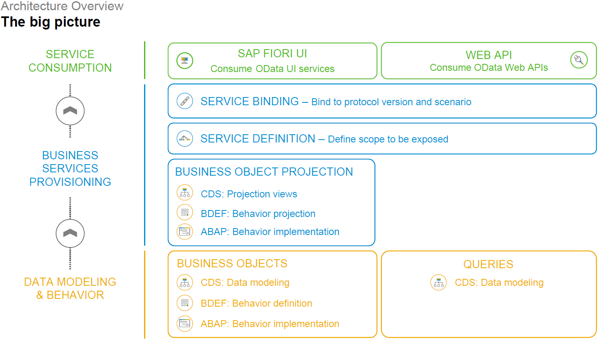
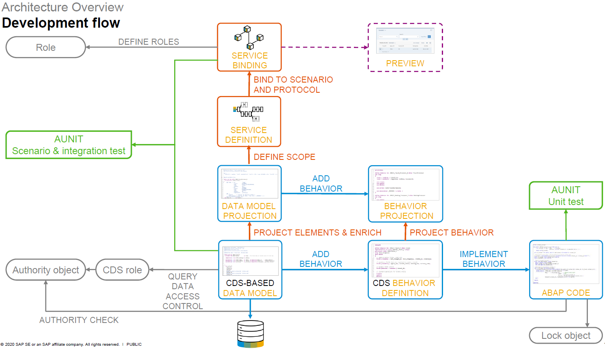
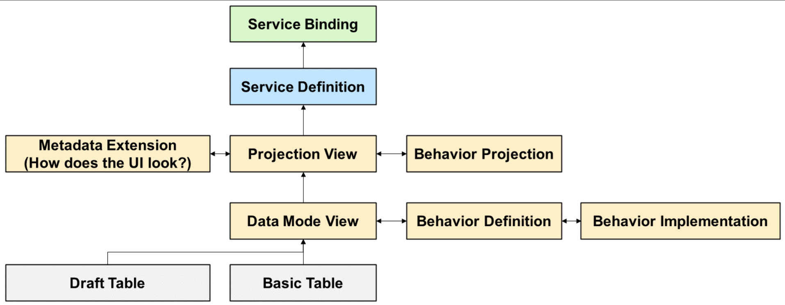

# Building Apps with the ABAP RESTful Application Programming Model 

## The big picture

## Development flow

## Construcción

## MANAGED APP

> framework handles CRUD operations automatically and is primarily used for greenfield developments where you build new apps from scratch using CDS and BDEF

[...detalle](./docs/MANAGED_APP.md)

## UNMANAGED APP

> Manually implement CRUD operations and is primarily used for brownfield developments where existing legacy code like BAPI

[....detalle](./docs/UNMANAGED_APP.md)

## Metadata Extensions

> provides UI-specific annotations separately from the data model and is primarily used to control Fiori Elements presentation, like field labels, visibility and layout, without modifying the core CDS view

[....detalle](./docs/metadata_extensions.md)

## ENTITY MANIPULATION LANGUAGE (EML)

> is the RAP-specific ABAP syntax to manipulate business objects and is primarily used to perform CRUD operations like READ, CREATE, MODIFY and DELETE on RAP entities while automatically handling transactional consistency, validations and authorizations.

[....detalle](./docs/EML.md)

## STANDARD PACKAGE TO LEARN

- **`/DMO/FLIGHT_READONLY`**
represents a read-only list reporting app

- **`/DMO/FLIGHT_MANAGED`**
represents the transactional app with implementation type managed

- **`/DMO/FLIGHT_UNMANAGED`**
represents the transactional app with implementation type unmanaged 

- **`/DMO/FLIGHT_DRAFT`**
epresents the transactional app with draft

- **`/DMO/FLIGHT_HIERARCHY`** 
contains the development objects showcasing hierarchies in a read-only and an editable treeview scenario

- **`/DMO/FLIGHT_LEGACY`**
contains objects that are used for the unmanaged scenario to implement a brownfield scenario, for which the business logic is already implemented in legacy objects

## Vocabulario

[vocabulario](./docs/vocabulario.md)

## List of Useful SAP Fiori TCodes

[....detalle](./docs/transacciones.MD)
